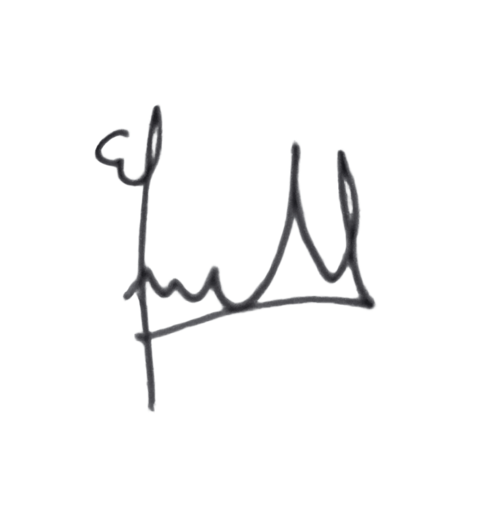
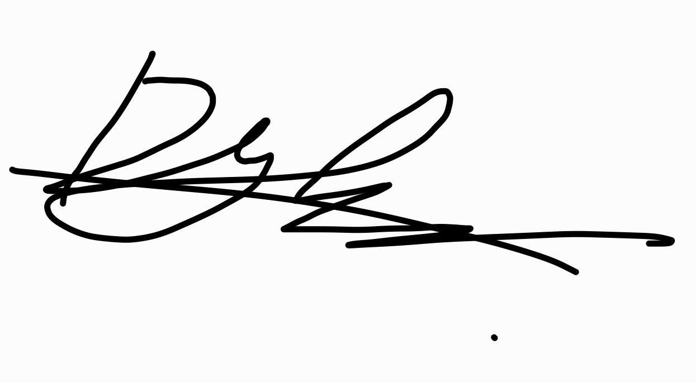
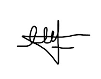
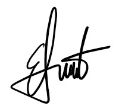
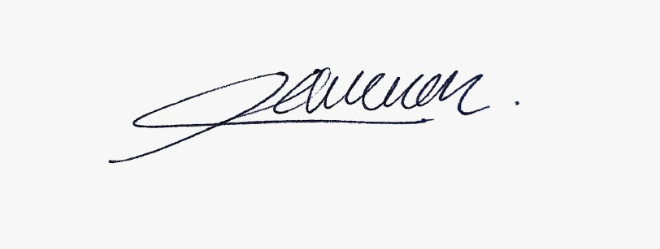

# Deklarasi Penggunaan AI

## Tugas Besar IF2150 - Rekayasa Perangkat Lunak

| Informasi | Keterangan |
|---|---|
| Kelas | *03* |
| Nomor Kelompok | *08* |
| Nama Kelompok | *The Dragon Warrior* |
| Nama Perangkat Lunak | *FoodLink* |

**Anggota Kelompok:**

| NIM | Nama |
|---|---|
| *13525024* | *Excell Timothy Josua Tarigan* |
| *13525036* | *Dylan Frederico Ketaren* |
| *13525111* | *Edbert Fernando* |
| *13525114* | *Ernest Clarence Gunawan* |
| *13525117* | *Abdur Rauuf Fawaaz* |

---

### Daftar Isi
* [Milestone 1](#milestone-1)
* [Milestone 2](#milestone-2)
* [Milestone 4](#milestone-4)
* [Milestone 7](#milestone-7)

---

### Log Penggunaan AI per Milestone

Silakan catat penggunaan AI yang berdampak signifikan pada pengerjaan tugas (misal: *generate* fungsi algoritma yang kompleks, *generate* draf dokumen SKPL/DPPL, atau *debugging* error utama). 
*Penggunaan sepele seperti memperbaiki *typo* atau auto-complete satu baris kode tidak perlu dicatat.*

### Milestone 1
| Tool AI | Tujuan Penggunaan | Contoh Prompt Utama | Modifikasi & Validasi Manusia |
| :--- | :--- | :--- | :--- |
| *ChatGPT* | *Memahami terkait asumsi dan batasan* | *"Coba berikan penjelasan terkait asumsi dan batasan saat sedang membuat perangkat lunak"* | *AI menyarankan banyak jenis asumsi dan batasan, namun akhirnya yang dipilih hanya asumsi teknis dan pengguna serta batasan ruang lingkup, resource, dan hukum* |
|*Claude* |*Brainstorming nama perangkat lunak* |*Kami sedang membuat sebuah perangkat lunak sebagai berikut....... Sarankan nama yang cocok* |*Awalnya AI menyarankan nama FoodChain tetapi setelah dipertimbangkan lagi, nama lebih cocok FoodLink karena perangkat lunak yang dibua tidak begitu berhubungan dengan chain (melingkar) dan lebih cocok link (menghubungkan)*|

### Milestone 2
| Tool AI | Tujuan Penggunaan | Contoh Prompt Utama | Modifikasi & Validasi Manusia |
| :--- | :--- | :--- | :--- |
| *Claude* | *Memvalidasi hasil pemetaan kebutuhan (2.3) agar sesuai dengan kriteria* | *Tabel pemetaan kebutuhan, tabel deskripsi aktivitas, kriteria requirement (user, business, system), "Apakah hasil pemetaan kebutuhan ini sudah sesuai dengan kriterianya? Berikan juga rekomendasi untuk revisi jika belum sesuai."* | *AI mengidentifikasi beberapa requirement yang mengandung kata-kata tidak terukur atau ambigu, antara lain R04, R07, R10, R25; kelompok merevisi mengikuti saran dari Claude* |
| *ChatGPT* | *Membantu menentukan pola EARS yang tepat untuk setiap kebutuhan fungsional P/L* | *Tabel kebutuhan fungsional dan materi pemilihan pola EARS, "Apakah pola EARS pada setiap kebutuhan sudah sesuai dengan kriteria dalam PPT? Berikan saran pola yang lebih tepat beserta perbaikan kalimatnya."* | *AI meninjau kesesuaian pola berdasarkan pemicu, keadaan, dan respons sistem, serta memberikan rekomendasi penyesuaian pola dan kalimat kebutuhan untuk ditinjau oleh kelompok* |

### Milestone 4
| Tool AI | Tujuan Penggunaan | Contoh Prompt Utama | Modifikasi & Validasi Manusia |
| :--- | :--- | :--- | :--- |
| *Claude* | *Menjelaskan cara pembuatan class diagram* | *(instruksi pembuatan class diagram dari template milestone, note asistensi akbar untuk hubungan antarkelas), "Jelaskan cara pembuatan class diagram sesuai hubungan antarkelas dengan bahasa sederhana"* | *AI menjelaskan dengan bahasa sederhana cara membuat class diagram dan hubungan antar kelas; kelompok mengikuti arahan dalam pembuatan class diagram* |

### Milestone 7
| Tool AI | Tujuan Penggunaan | Contoh Prompt Utama | Modifikasi & Validasi Manusia |
| :--- | :--- | :--- | :--- |
| *Nano Banana 2* | *Membuat logo FoodLink* | *"Aku mau membuat logo untuk perangkat lunak bernama FoodLink, berikut dekripsinya:" (deskripsi FoodLink)* | *AI memberikan beberapa opsi logo, dan kelompok menggunakan yang paling cocok* |
| *Claude* | *Merevisi sequence diagram UC01 agar sesuai arahan asistensi akbar* | *(Penjelasan UC01, Sequence diagram yang belum benar, File PPT Asistensi Akbar Milestone 7) "Saya telah membuat sebuah sequence diagram untuk use case UC01, dan ternyata masi kurang lifeline, activation bar, dan pemisahan ECB, buatkan yang baru dong"* | *AI memberikan sequence diagram yang sudah sesuai ketentuan* |
---
### Pernyataan Integritas dan Persetujuan

Kami yang bertanda tangan di bawah ini menyatakan bahwa seluruh log penggunaan AI di atas adalah benar. Kami telah memvalidasi seluruh hasil AI dan bertanggung jawab penuh atas orisinalitas, keamanan, dan kebenaran hasil akhir dari tugas ini.

| Tanda Tangan | Nama Anggota |
| :---: | :--- |
|  | **13525024 - Excell Timothy Josua Tarigan** |
|  | **13525036 - Dylan Frederico Ketaren** |
|  | **13525111 - Edbert Fernando** |
|  | **13525114 - Ernest Clarence Gunawan** |
|  | **13525117 - Abdur Rauuf Fawaaz** |

### Milestone 8
| Tool AI | Tujuan Penggunaan | Contoh Prompt Utama | Modifikasi & Validasi Manusia |
| :--- | :--- | :--- | :--- |
| *Chat-gpt* | *Brainstorming ilustrasi web-app* | *"berikan ilusstrasi ilustrasi mengenai web yang memiliki kemiripan dengan proyek FoodLink,berikan juga color pallete yang sesuai dengan logo (upload logonya yang sudah dibuat) "* | *AI memberikan contoh contoh website dan memberikan sedikit ilustrasi beserta color pallete yang mirip dengan logo* |
| *Claude* | *Memulai pengerjaan desain web* | *"Untuk membuat User Interface website(jelaskan website seperti apa, deskripsi umum, tujuan dan pada device apa saja di implementasikan) menggunakan color-pallete ini(color pallete yang sudah di siapkan oleh Chat-gpt sebelumnya), website seperti apa yang sebaiknya dibuat"* | *AI memberikan desain kasar yang sesuai dengan parameter parameter yang diberikan. contohnya ada 3 user(pihak fnb, pihak ngo, admin sistem) dia mengenerate user page yang dikhususkan untuk masing masing user pada figma. Prompting dilakukan beberapa kali karena ada beberapa ketidaksesuaian dengan gambaran awal* |
| *Claude* | *Menyusun algo dan query* | *(Penjelasan terkait dokumen sebelumnya), Bantu implementasi algo dan query untuk ...* | *Memeriksa pemakaian atribut dan operasi, menanyakan terkait esensi beberapa hal*

---
### Pernyataan Integritas dan Persetujuan

Kami yang bertanda tangan di bawah ini menyatakan bahwa seluruh log penggunaan AI di atas adalah benar. Kami telah memvalidasi seluruh hasil AI dan bertanggung jawab penuh atas orisinalitas, keamanan, dan kebenaran hasil akhir dari tugas ini.

| Tanda Tangan | Nama Anggota |
| :---: | :--- |
|  | **13525024 - Excell Timothy Josua Tarigan** |
|  | **13525036 - Dylan Frederico Ketaren** |
|  | **13525111 - Edbert Fernando** |
|  | **13525114 - Ernest Clarence Gunawan** |
|  | **13525117 - Abdur Rauuf Fawaaz** |