<h1>
IF2150 REKAYASA PERANGKAT LUNAK
 
TUGAS 10
 
HASIL IMPLEMENTASI DAN UJI PERANGKAT LUNAK (HIUPL)
</h1>
 

## *FoodLink*

### Untuk: *Angel*

Dipersiapkan oleh:
| Informasi | Keterangan |
| --- | --- |
| Kelas | *03* |
| Kelompok | *08*  |

| NIM | Nama |
|---|---|
| *13524123* | *Yuhan Fanzuri Nizar* |
| *13525024* | *Excell Timothy Josua Tarigan* |
| *13525036* | *Dylan Frederico Ketaren* |
| *13525111* | *Edbert Fernando* |
| *13525114* | *Ernest Clarence Gunawan* |
| *13525117* | *Abdur Rauuf Fawaaz* |

---

## Daftar Isi

- [BAB 1: Pendahuluan](#bab-1-pendahuluan)
  - [1.1 Tujuan Penulisan Dokumen](#11-tujuan-penulisan-dokumen)
  - [1.2 Lingkup Masalah](#12-lingkup-masalah)
  - [1.3 Definisi, Istilah, dan Singkatan](#13-definisi-istilah-dan-singkatan)
  - [1.4 Aturan Penomoran](#14-aturan-penomoran)
  - [1.5 Referensi](#15-referensi)
  - [1.6 Deskripsi Umum Dokumen (Ikhtisar)](#16-deskripsi-umum-dokumen-ikhtisar)
- [BAB 2: Deskripsi Umum Perangkat Lunak](#bab-2-deskripsi-umum-perangkat-lunak)
- [BAB 3: Implementasi](#bab-3-implementasi)
  - [3.1 Lingkungan Implementasi](#31-lingkungan-implementasi)
  - [3.2 Implementasi Modul](#32-implementasi-modul)
  - [3.3 Implementasi Antarmuka](#33-implementasi-antarmuka)
  - [3.4 File Lain](#34-file-lain)
- [BAB 4: Hasil Pengujian](#bab-4-hasil-pengujian)
  - [4.1 Strategi dan Kedalaman Pengujian Kelas](#41-strategi-dan-kedalaman-pengujian-kelas)
  - [4.2 Pengujian Unit Kelas](#42-pengujian-unit-kelas)
  - [4.3 Pengujian Integrasi](#43-pengujian-integrasi)
  - [4.4 Pengujian Use Case](#44-pengujian-use-case)
  - [4.5 Pengujian Kebutuhan Non-Fungsional (KNF)](#45-pengujian-kebutuhan-non-fungsional-knf)
  - [4.6 Tangkapan Layar dan Bukti Hasil Pengujian](#46-tangkapan-layar-dan-bukti-hasil-pengujian)
- [BAB 5: Traceability](#bab-5-traceability)

---

## Daftar Perubahan

| Revisi | Deskripsi |
| :--- | :--- |
| *A* | *Deskripsikan perubahan yang dilakukan dari dokumen sebelumnya pada dokumen ini. Jika tidak terdapat perubahan, harap kosongkan tabel.* |
| *B* |  |
| *C* |  |
| ... |  |

---

# BAB 1: Pendahuluan

## 1.1 Tujuan Penulisan Dokumen
Dokumen Hasil Implementasi dan Uji Perangkat Lunak (HIUPL) ini disusun untuk melaporkan hasil implementasi dan pengujian perangkat lunak FoodLink sebagai tindak lanjut dari SKPL, APL, DPPL, dan laporan Implementasi. Dokumen ini memuat lingkungan implementasi, daftar modul/kelas yang telah dibuat, antarmuka yang tersedia, strategi serta hasil pengujian unit, integrasi, use case, dan kebutuhan non-fungsional, lengkap dengan bukti tangkapan layar dan matriks traceability. Dengan demikian, dokumen ini menjadi bukti bahwa kebutuhan fungsional, kebutuhan non-fungsional, dan use case FoodLink telah diimplementasikan serta diuji sesuai rancangan.
 
Dokumen ini ditujukan bagi kelompok sebagai dokumentasi hasil pekerjaan dan acuan verifikasi, serta untuk dosen dan asisten mata kuliah IF2150 Rekayasa Perangkat Lunak sebagai bahan evaluasi kesesuaian implementasi dengan kebutuhan dan rancangan yang telah ditetapkan.

## 1.2 Lingkup Masalah
FoodLink merupakan suatu sistem perangkat lunak yang bertujuan untuk mengurangi pemborosan makanan dengan menghubungkan pemilik usaha F&B dan juga organisasi non-pemerintah (NGO). Sistem membantu pemilik F&B untuk mencatat data penjualan dan sisa produk harian untuk menghasilkan rekomendasi produksi, serta menyediakan akses untuk mengumumkan produk surplus yang dapat didonasikan atau dijual lagi dengan harga diskon. Sementara itu, NGO dapat menemukan, menyaring, dan mengklaim produk surplus di sekitar lokasinya. Dengan begitu, FoodLink akan mendukung pencapaian SDG 12 dan SDG 2..

## 1.3 Definisi, Istilah, dan Singkatan
Semua definisi dan singkatan yang digunakan dalam dokumen ini beserta penjelasannya.

Tabel 1.3. Definisi Istilah dan Singkatan

| Singkatan, Akronim, atau Istilah | Penjelasan |
| :--- | :--- |
| *P/L* | *Singkatan dari Perangkat Lunak, yaitu aplikasi yang memberikan perintah kepada komputer untuk menjalankan tugas tertentu.* |
| *SKPL* | *Singkatan dari Spesifikasi Kebutuhan Perangkat Lunak, yaitu dokumen yang merangkum kriteria-kriteria yang diperlukan untuk membangun aplikasi menjalankan tugasnya.* |
| *DPPL* | *Singkatan dari Deskripsi Perancangan Perangkat Lunak, yaitu dokumen yang menjelaskan rancangan arsitektur, kelas, dan antarmuka P/L.* |
| *HIUPL* | *Singkatan dari Hasil Implementasi dan Uji Perangkat Lunak, yaitu dokumen yang melaporkan hasil implementasi dan pengujian P/L.* |
| *KF* | *Singkatan dari Kebutuhan Fungsional.* |
| *KNF* | *Singkatan dari Kebutuhan Non-Fungsional.* |
| *UC* | *Singkatan dari Use Case.* |
| *TC* | *Singkatan dari Test Case, yaitu satu kasus uji untuk skenario tertentu.* |
| *UT* | *Singkatan dari Unit Test, yaitu test case tingkat kelas/operasi.* |
| *INT* | *Singkatan dari Integration Test, yaitu test case yang menguji interaksi antarkomponen.* |
| *Boundary* | *Kasus uji pada nilai batas masukan, misalnya nilai minimum, maksimum, atau tepat di ambang aturan.* |
| *Coverage* | *Persentase baris/cabang kode yang dieksekusi oleh pengujian.* |
| *NGO* | *Non-Governmental Organization, organisasi non-pemerintah yang menerima dan mendistribusikan makanan surplus kepada pihak yang membutuhkan.* |
| *F&B* | *Food and Beverage, sebutan untuk usaha yang bergerak di bidang makanan dan minuman.* 

## 1.4 Aturan Penomoran
Aturan penomoran (ID) yang digunakan dalam dokumen ini.

Tabel 1.4. Aturan Penomoran

| Hal/Bagian | Penomoran | Keterangan |
| :--- | :--- | :--- |
| *Kebutuhan Fungsional* | *KFXX* | *XX merupakan nomor urut dua digit, dimulai dari 01* |
| *Kebutuhan Non-Fungsional* | *KNFXX* | *Sesuai SKPL* |
| *Use Case* | *UCXX* | *XX merupakan nomor urut dua digit, dimulai dari 01* |
| *Kelas* | *CXX* | *XX merupakan nomor urut dua digit, dimulai dari 01* |
| *Antarmuka* | *I-XX* | *XX merupakan nomor urut dua digit, dimulai dari 01* |
| *Test Case Unit* | *CXX-UTYY* | *XX adalah nomor kelas, YY adalah nomor urut test case unit pada kelas tersebut* |
| *Test Case Integrasi* | *INT-TCYY* | *YY adalah nomor urut test case integrasi* |
| *Test Case Use Case* | *UCXX-TCYY* | *XX adalah nomor use case, YY adalah nomor urut test case pada use case tersebut* |
| *Test Case KNF* | *KNFXX-TCYY* | *XX adalah nomor KNF, YY adalah nomor urut test case pada KNF tersebut* |
| *...* | *...* | *...* |

## 1.5 Referensi
- [K03_G08_SKPL.md](https://github.com/Edbertf/IF2150-RPL-K03-G08/blob/main/docs/M5/K03_G08_SKPL.md)
- [K03_G08_APL.md](https://github.com/Edbertf/IF2150-RPL-K03-G08/blob/main/docs/M6/K03_G08_APL.md)
- [K03_G08_DPPL.md](https://github.com/Edbertf/IF2150-RPL-K03-G08/blob/main/docs/M7/K03_G08_DPPL.md)
- [K03_G08_DPPL2.md](https://github.com/Edbertf/IF2150-RPL-K03-G08/blob/main/docs/M8/K03_G08_DPPL2.md)
- [K03_G08_Implementasi.md](https://github.com/Edbertf/IF2150-RPL-K03-G08/blob/main/docs/M9/K03_G08_Implementasi.md)

## 1.6 Deskripsi Umum Dokumen (Ikhtisar)
Dokumen HIUPL ini disusun dalam lima bab. **Bab 1** memuat pendahuluan yang menjelaskan tujuan dokumen, lingkup masalah, definisi istilah, aturan penomoran, referensi, serta ikhtisar dokumen. **Bab 2** menyajikan deskripsi umum perangkat lunak, meliputi gambaran sistem, batasan, keterkaitan dengan sistem lain, aktor, dan use case diagram FoodLink. **Bab 3** menjelaskan implementasi perangkat lunak, mulai dari lingkungan implementasi, daftar modul/kelas, antarmuka yang telah dibuat, hingga file pendukung dan perubahan terhadap DPPL. **Bab 4** memaparkan strategi dan hasil pengujian, mencakup pengujian unit, integrasi, use case, kebutuhan non-fungsional, serta tangkapan layar sebagai bukti. Dokumen ini ditutup dengan **Bab 5** yang menyajikan matriks traceability untuk memetakan keterkaitan antara kebutuhan, use case, kelas, implementasi, dan hasil pengujian.

 

---

# BAB 2: Deskripsi Umum Perangkat Lunak

Bagian ini diisi dengan *System Overview*, dalam bentuk gambar dan narasi yang memberikan gambaran tentang aplikasi dan konteksnya. **Batasan dan keterkaitan** antara sistem yang dibangun dengan sistem lain di luarnya harus jelas. Deskripsi umum sistem perlu dilengkapi dengan pemodelan kasus yang dihadapi, seperti *use case diagram*. Berikan narasi yang jelas untuk setiap gambar yang ditampilkan.

Bagian ini dapat menyalin atau meringkas dari dokumen SKPL atau DPPL.

<i>Gambar 2.1. Use Case Diagram [Nama P/L]</i>

 

---

# BAB 3: Implementasi

Bagian ini diisi dengan informasi tentang elemen P/L yang dikembangkan (*executable files*, *configuration files*, *data files*, dan sebagainya) serta perubahannya terhadap rancangan pada DPPL (jika ada).

## 3.1 Lingkungan Implementasi

Tuliskan *hardware* dan *software* yang digunakan untuk implementasi, mencakup *operating system*, bahasa pemrograman beserta versinya, *framework*/*library*, DBMS, *development tools*, dan *version control*. Lingkungan ini harus konsisten dengan **Subbab 2.1 DPPL**; jelaskan jika ada perubahan. Cantumkan juga *framework* dan alat pengujian yang dipakai.

Tabel 3.1. Lingkungan Implementasi

| Aspek | Keterangan |
| :--- | :--- |
| *Hardware* | *[Spesifikasi perangkat keras]* |
| *Operating System* | *[Nama dan versi OS]* |
| *Bahasa Pemrograman* | *[Bahasa dan versi]* |
| *Framework/Library* | *[Daftar framework/library beserta versi]* |
| *DBMS* | *[Nama dan versi DBMS]* |
| *Development Tools* | *[IDE, version control, tools lain]* |
| *Testing Tools* | *[Framework unit test, alat ukur performa, alat coverage]* |

## 3.2 Implementasi Modul

Tabel 3.2. Implementasi Modul

| No | ID Kelas | Nama Modul/Kelas | Nama File Fisik | Nama File Executable |
| :--- | :--- | :--- | :--- | :--- |
| 1 | *C01* | *AkunPengguna* | *src/models/AkunPengguna.js* | *-* |
| 2 | *C02* | *Pendaftaran* | *src/models/Pendaftaran.js* | *-* |
| 3 | *C03* | *DokumenPendukung* | *src/models/DokumenPendukung.js* | *-* |
| 4 | *C04* | *VerifikasiController* | *src/controllers/VerifikasiController.js*, *src/routes/admin.js* | *-* |
| 5 | *C05* | *Produk* | *src/models/Produk.js* | *-* |
| 6 | *C06* | *DataPenjualan* | *src/models/DataPenjualan.js* | *-* |
| 7 | *C07* | *PrediksiProduksi* | *src/models/PrediksiProduksi.js* | *-* |
| 8 | *C08* | *ProdukSurplus* | *src/models/ProdukSurplus.js* | *-* |
| 9 | *C09* | *MetodeDistribusiSurplus* | *src/models/MetodeDistribusiSurplus.js* | *-* |
| 10 | *C10* | *DokumenKlaim* | *src/models/DokumenKlaim.js* | *-* |
| 11 | *C11* | *LogAktivitas* | *src/models/LogAktivitas.js* | *-* |
| 12 | *C12* | *RegistrasiPage* | *src/views/auth/I02-I03-Registrasi.ejs*, *src/routes/auth.js* | *-* |
| 13 | *C13* | *VerifikasiPage* | *src/views/admin/I19-VerifikasiPendaftar.ejs*, *src/views/admin/I20-DetailPendaftar.ejs*, *src/views/admin/I21-I22-HasilVerifikasi.ejs*, *src/routes/admin.js* | *-* |
| 14 | *C14* | *StatusPendaftaranPage* | *src/views/auth/I04-StatusPendaftaran.ejs*, *src/routes/status.js* | *-* |
| 15 | *C15* | *PenjualanPage* | *src/views/fnb/I06-PenjualanHarian.ejs*, *src/views/fnb/I07-PenjualanTersimpan.ejs*, *src/routes/fnb.js* | *-* |
| 16 | *C16* | *PrediksiPage* | *src/views/fnb/I05-DashboardF&B.ejs*, *src/controllers/PrediksiController.js* | *-* |
| 17 | *C17* | *ProdukSurplusPage* | *src/views/surplus/I08-CatatSurplus.ejs*, *src/controllers/CatatSurplusController.js* | *-* |
| 18 | *C18* | *DistribusiSurplusPage* | *src/views/surplus/I09-AturDistribusi.ejs*, *src/views/surplus/I11-SuksesPublikasi.ejs*, *src/controllers/DistribusiSurplusController.js* | *-* |
| 19 | *C19* | *DaftarSurplusPage* | *src/views/ngo/I12-DaftarSurplus.ejs*, *src/controllers/SurplusController.js* | *-* |
| 20 | *C20* | *KlaimPage* | *src/views/ngo/I15-DetailProduk.ejs*, *src/views/ngo/N6-KlaimBerhasil.ejs*, *src/routes/ngo.js* | *-* |
| 21 | *C21* | *PengambilanPage* | *src/views/ngo/N7-KlaimSaya.ejs*, *src/views/ngo/N7-PengambilanSelesai.ejs*, *src/views/ngo/partials/N5-KonfirmasiKlaim.ejs*, *src/routes/ngo.js* | *-* |
| 22 | *C22* | *LogAktivitasPage* | *src/views/admin/I23-LogAktivitas.ejs* | *-* |
| 23 | *C23* | *AuthController* | *src/controllers/AuthController.js* | *-* |
| 24 | *C24* | *PenjualanController* | *src/controllers/PenjualanController.js* | *-* |
| 25 | *C25* | *PrediksiController* | *src/controllers/PrediksiController.js* | *-* |
| 26 | *C26* | *ProdukSurplusController* | *src/controllers/CatatSurplusController.js*, *src/controllers/DistribusiSurplusController.js* | *-* |
| 27 | *C27* | *SurplusController* | *src/controllers/SurplusController.js* | *-* |
| 28 | *C28* | *KlaimController* | *src/controllers/KlaimController.js* | *-* |
| 29 | *C29* | *LogController* | *src/controllers/LogController.js*, *src/routes/log.js* | *-* |
| 30 | *C30* | *PemilikFnB* | *src/models/PemilikFnB.js* | *-* |
| 31 | *C31* | *PerwakilanNGO* | *src/models/PerwakilanNGO.js* | *-* |
| 32 | *C32* | *AdminSistem* | *src/middleware/peran.js*, *src/routes/admin.js*, *src/routes/log.js* | *-* |
| 33 | *C33* | *GeolocationAdapter* | *src/models/GeolocationAdapter.js* | *-* |
| 34 | *C34* | *PenyaringanController* | *src/controllers/SurplusController.js* | *-* |

## 3.3 Implementasi Antarmuka

Daftar antarmuka yang telah diimplementasikan. Gunakan ID dan nama layar yang sama dengan ID dan nama layar pada tugas DPPL.

Tabel 3.3. Implementasi Antarmuka

| No | ID Antarmuka | Nama Antarmuka | Nama File Fisik | Nama File Executable |
| :--- | :--- | :--- | :--- | :--- |
| 1 | *I-00* | *Masuk* | *src/views/auth/I00-Masuk.ejs* | *-* |
| 2 | *I-01* | *Selamat Datang* | *src/views/I01-SelamatDatang.ejs* | *-* |
| 3 | *I-02* | *Registrasi - Pemilik F&B* | *src/views/auth/I02-I03-Registrasi.ejs* | *-* |
| 4 | *I-03* | *Registrasi - NGO* | *src/views/auth/I02-I03-Registrasi.ejs* | *-* |
| 5 | *I-04* | *Status Pendaftaran* | *src/views/auth/I04-StatusPendaftaran.ejs* | *-* |
| 6 | *I-05* | *Dashboard Pemilik F&B* | *src/views/fnb/I05-DashboardF&B.ejs* | *-* |
| 7 | *I-06* | *Penjualan Harian* | *src/views/fnb/I06-PenjualanHarian.ejs* | *-* |
| 8 | *I-07* | *Penjualan Tersimpan* | *src/views/fnb/I07-PenjualanTersimpan.ejs* | *-* |
| 9 | *I-08* | *Catat Produk Surplus* | *src/views/surplus/I08-CatatSurplus.ejs* | *-* |
| 10 | *I-09* | *Atur Distribusi - Donasi* | *src/views/surplus/I09-AturDistribusi.ejs* | *-* |
| 11 | *I-10* | *Atur Distribusi - Jual Diskon* | *src/views/surplus/I09-AturDistribusi.ejs* | *-* |
| 12 | *I-11* | *Surplus Dipublikasikan* | *src/views/surplus/I11-SuksesPublikasi.ejs* | *-* |
| 13 | *I-12* | *Daftar Surplus* | *src/views/ngo/I12-DaftarSurplus.ejs* | *-* |
| 14 | *I-13* | *Filter* | *src/views/ngo/I12-DaftarSurplus.ejs* | *-* |
| 15 | *I-14* | *Daftar Surplus (Terfilter)* | *src/views/ngo/I12-DaftarSurplus.ejs* | *-* |
| 16 | *I-15* | *Detail Produk* | *src/views/ngo/I15-DetailProduk.ejs* | *-* |
| 17 | *I-16* | *Konfirmasi Klaim* | *src/views/ngo/partials/N5-KonfirmasiKlaim.ejs* | *-* |
| 18 | *I-17* | *Klaim Berhasil* | *src/views/ngo/N6-KlaimBerhasil.ejs* | *-* |
| 19 | *I-18* | *Pengambilan Selesai* | *src/views/ngo/N7-PengambilanSelesai.ejs* | *-* |
| 20 | *I-19* | *Verifikasi Pendaftar* | *src/views/admin/I19-VerifikasiPendaftar.ejs* | *-* |
| 21 | *I-20* | *Detail Pendaftar* | *src/views/admin/I20-DetailPendaftar.ejs* | *-* |
| 22 | *I-21* | *Pendaftar Diterima* | *src/views/admin/I21-I22-HasilVerifikasi.ejs* | *-* |
| 23 | *I-22* | *Pendaftar Ditolak* | *src/views/admin/I21-I22-HasilVerifikasi.ejs* | *-* |
| 24 | *I-23* | *Log Aktivitas* | *src/views/admin/I23-LogAktivitas.ejs* | *-* |
| 25 | *N7* | *Klaim Saya* | *src/views/ngo/N7-KlaimSaya.ejs* | *-* |

## 3.4 File Lain

Daftar file lain yang dibuat selain file kelas dan antarmuka, misalnya file *utility*, *configuration*, *database schema/seed*, *file test*, atau *data*.

Tabel 3.4. File Lain

| No | Nama File | Keterangan |
| :--- | :--- | :--- |
| 1 | *[Nama file]* | *[Fungsi file]* |
| ... | *...* | *...* |

 

---

# BAB 4: Hasil Pengujian

Bab ini melaporkan hasil pengujian P/L pada level unit, integrasi, dan sistem. Pengujian dilakukan pada tag release terakhir Tugas 9. Hasil aktual diisi berdasarkan pengamatan saat pengujian. Kesimpulan diisi `Pass` atau `Fail`, dan untuk `Fail` dilengkapi penyebab serta usulan perbaikan.

## 4.1 Strategi dan Kedalaman Pengujian Kelas

Setiap kelas perancangan pada Tabel 4.1 DPPL diklasifikasikan ke dalam tiga tingkat kedalaman pengujian. Tingkat **Mendalam** diberikan pada kelas yang memuat logika bisnis, perhitungan, validasi, aturan status, algoritma, integrasi eksternal, atau keamanan. Tingkat **Sedang** diberikan pada kelas yang hanya mengoordinasikan atau mendelegasikan proses. Tingkat **Tidak perlu** diberikan pada kelas tanpa logika, seperti *entity/DTO* dan kelas konfigurasi, yang teruji secara tidak langsung melalui test case use case. Seluruh kelas wajib dicantumkan beserta alasan penentuan tingkatnya.

Tabel 4.1.1. Identifikasi Tingkat Pengujian Kelas

| ID Kelas | Nama Kelas | Tingkat | Alasan | Test Case Terkait |
| :--- | :--- | :--- | :--- | :--- |
| *C01* | *AkunPengguna* | *Mendalam* | *Menyimpan kata sandi sebagai hash dan memvalidasi data registrasi akun* | C01-UT01 s.d. C01-UT05 |
| *C02* | *Pendaftaran* | *Mendalam* | *Memvalidasi data pendaftaran dan mengelola transisi status verifikasi* | C02-UT01 s.d. C02-UT18 |
| *C03* | *DokumenPendukung* | *Mendalam* | *Memvalidasi tipe dan ukuran berkas serta menyimpan dokumen pendukung* | C03-UT01 s.d. C03-UT10 |
| *C04* | *VerifikasiController* | *Sedang* | *Mengoordinasikan tampilan verifikasi dan mendelegasikan perubahan status ke C02, diuji juga melalui integrasi* | C04-UT01 s.d. C04-UT07 |
| *C05* | *Produk* | *Tidak perlu* | *Entity produk tanpa logika, hanya menyimpan atribut dan getter, diuji tidak langsung melalui UC* | C06-UT01 s.d. C06-UT08 |
| *C06* | *DataPenjualan* | *Mendalam* | *Memvalidasi input penjualan dan menghitung sisa stok harian* | *C06-UT01 s.d. C06-UT08* |
| *C07* | *PrediksiProduksi* | *Mendalam* | *Menjalankan dan menyimpan prediksi produksi beserta rekomendasi jumlah* | *C07-UT01 s.d. C07-UT08* |
| *C08* | *ProdukSurplus* | *Mendalam* | *Memvalidasi data surplus dan mengelola status ketersediaan* | *C08-UT01 s.d. C08-UT16* |
| *C09* | *MetodeDistribusiSurplus* | *Mendalam* | *Menentukan metode distribusi serta perhitungan harga atau gratis* | *C09-UT01 s.d. C09-UT09* |
| *C10* | *DokumenKlaim* | *Mendalam* | *Mencatat klaim dan mengelola transisi status klaim* | *C10-UT01 s.d. C10-UT09* |
| *C11* | *LogAktivitas* | *Mendalam* | *Mencari dan menyaring log dengan query serta validasi kriteria* | *C11-UT01 s.d. C11-UT09* |
| *C12* | *RegistrasiPage* | *Tidak perlu* | *View-only untuk formulir registrasi, logika di C23, diuji tidak langsung melalui UC* | |
| *C13* | *VerifikasiPage* | *Tidak perlu* | *View-only untuk daftar dan detail verifikasi, logika di C04, diuji tidak langsung melalui UC* | |
| *C14* | *StatusPendaftaranPage* | *Tidak perlu* | *View-only untuk status pendaftaran, logika di C02, diuji tidak langsung melalui UC* | |
| *C15* | *PenjualanPage* | *Tidak perlu* | *View-only untuk formulir penjualan, logika di C24, diuji tidak langsung melalui UC* | |
| *C16* | *PrediksiPage* | *Tidak perlu* | *View-only untuk dashboard dan grafik prediksi, logika di C25 dan C07, diuji tidak langsung melalui UC* | |
| *C17* | *ProdukSurplusPage* | *Tidak perlu* | *View-only untuk formulir produk surplus, logika di C26, diuji tidak langsung melalui UC* | |
| *C18* | *DistribusiSurplusPage* | *Tidak perlu* | *View-only untuk formulir distribusi surplus, logika di C26 dan C09, diuji tidak langsung melalui UC* | |
| *C19* | *DaftarSurplusPage* | *Tidak perlu* | *View-only untuk daftar dan filter surplus, logika di C34 dan C27, diuji tidak langsung melalui UC* | |
| *C20* | *KlaimPage* | *Tidak perlu* | *View-only untuk detail dan pengajuan klaim, logika di C28, diuji tidak langsung melalui UC* | |
| *C21* | *PengambilanPage* | *Tidak perlu* | *View-only untuk detail dan konfirmasi pengambilan, logika di C28, diuji tidak langsung melalui UC* | |
| *C22* | *LogAktivitasPage* | *Tidak perlu* | *View-only untuk dashboard log, logika di C29 dan C11, diuji tidak langsung melalui UC* | |
| *C23* | *AuthController* | *Mendalam* | *Memvalidasi kelengkapan dan format registrasi serta mengecek status pendaftaran* | |
| *C24* | *PenjualanController* | *Mendalam* | *Memvalidasi input penjualan dengan batas numerik lalu menyimpan data* | |
| *C25* | *PrediksiController* | *Mendalam* | *Mengecek kecukupan data historis dan menjalankan prediksi produksi* | |
| *C26* | *ProdukSurplusController* | *Mendalam* | *Memvalidasi data surplus dan metode distribusi lalu menyimpan keduanya* | |
| *C27* | *SurplusController* | *Mendalam* | *Mengambil surplus tersedia, menghitung jarak lewat C33, dan mengurutkan hasil* | |
| *C28* | *KlaimController* | *Mendalam* | *Mengelola persetujuan klaim, ketersediaan, penguncian, dan konfirmasi pengambilan* | |
| *C29* | *LogController* | *Sedang* | *Hanya memilih kriteria filter dan mendelegasikan pencarian ke C11, diuji juga melalui integrasi* | |
| *C30* | *PemilikFnB* | *Tidak perlu* | *Kelas peran/entity pemilik F&B yang menyimpan data dan mendelegasikan aksi ke controller/model, diuji tidak langsung melalui UC* | |
| *C31* | *PerwakilanNGO* | *Tidak perlu* | *Kelas peran/entity NGO yang menyimpan data dan mendelegasikan aksi ke controller/model, diuji tidak langsung melalui UC* | |
| *C32* | *AdminSistem* | *Mendalam* | *Guard otorisasi peran dan status verifikasi akun* | |
| *C33* | *GeolocationAdapter* | *Mendalam* | *Adapter integrasi geocoding dan perhitungan jarak* | |
| *C34* | *PenyaringanController* | *Mendalam* | *Memvalidasi kriteria dan menyaring produk berdasarkan jenis, jarak, dan waktu* | |

## 4.2 Pengujian Unit Kelas

Pengujian unit dilakukan pada kelas bertingkat Mendalam dan Sedang. Kelas Mendalam diuji pada seluruh operasi public dengan kasus normal, batas, dan negatif, serta mencapai *coverage* minimal 70%. Kelas Sedang diuji minimal dengan satu kasus normal dan satu kasus gagal pada operasi public utama.

Cara menjalankan unit test: *tambahkan `--experimental-test-coverage --test-coverage-include="**/<Folder>/<NamaKelas>.js"` pada perintah tersebut, misalnya `node --test --experimental-test-coverage --test-coverage-include="**/models/PrediksiProduksi.js" tests/PrediksiProduksi.test.js` untuk C07*.

Lokasi file test: *`src/tests/`*.

### 4.2.1 Kelas AkunPengguna

**ID Kelas:** *C01*  
**Nama Kelas:** *AkunPengguna*  
**Tingkat:** *Mendalam*

Tabel 4.2.1. Hasil Pengujian Unit Kelas AkunPengguna

| ID Pengujian | Operasi yang Diuji | Jenis Kasus | Prosedur/Masukan | Hasil yang Diharapkan | Hasil Pengujian | Kesimpulan |
| :--- | :--- | :--- | :--- | :--- | :--- | :--- |
| *C01-UT01* | *`registrasi()`* | *Normal* | *Registrasi akun F&B dengan email unik dan kata sandi `rahasia123`* | *Akun tersimpan, idAkun dikembalikan, kata sandi berupa hash dan cocok dengan `bcrypt.compareSync()`* | *Lulus, akun tersimpan dan hash bcrypt terverifikasi* | *Pass* |
| *C01-UT02* | *`registrasi()`* | *Batas* | *Kata sandi tepat 72 karakter* | *Akun tersimpan dan hash tetap dapat diverifikasi* | *Lulus, kata sandi 72 karakter ter-hash dan dapat diverifikasi* | *Pass* |
| *C01-UT03* | *`registrasi()`* | *Negatif* | *Email yang sudah terdaftar didaftarkan ulang* | *Operasi gagal karena UNIQUE constraint dan jumlah akun tidak bertambah* | *Lulus, error UNIQUE constraint terdeteksi dan jumlah akun tetap* | *Pass* |
| *C01-UT04* | *`cariBerdasarkanEmail()`* | *Normal/Negatif* | *Email terdaftar dan email yang tidak terdaftar* | *Data akun dikembalikan untuk email terdaftar, `null` untuk email tidak terdaftar* | *Lulus, akun ditemukan dan `null` untuk email tidak terdaftar* | *Pass* |
| *C01-UT05* | *`cariKredensial()`* | *Normal/Negatif* | *Email terdaftar dan email yang tidak terdaftar* | *Hash kata sandi dikembalikan dan cocok, `null` untuk email tidak terdaftar* | *Lulus, hash cocok dan `null` untuk email tidak terdaftar* | *Pass* |

Tabel 4.2.1b. Ringkasan Cakupan Kelas AkunPengguna

| Informasi | Keterangan |
| :--- | :--- |
| Daftar operasi public pada DPPL | *`registrasi()`* |
| Operasi yang diuji | *`registrasi()`, `cariBerdasarkanEmail()`, `cariKredensial()`* |
| ID Algoritma yang tercakup | *Algo-C01-01* |
| Coverage (wajib ≥ 70%) | *100% baris / 100% cabang, `node --test --experimental-test-coverage`, bukti pada 4.6* |

### 4.2.2 Kelas Pendaftaran

**ID Kelas:** *C02*  
**Nama Kelas:** *Pendaftaran*  
**Tingkat:** *Mendalam*

Tabel 4.2.2. Hasil Pengujian Unit Kelas Pendaftaran

| ID Pengujian | Operasi yang Diuji | Jenis Kasus | Prosedur/Masukan | Hasil yang Diharapkan | Hasil Pengujian | Kesimpulan |
| :--- | :--- | :--- | :--- | :--- | :--- | :--- |
| *C02-UT01* | *`ajukanPendaftaran()`* | *Normal* | *Akun F&B valid yang belum memiliki pendaftaran* | *idPendaftaran dikembalikan dan baris tersimpan dengan status `menunggu verifikasi` serta tanggal Jakarta hari ini* | *Lulus, idPendaftaran > 0, status dan tanggal sesuai* | *Pass* |
| *C02-UT02* | *`ajukanPendaftaran()`* | *Batas* | *Akun yang sudah memiliki pendaftaran diajukan lagi* | *INSERT ditolak oleh UNIQUE constraint dan jumlah pendaftaran tidak bertambah* | *Lulus, error UNIQUE `pendaftaran.id_akun` terdeteksi* | *Pass* |
| *C02-UT03* | *`ajukanPendaftaran()`* | *Negatif* | *idAkun 999999 yang tidak terdaftar* | *INSERT ditolak oleh FOREIGN KEY constraint dan jumlah pendaftaran tidak bertambah* | *Lulus, error FOREIGN KEY terdeteksi* | *Pass* |
| *C02-UT04* | *`getDaftarMenungguVerifikasi()`* | *Normal* | *Satu pendaftar F&B dan satu pendaftar NGO berstatus menunggu* | *Keduanya muncul dengan nama usaha/organisasi dan status `menunggu verifikasi`* | *Lulus, kedua baris dan nama sesuai* | *Pass* |
| *C02-UT05* | *`getDaftarMenungguVerifikasi()`* | *Batas* | *Satu pendaftaran diterima dan satu ditolak* | *Keduanya tidak muncul dalam daftar* | *Lulus, hanya status menunggu yang diambil* | *Pass* |
| *C02-UT06* | *`getDaftarMenungguVerifikasi()`* | *Negatif* | *Seluruh isi tabel pendaftaran dihapus sementara dalam transaksi* | *Daftar yang dikembalikan berupa array kosong* | *Lulus, hasil `[]` dan transaksi dibatalkan* | *Pass* |
| *C02-UT07* | *`getDetailPendaftar()`* | *Normal* | *idPendaftaran milik pemilik F&B* | *Data akun, status, tanggal, nama usaha, alamat, dan jam operasional terisi; field NGO `null`* | *Lulus, data F&B lengkap dan field NGO `null`* | *Pass* |
| *C02-UT08* | *`getDetailPendaftar()`* | *Batas* | *idPendaftaran milik perwakilan NGO* | *Data akun, status, tanggal, nama organisasi, nomor legalitas, dan lokasi terisi; field F&B `null`* | *Lulus, data NGO lengkap dan field F&B `null`* | *Pass* |
| *C02-UT09* | *`getDetailPendaftar()`* | *Negatif* | *idPendaftaran 999999 yang tidak ada* | *Operasi mengembalikan `null`* | *Lulus, hasil `null`* | *Pass* |
| *C02-UT10* | *`updateStatus()`* | *Normal* | *Pendaftaran menunggu dengan status `diterima`* | *Operasi mengembalikan `true` dan status berubah menjadi `diterima`* | *Lulus, return `true` dan status `diterima`* | *Pass* |
| *C02-UT11* | *`updateStatus()`* | *Normal* | *Pendaftaran menunggu dengan status `ditolak`* | *Operasi mengembalikan `true` dan status berubah menjadi `ditolak`* | *Lulus, return `true` dan status `ditolak`* | *Pass* |
| *C02-UT12* | *`updateStatus()`* | *Batas* | *Pendaftaran yang sudah diterima diubah lagi menjadi `ditolak`* | *Operasi mengembalikan `false` dan status tetap `diterima`* | *Lulus, keputusan pertama tidak tertimpa* | *Pass* |
| *C02-UT13* | *`updateStatus()`* | *Negatif* | *Status `pending` pada pendaftaran menunggu; status `diterima` pada idPendaftaran 999999* | *Operasi mengembalikan `false` untuk keduanya dan status awal tidak berubah* | *Lulus, kedua input ditolak tanpa perubahan* | *Pass* |
| *C02-UT14* | *`getStatus()`* | *Normal* | *Pendaftaran baru yang masih menunggu* | *Mengembalikan `menunggu verifikasi`* | *Lulus, status awal terbaca* | *Pass* |
| *C02-UT15* | *`getStatus()`* | *Batas* | *Pendaftaran tepat setelah diputuskan diterima* | *Mengembalikan `diterima`* | *Lulus, status hasil keputusan terbaca* | *Pass* |
| *C02-UT16* | *`getStatus()`* | *Negatif* | *idPendaftaran 999999 yang tidak ada* | *Mengembalikan `null`* | *Lulus, hasil `null`* | *Pass* |
| *C02-UT17* | *`cariBerdasarkanAkun()`* | *Normal* | *idAkun yang memiliki pendaftaran* | *Objek berisi idPendaftaran, tanggalDaftar, dan statusVerifikasi* | *Lulus, data pendaftaran milik akun sesuai* | *Pass* |
| *C02-UT18* | *`cariBerdasarkanAkun()`* | *Negatif* | *idAkun yang belum memiliki pendaftaran* | *Mengembalikan `null`* | *Lulus, hasil `null`* | *Pass* |
 
Tabel 4.2.2b. Ringkasan Cakupan Kelas Pendaftaran
 
| Informasi | Keterangan |
| :--- | :--- |
| Daftar operasi public pada DPPL | *`ajukanPendaftaran()`, `getDaftarMenungguVerifikasi()`, `getDetailPendaftar()`, `updateStatus()`, `getStatus()`* |
| Operasi yang diuji | *`ajukanPendaftaran()`, `getDaftarMenungguVerifikasi()`, `getDetailPendaftar()`, `updateStatus()`, `getStatus()`, `cariBerdasarkanAkun()`* |
| ID Algoritma yang tercakup | *Algo-C02-01 s.d. Algo-C02-05* |
| Coverage (wajib ≥ 70%) | *100% baris / 100% cabang, `node --test --experimental-test-coverage`, bukti pada 4.6* |

### 4.2.3 Kelas DokumenPendukung

**ID Kelas:** *C03*  
**Nama Kelas:** *DokumenPendukung*  
**Tingkat:** *Mendalam*

Tabel 4.2.3. Hasil Pengujian Unit Kelas DokumenPendukung

| ID Pengujian | Operasi yang Diuji | Jenis Kasus | Prosedur/Masukan | Hasil yang Diharapkan | Hasil Pengujian | Kesimpulan |
| :--- | :--- | :--- | :--- | :--- | :--- | :--- |
| *C03-UT01* | *`unggahDokumen()`* | *Normal* | *Unggah berkas `NIB.pdf` untuk pendaftaran valid* | *idDokumen dikembalikan, metadata tersimpan, berkas tersalin ke storage, berkas sementara dihapus* | *Lulus, metadata dan berkas tujuan sesuai* | *Pass* |
| *C03-UT02* | *`unggahDokumen()`* | *Batas* | *Nama berkas `Laporan NIB (Final).PDF`* | *Ekstensi dinormalkan menjadi `.pdf` dan nama disanitasi menjadi `Laporan_NIB__Final_.pdf`* | *Lulus, nama dan tipe dokumen sesuai* | *Pass* |
| *C03-UT03* | *`unggahDokumen()`* | *Negatif* | *Berkas `virus.exe` dengan ekstensi tidak didukung* | *Operasi gagal, tidak ada baris baru, folder dokumen tidak dibuat* | *Lulus, error ekstensi tidak didukung* | *Pass* |
| *C03-UT04* | *`unggahDokumen()`* | *Batas* | *Dua berkas dengan nama asli `NIB.pdf` pada pendaftaran yang sama* | *Berkas pertama `NIB.pdf`, berkas kedua mendapat nama `NIB-1.pdf`* | *Lulus, akhiran unik ditambahkan* | *Pass* |
| *C03-UT05* | *`unggahDokumen()`* | *Negatif* | *idPendaftaran 999999 yang tidak ada* | *INSERT gagal karena FOREIGN KEY dan berkas hasil salinan dibersihkan* | *Lulus, folder kosong dan berkas sementara terhapus* | *Pass* |
| *C03-UT06* | *`getDokumen()`* | *Normal* | *Dua dokumen diunggah untuk satu pendaftaran* | *Kedua dokumen dikembalikan urut berdasarkan idDokumen beserta nama dan tipe* | *Lulus, urutan dan metadata sesuai* | *Pass* |
| *C03-UT07* | *`getDokumen()`* | *Batas* | *Dua pendaftaran, dokumen hanya dimiliki pendaftaran A* | *Pendaftaran A mengembalikan dokumennya, pendaftaran B mengembalikan array kosong* | *Lulus, dokumen tidak bocor antar pendaftaran* | *Pass* |
| *C03-UT08* | *`getDokumen()`* | *Negatif* | *idPendaftaran 999999 yang tidak ada* | *Mengembalikan array kosong* | *Lulus, hasil `[]`* | *Pass* |
| *C03-UT09* | *`ambilPathBerkas()`* | *Normal* | *idPendaftaran 12 dan nama `NIB.pdf`* | *Path berada di folder `12` dalam akar storage* | *Lulus, path sesuai* | *Pass* |
| *C03-UT10* | *`ambilPathBerkas()`* | *Batas* | *Nama berkas `../../evil.pdf`* | *Komponen traversal dibuang dan path tetap di folder pendaftaran* | *Lulus, path tetap aman* | *Pass* |

Tabel 4.2.3b. Ringkasan Cakupan Kelas DokumenPendukung

| Informasi | Keterangan |
| :--- | :--- |
| Daftar operasi public pada DPPL | *`unggahDokumen()`, `getDokumen()`* |
| Operasi yang diuji | *`unggahDokumen()`, `getDokumen()`, `ambilPathBerkas()`* |
| ID Algoritma yang tercakup | *Algo-C03-01, Algo-C03-02* |
| Coverage (wajib ≥ 70%) | *100% baris / 85.71% cabang, `node --test --experimental-test-coverage`, bukti pada 4.6* |

### 4.2.4 Kelas VerifikasiController

**ID Kelas:** *C04*  
**Nama Kelas:** *VerifikasiController*  
**Tingkat:** *Sedang*

Tabel 4.2.4. Hasil Pengujian Unit Kelas VerifikasiController

| ID Pengujian | Operasi yang Diuji | Jenis Kasus | Prosedur/Masukan | Hasil yang Diharapkan | Hasil Pengujian | Kesimpulan |
| :--- | :--- | :--- | :--- | :--- | :--- | :--- |
| *C04-UT01* | *`tampilkanDaftarPendaftar()`* | *Normal* | *Ada pendaftar F&B dan NGO berstatus menunggu* | *Halaman daftar dirender dengan nama, label tipe, dan tanggal pendaftar* | *Lulus, kedua pendaftar tampil dengan label yang sesuai* | *Pass* |
| *C04-UT02* | *`tampilkanDaftarPendaftar()`* | *Negatif* | *Tidak ada pendaftaran berstatus menunggu* | *Halaman tetap dirender dengan daftar kosong* | *Lulus, daftar berisi array kosong* | *Pass* |
| *C04-UT03* | *`ambilDetailPendaftar()`* | *Normal* | *idPendaftaran valid dan memiliki satu dokumen* | *Halaman detail dirender dengan data pendaftar dan status dokumen `tersedia`* | *Lulus, detail dan dokumen tampil* | *Pass* |
| *C04-UT04* | *`ambilDetailPendaftar()`* | *Negatif* | *idPendaftaran 999999 yang tidak ada* | *Respons 404 dengan pesan `Pendaftaran tidak ditemukan.`* | *Lulus, status 404 dan pesan sesuai* | *Pass* |
| *C04-UT05* | *`prosesVerifikasi()`* | *Normal* | *Keputusan `terima` untuk pendaftaran F&B yang menunggu* | *Status menjadi `diterima`, log verifikasi dicatat, dan diarahkan ke halaman hasil* | *Lulus, status, log, dan redirect sesuai* | *Pass* |
| *C04-UT06* | *`prosesVerifikasi()`* | *Normal* | *Keputusan `tolak` untuk pendaftaran NGO yang menunggu* | *Status menjadi `ditolak`, log verifikasi dicatat, dan diarahkan ke halaman hasil* | *Lulus, status, log, dan redirect sesuai* | *Pass* |
| *C04-UT07* | *`prosesVerifikasi()`* | *Negatif* | *Keputusan `ubah` yang tidak dikenal* | *Status tidak berubah, tidak ada log baru, dan diarahkan kembali ke detail dengan pesan error* | *Lulus, keputusan ditolak tanpa perubahan* | *Pass* |

### 4.2.5 Kelas DataPenjualan

**ID Kelas:** *C06*  
**Nama Kelas:** *DataPenjualan*  
**Tingkat:** *Mendalam*

Tabel 4.2.5. Hasil Pengujian Unit Kelas DataPenjualan

| ID Pengujian | Operasi yang Diuji | Jenis Kasus | Prosedur/Masukan | Hasil yang Diharapkan | Hasil Pengujian | Kesimpulan |
| :--- | :--- | :--- | :--- | :--- | :--- | :--- |
| *C06-UT01* | *`catatPenjualan()`* | *Normal* | *Satu produk dengan jumlah terjual 12 dan tersisa 3* | *Satu baris tersimpan pada tanggal Jakarta hari ini dan tanggal dikembalikan* | *Lulus, baris dan tanggal sesuai* | *Pass* |
| *C06-UT02* | *`catatPenjualan()`* | *Batas* | *Array kosong, nilai 0/0, lalu produk dan tanggal yang sama dicatat ulang dengan nilai 7/8* | *Array kosong tidak menambah baris; nilai 0 diterima; baris yang sama diperbarui tanpa duplikasi* | *Lulus, jumlah baris tetap dan nilai terbaru tersimpan* | *Pass* |
| *C06-UT03* | *`catatPenjualan()`* | *Negatif* | *Jumlah terjual -1, jumlah tersisa -1, lalu produk valid diikuti idProduk 999999* | *Operasi gagal karena CHECK atau FOREIGN KEY dan seluruh transaksi dibatalkan* | *Lulus, error terdeteksi dan tidak ada baris tersimpan* | *Pass* |
| *C06-UT04* | *`getDataHistoris()`* | *Normal* | *Data hari ini, 2 hari lalu, 6 hari lalu, 7 hari lalu, dan data pemilik lain* | *Hanya 5 baris dalam 7 hari milik pemilik, urut tanggal lalu idProduk* | *Lulus, filter, jumlah, dan urutan sesuai* | *Pass* |
| *C06-UT05* | *`getDataHistoris()`* | *Batas* | *`batasHari` 1 dan 2 dengan data hari ini, kemarin, dan dua hari lalu* | *`batasHari=1` hanya hari ini; `batasHari=2` hari ini dan kemarin* | *Lulus, batas inklusif sesuai* | *Pass* |
| *C06-UT06* | *`getDataHistoris()`* | *Negatif* | *Pemilik tanpa data dan idPemilik 999999* | *Mengembalikan array kosong* | *Lulus, hasil `[]`* | *Pass* |
| *C06-UT07* | *`getPenjualanHarian()`* | *Normal/Negatif* | *Dua produk hari ini, data kemarin, dan pemilik lain; lalu tanggal tanpa data dan idPemilik 999999* | *Dua baris hari ini milik pemilik urut idProduk; array kosong untuk data yang tidak ada* | *Lulus, filter dan urutan sesuai, hasil kosong sesuai* | *Pass* |
| *C06-UT08* | *`hitungHariTerkumpul()`* | *Normal/Negatif* | *Data hari ini, kemarin, dua hari lalu, tujuh hari lalu, dan pemilik lain; lalu pemilik tanpa data dan idPemilik 999999* | *Menghitung 3 hari unik dalam 7 hari; `batasHari=2` menghasilkan 2; data kosong menghasilkan 0* | *Lulus, hari unik, batas, dan hasil kosong sesuai* | *Pass* |

Tabel 4.2.5b. Ringkasan Cakupan Kelas DataPenjualan

| Informasi | Keterangan |
| :--- | :--- |
| Daftar operasi public pada DPPL | *`getDataHistoris()`, `catatPenjualan()`* |
| Operasi yang diuji | *`getDataHistoris()`, `catatPenjualan()`, `getPenjualanHarian()`, `hitungHariTerkumpul()`; `tanggalHariIni()` tercakup melalui `catatPenjualan()`* |
| ID Algoritma yang tercakup | *Algo-C06-01, Algo-C06-02* |
| Coverage (wajib ≥ 70%) | *100% baris / 100% cabang, `node --test --experimental-test-coverage`, bukti pada 4.6* |

### 4.2.6 Kelas PrediksiProduksi

**ID Kelas:** *C07*  
**Nama Kelas:** *PrediksiProduksi*  
**Tingkat:** *Mendalam*

Tabel 4.2.6. Hasil Pengujian Unit Kelas PrediksiProduksi

| ID Pengujian | Operasi yang Diuji | Jenis Kasus | Prosedur/Masukan | Hasil yang Diharapkan | Hasil Pengujian | Kesimpulan |
| :--- | :--- | :--- | :--- | :--- | :--- | :--- |
| *C07-UT01* | *`simpanPrediksi()`* | *Normal* | *Dua baris data untuk satu produk: 10/4 dan 20/0* | *Satu prediksi tersimpan untuk tanggal besok dengan rata-rata terjual 15 dan tersisa 2, sehingga rekomendasi 16* | *Lulus, tanggal dan nilai rekomendasi sesuai* | *Pass* |
| *C07-UT02* | *`simpanPrediksi()`* | *Batas* | *Dua produk berbeda, lalu produk A dicatat ulang pada tanggal prediksi yang sama* | *Produk A dan B masing-masing mendapat prediksi; pencatatan ulang A memperbarui baris tanpa duplikasi* | *Lulus, jumlah baris tetap dan nilai terbaru tersimpan* | *Pass* |
| *C07-UT03* | *`simpanPrediksi()`* | *Negatif* | *Array kosong, `null`, string, lalu produk valid diikuti idProduk 999999* | *Input kosong dan FOREIGN KEY ditolak; transaksi dibatalkan sehingga tidak ada prediksi tersimpan* | *Lulus, error terdeteksi dan tidak ada baris tersimpan* | *Pass* |
| *C07-UT04* | *`getHasilPrediksi()`* | *Normal* | *Prediksi dua produk milik satu pemilik; produk A memiliki penjualan terakhir 10* | *Dua baris dikembalikan urut idProduk; produk A memiliki rekomendasi 12, penjualan terakhir 10, dan tren 2* | *Lulus, filter, urutan, dan tren sesuai* | *Pass* |
| *C07-UT05* | *`getHasilPrediksi()`* | *Batas* | *Prediksi produk tanpa data penjualan dan prediksi milik pemilik lain* | *Hanya prediksi pemilik yang dikembalikan; `terjualTerakhir` dan `tren` bernilai `null`* | *Lulus, data pemilik lain tidak ikut dan nilai null sesuai* | *Pass* |
| *C07-UT06* | *`getHasilPrediksi()`* | *Negatif* | *Prediksi tersimpan untuk tanggal hari ini dan idPemilik 999999* | *Mengembalikan array kosong karena prediksi harus bertanggal besok dan milik pemilik yang diminta* | *Lulus, hasil `[]`* | *Pass* |
| *C07-UT07* | *`hitungRekomendasi()`* | *Normal/Batas/Negatif* | *Nilai 10/4, 10.4/0, 10.5/0, -10/0, `Infinity`, dan `NaN`* | *Hasil 12, 10, 11, 0, 0, dan 0 sesuai pembulatan serta batas bawah* | *Lulus, pembulatan dan penanganan nilai tidak valid sesuai* | *Pass* |
| *C07-UT08* | *`tanggalBesok()`* | *Normal* | *Memanggil helper tanggal besok* | *Tanggal Jakarta berformat `YYYY-MM-DD` satu hari setelah hari ini* | *Lulus, format dan tanggal sesuai* | *Pass* |

Tabel 4.2.6b. Ringkasan Cakupan Kelas PrediksiProduksi

| Informasi | Keterangan |
| :--- | :--- |
| Daftar operasi public pada DPPL | *`simpanPrediksi()`, `getHasilPrediksi()`* |
| Operasi yang diuji | *`simpanPrediksi()`, `getHasilPrediksi()`, `hitungRekomendasi()`, `tanggalBesok()`* |
| ID Algoritma yang tercakup | *Algo-C07-01, Algo-C07-02* |
| Coverage (wajib ≥ 70%) | *100% baris / 100% cabang, `node --test --experimental-test-coverage`, bukti pada 4.6* |

### 4.2.7 Kelas ProdukSurplus

**ID Kelas:** *C08*  
**Nama Kelas:** *ProdukSurplus*  
**Tingkat:** *Mendalam*

Tabel 4.2.7. Hasil Pengujian Unit Kelas ProdukSurplus

| ID Pengujian | Operasi yang Diuji | Jenis Kasus | Prosedur/Masukan | Hasil yang Diharapkan | Hasil Pengujian | Kesimpulan |
| :--- | :--- | :--- | :--- | :--- | :--- | :--- |
| *C08-UT01* | *`simpanProdukSurplus()`* | *Normal* | *Produk valid, jumlah 3, batas waktu 2099-01-01 12:00* | *idSurplus dikembalikan dan baris tersimpan dengan status `tersedia` serta atribut sesuai* | *Lulus, id dan seluruh atribut sesuai* | *Pass* |
| *C08-UT02* | *`simpanProdukSurplus()`* | *Batas* | *Jumlah tepat 1* | *Surplus tetap tersimpan karena jumlah minimum yang diterima constraint adalah 1* | *Lulus, jumlah 1 tersimpan* | *Pass* |
| *C08-UT03* | *`simpanProdukSurplus()`* | *Negatif* | *Jumlah 0, jumlah -1, lalu idProduk 999999* | *CHECK dan FOREIGN KEY menolak penyimpanan; jumlah baris tidak bertambah* | *Lulus, error constraint terdeteksi dan tidak ada baris baru* | *Pass* |
| *C08-UT04* | *`setStatus()`* | *Normal* | *Surplus tersedia diubah menjadi `terklaim`* | *Status berubah menjadi `terklaim`* | *Lulus, status tersimpan* | *Pass* |
| *C08-UT05* | *`setStatus()`* | *Batas* | *Surplus terklaim diubah menjadi `selesai`* | *Status berubah menjadi `selesai`* | *Lulus, status akhir sesuai* | *Pass* |
| *C08-UT06* | *`setStatus()`* | *Negatif* | *Status `diproses`; lalu status `selesai` untuk idSurplus 999999* | *Status tidak valid ditolak tanpa perubahan; id yang tidak ada memunculkan error* | *Lulus, kedua kesalahan terdeteksi* | *Pass* |
| *C08-UT07* | *`getDetailSurplus()`* | *Normal* | *idSurplus valid dengan jumlah 5* | *Seluruh atribut surplus dikembalikan sesuai baris database* | *Lulus, id, jumlah, batas waktu, dan status sesuai* | *Pass* |
| *C08-UT08* | *`getDetailSurplus()`* | *Batas* | *Surplus dengan batas waktu 2020-01-01 12:00* | *Detail tetap dikembalikan karena penyaringan waktu dilakukan di C27* | *Lulus, detail tersedia meskipun batas waktu lewat* | *Pass* |
| *C08-UT09* | *`getDetailSurplus()`* | *Negatif* | *idSurplus 999999 dan 0* | *Mengembalikan `null`* | *Lulus, hasil `null`* | *Pass* |
| *C08-UT10* | *`getProdukSurplusTersedia()`* | *Normal* | *Dua surplus tersedia, satu terklaim, dan satu selesai* | *Hanya dua surplus tersedia yang dikembalikan, urut idSurplus* | *Lulus, filter status dan urutan sesuai* | *Pass* |
| *C08-UT11* | *`getProdukSurplusTersedia()`* | *Batas* | *Satu surplus tersedia dengan batas waktu 2020-01-01 12:00* | *Model tetap mengembalikannya; penyaringan batas waktu dilakukan C27* | *Lulus, baris tersedia dikembalikan* | *Pass* |
| *C08-UT12* | *`getProdukSurplusTersedia()`* | *Negatif* | *Tabel surplus dikosongkan* | *Mengembalikan array kosong* | *Lulus, hasil `[]`* | *Pass* |
| *C08-UT13* | *`getStatus()`* | *Normal* | *Surplus baru berstatus tersedia* | *Mengembalikan `tersedia`* | *Lulus, status sesuai* | *Pass* |
| *C08-UT14* | *`getStatus()`* | *Batas* | *Status diubah menjadi `selesai` lalu dibaca kembali* | *Mengembalikan `selesai`* | *Lulus, status terbaru terbaca* | *Pass* |
| *C08-UT15* | *`getStatus()`* | *Negatif* | *idSurplus 999999 dan 0* | *Mengembalikan `null`* | *Lulus, hasil `null`* | *Pass* |
| *C08-UT16* | *`tambahProduk()`, `getSemuaProduk()`, `getProdukById()`, `updateProduk()`* | *Normal/Negatif* | *Tambah produk, baca daftar/detail, ubah produk, lalu akses id 999999* | *Produk bertambah dan berubah; id yang tidak ada menghasilkan `null`; update id tidak ada ditolak* | *Lulus, seluruh operasi pendukung sesuai* | *Pass* |

Tabel 4.2.7b. Ringkasan Cakupan Kelas ProdukSurplus

| Informasi | Keterangan |
| :--- | :--- |
| Daftar operasi public pada DPPL | *`simpanProdukSurplus()`, `setStatus()`, `getDetailSurplus()`, `getProdukSurplusTersedia()`, `getStatus()`* |
| Operasi yang diuji | *`simpanProdukSurplus()`, `setStatus()`, `getDetailSurplus()`, `getProdukSurplusTersedia()`, `getStatus()`, operasi pendukung `tambahProduk()`, `getSemuaProduk()`, `getProdukById()`, `updateProduk()`* |
| ID Algoritma yang tercakup | *Algo-C08-01 s.d. Algo-C08-05* |
| Coverage (wajib ≥ 70%) | *100% baris / 100% cabang, `node --test --experimental-test-coverage`, bukti pada 4.6* |

### 4.2.8 Kelas MetodeDistribusiSurplus

**ID Kelas:** *C09*  
**Nama Kelas:** *MetodeDistribusiSurplus*  
**Tingkat:** *Mendalam*

Tabel 4.2.8. Hasil Pengujian Unit Kelas MetodeDistribusiSurplus

| ID Pengujian | Operasi yang Diuji | Jenis Kasus | Prosedur/Masukan | Hasil yang Diharapkan | Hasil Pengujian | Kesimpulan |
| :--- | :--- | :--- | :--- | :--- | :--- | :--- |
| *C09-UT01* | *`simpanMetode()`* | *Normal* | *Produk valid dengan jenis `Donasi` dan harga 0* | *Satu baris metode tersimpan dengan jenis `Donasi` dan harga 0* | *Lulus, data metode sesuai* | *Pass* |
| *C09-UT02* | *`simpanMetode()`* | *Batas* | *Produk yang sudah memiliki metode `Donasi` diubah menjadi `Jual Diskon` dengan harga 8000* | *Baris yang sama diperbarui, tidak ada duplikasi, dan idDistribusi tetap* | *Lulus, jumlah baris tetap dan nilai terbaru tersimpan* | *Pass* |
| *C09-UT03* | *`simpanMetode()`* | *Negatif* | *Jenis `Gratis`; idProduk 999999; lalu harga -1 untuk `Jual Diskon`* | *Jenis ditolak validasi; relasi ditolak FOREIGN KEY; harga negatif ditolak CHECK; tidak ada baris baru* | *Lulus, seluruh error terdeteksi* | *Pass* |
| *C09-UT04* | *`getInfoDistribusi()`* | *Normal* | *Produk dengan metode `Donasi` dan harga 0* | *Mengembalikan objek berisi `jenisDistribusi` dan `harga`* | *Lulus, objek sesuai* | *Pass* |
| *C09-UT05* | *`getInfoDistribusi()`* | *Batas* | *Metode diubah dari `Donasi` menjadi `Jual Diskon` dengan harga 12000* | *Mengembalikan jenis dan harga terbaru* | *Lulus, data terbaru terbaca* | *Pass* |
| *C09-UT06* | *`getInfoDistribusi()`* | *Negatif* | *idProduk 999999 dan 0* | *Mengembalikan `null`* | *Lulus, hasil `null`* | *Pass* |
| *C09-UT07* | *`getJenisDistribusi()`* | *Normal* | *Produk dengan metode `Donasi`* | *Mengembalikan string `Donasi`* | *Lulus, jenis sesuai* | *Pass* |
| *C09-UT08* | *`getJenisDistribusi()`* | *Batas* | *Metode diubah dari `Donasi` menjadi `Jual Diskon`* | *Mengembalikan string `Jual Diskon`* | *Lulus, jenis terbaru terbaca* | *Pass* |
| *C09-UT09* | *`getJenisDistribusi()`* | *Negatif* | *idProduk 999999 dan 0* | *Mengembalikan `null`* | *Lulus, hasil `null`* | *Pass* |

Tabel 4.2.8b. Ringkasan Cakupan Kelas MetodeDistribusiSurplus

| Informasi | Keterangan |
| :--- | :--- |
| Daftar operasi public pada DPPL | *`pilihMetodeDistribusi()`, `getInfoDistribusi()`, `getJenisDistribusi()`* |
| Operasi yang diuji | *`simpanMetode()` sebagai implementasi `pilihMetodeDistribusi()`, `getInfoDistribusi()`, `getJenisDistribusi()`* |
| ID Algoritma yang tercakup | *Algo-C09-01 s.d. Algo-C09-03* |
| Coverage (wajib ≥ 70%) | *100% baris / 100% cabang, `node --test --experimental-test-coverage`, bukti pada 4.6* |

### 4.2.9 Kelas DokumenKlaim

**ID Kelas:** *C10*  
**Nama Kelas:** *DokumenKlaim*  
**Tingkat:** *Mendalam*

Tabel 4.2.9. Hasil Pengujian Unit Kelas DokumenKlaim

| ID Pengujian | Operasi yang Diuji | Jenis Kasus | Prosedur/Masukan | Hasil yang Diharapkan | Hasil Pengujian | Kesimpulan |
| :--- | :--- | :--- | :--- | :--- | :--- | :--- |
| *C10-UT01* | *`catatKlaim()`* | *Normal* | *NGO valid mengklaim satu produk surplus* | *idKlaim dikembalikan; baris tersimpan dengan status `terklaim` dan waktu klaim valid* | *Lulus, id, status, dan waktu sesuai* | *Pass* |
| *C10-UT02* | *`catatKlaim()`* | *Batas* | *Satu NGO mengklaim dua produk surplus berbeda* | *Dua klaim tersimpan dengan idKlaim berbeda dan status `terklaim`* | *Lulus, kedua klaim tersimpan* | *Pass* |
| *C10-UT03* | *`catatKlaim()`* | *Negatif* | *Klaim ulang produk yang sama; idNgo 999999; idSurplus 999999* | *Duplikasi ditolak UNIQUE; relasi tidak valid ditolak FOREIGN KEY; jumlah klaim tidak bertambah* | *Lulus, seluruh error terdeteksi* | *Pass* |
| *C10-UT04* | *`getDetailKlaim()`* | *Normal* | *idKlaim valid* | *Mengembalikan idKlaim, idNgo, idSurplus, waktuKlaim, dan statusKlaim* | *Lulus, seluruh atribut sesuai* | *Pass* |
| *C10-UT05* | *`getDetailKlaim()`* | *Batas* | *Dua klaim berbeda, lalu mengambil klaim kedua* | *Dokumen yang dikembalikan sesuai idKlaim yang diminta, bukan klaim pertama* | *Lulus, idKlaim dan idSurplus sesuai* | *Pass* |
| *C10-UT06* | *`getDetailKlaim()`* | *Negatif* | *idKlaim 999999 dan 0* | *Melempar error `Dokumen klaim tidak ditemukan.`* | *Lulus, error sesuai* | *Pass* |
| *C10-UT07* | *`getDaftarKlaim()`* | *Normal* | *Dua klaim milik satu NGO dengan waktu berbeda* | *Klaim terbaru muncul lebih dulu dan data produk, kategori, status surplus, jumlah, serta nama usaha terisi* | *Lulus, urutan dan data gabungan sesuai* | *Pass* |
| *C10-UT08* | *`getDaftarKlaim()`* | *Batas* | *Dua klaim milik NGO yang diuji dengan waktu sama, dan satu klaim milik NGO lain* | *Hanya klaim NGO yang diuji yang dikembalikan; waktu sama diurutkan idKlaim terbesar lebih dulu* | *Lulus, filter NGO dan pemecah urutan sesuai* | *Pass* |
| *C10-UT09* | *`getDaftarKlaim()`* | *Negatif* | *idNgo 999999 dan NGO tanpa klaim* | *Mengembalikan array kosong* | *Lulus, hasil `[]`* | *Pass* |

Tabel 4.2.9b. Ringkasan Cakupan Kelas DokumenKlaim

| Informasi | Keterangan |
| :--- | :--- |
| Daftar operasi public pada DPPL | *`catatKlaim()`, `getDetailKlaim()`, `getWaktuKlaim()`, `getStatusKlaim()`* |
| Operasi yang diuji | *`catatKlaim()`, `getDetailKlaim()` (mencakup `waktuKlaim` dan `statusKlaim`), `getDaftarKlaim()`* |
| ID Algoritma yang tercakup | *Algo-C10-01, Algo-C10-02; Algo-C10-03/04 tercakup melalui `getDetailKlaim()`* |
| Coverage (wajib ≥ 70%) | *96.92% baris / 85.71% cabang, `node --test --experimental-test-coverage`, bukti pada 4.6* |

### 4.2.10 Kelas LogAktivitas

**ID Kelas:** *C11*  
**Nama Kelas:** *LogAktivitas*  
**Tingkat:** *Mendalam*

Tabel 4.2.10. Hasil Pengujian Unit Kelas LogAktivitas

| ID Pengujian | Operasi yang Diuji | Jenis Kasus | Prosedur/Masukan | Hasil yang Diharapkan | Hasil Pengujian | Kesimpulan |
| :--- | :--- | :--- | :--- | :--- | :--- | :--- |
| *C11-UT01* | *`catatLog()`* | *Normal* | *Akun pemilik valid dengan aktivitas `Mencatat penjualan C11`* | *Satu log tersimpan dengan waktu berformat `YYYY-MM-DD HH:mm:ss`* | *Lulus, aktivitas dan format waktu sesuai* | *Pass* |
| *C11-UT02* | *`catatLog()`* | *Negatif* | *idAkun 999999 yang tidak terdaftar* | *INSERT ditolak FOREIGN KEY dan jumlah log tidak bertambah* | *Lulus, error relasi terdeteksi* | *Pass* |
| *C11-UT03* | *`getDaftarLog()`* | *Normal* | *Enam log milik admin, pemilik, dan NGO dengan waktu berbeda* | *Log terbaru lebih dulu dan kolom pengguna berisi `Admin Sistem`, nama usaha, atau nama organisasi* | *Lulus, urutan dan nama pengguna sesuai* | *Pass* |
| *C11-UT04* | *`getDaftarLog()`* | *Batas* | *120 log tambahan dimasukkan setelah data awal* | *Hanya 100 log terbaru yang dikembalikan; baris teratas adalah `Aktivitas tambahan 119`* | *Lulus, batas 100 diterapkan* | *Pass* |
| *C11-UT05* | *`getDaftarLog()`* | *Negatif* | *Tabel log dikosongkan* | *Mengembalikan array kosong* | *Lulus, hasil `[]`* | *Pass* |
| *C11-UT06* | *`cariLog()`* | *Normal* | *Kata kunci `Klaim`, `Surplus`, dan `Verifikasi`* | *`Klaim` dan `Surplus` masing-masing mengembalikan satu log; `Verifikasi` mengembalikan dua log, seluruhnya memuat nama pengguna* | *Lulus, hasil filter sesuai* | *Pass* |
| *C11-UT07* | *`cariLog()`* | *Batas* | *Kata kunci `klaim` dan `SURPLUS`* | *Pencarian tetap menemukan log yang sama tanpa membedakan huruf besar/kecil* | *Lulus, pencarian case-insensitive* | *Pass* |
| *C11-UT08* | *`cariLog()`* | *Negatif* | *Kata kunci `TidakAda`* | *Mengembalikan array kosong* | *Lulus, hasil `[]`* | *Pass* |
| *C11-UT09* | *`adaLog()`* | *Normal/Negatif* | *Tabel berisi log, lalu dikosongkan sementara dalam transaksi* | *Mengembalikan `true` saat berisi dan `false` saat kosong; perubahan dibatalkan* | *Lulus, kedua kondisi sesuai* | *Pass* |

Tabel 4.2.10b. Ringkasan Cakupan Kelas LogAktivitas

| Informasi | Keterangan |
| :--- | :--- |
| Daftar operasi public pada DPPL | *`getDaftarLog()`, `cariLog()`* |
| Operasi yang diuji | *`getDaftarLog()`, `cariLog()`, `catatLog()`, `adaLog()`* |
| ID Algoritma yang tercakup | *Algo-C11-01, Algo-C11-02* |
| Coverage (wajib ≥ 70%) | *100% baris / 100% cabang, `node --test --experimental-test-coverage`, bukti pada 4.6* |

 

## 4.3 Pengujian Integrasi

Pengujian integrasi memeriksa interaksi antarkomponen yang melewati batas, yaitu *Controller* ke *Model*, aplikasi ke basis data, dan aplikasi ke sistem eksternal. Daftar antarmuka mengacu pada dokumen DPPL, dengan minimal satu test case untuk setiap antarmuka. Pengujian memakai komponen nyata, bukan *mock*. Apabila ada antarmuka tambahan yang belum didaftarkan pada dokumen DPPL, cantumkan juga.

Tabel 4.3.1. Daftar Antarmuka Antarkomponen

| ID Antarmuka | Komponen Asal | Komponen Tujuan | Jenis Batas | Test Case |
| :--- | :--- | :--- | :--- | :--- |
| *I-01* | *KeranjangController* | *Keranjang (Model)* | *Controller - Model* | *INT-TC01, INT-TC02* |
| *I-02* | *Pesanan (Model)* | *Database* | *Aplikasi - Basis data* | *INT-TC03* |
| *I-03* | *PaymentGatewayAdapter* | *Payment Gateway (dummy)* | *Aplikasi - Sistem eksternal* | *INT-TC04, INT-TC05* |
| *[I-XX]* | *[Komponen asal]* | *[Komponen tujuan]* | *[Jenis batas]* | *[ID test case]* |
| *...* | *...* | *...* | *...* | *...* |

Tabel 4.3.2. Hasil Pengujian Integrasi

| ID Pengujian | ID Antarmuka | Skenario | Prosedur/Masukan | Hasil yang Diharapkan | Hasil Pengujian | Kesimpulan |
| :--- | :--- | :--- | :--- | :--- | :--- | :--- |
| *INT-TC01* | *I-01* | *Normal: tambah item ke keranjang* | *Panggil `tambahItem()` melalui KeranjangController dengan produk valid* | *Item tersimpan pada Keranjang dan tampil pada daftar item* | *[Hasil aktual]* | *Pass/Fail* |
| *INT-TC03* | *I-02* | *Normal: simpan pesanan* | *Buat pesanan, lalu baca ulang langsung dari basis data* | *Baris pesanan ada dengan nilai total dan status yang sama* | *[...]* | *Pass/Fail* |
| *INT-TC05* | *I-03* | *Gagal: gateway mengembalikan status gagal* | *Kirim otorisasi dengan saldo dummy tidak cukup* | *Status pesanan tidak berubah menjadi "Lunas", pesan gagal diteruskan ke pengguna* | *[...]* | *Pass/Fail* |
| *...* | *...* | *...* | *...* | *...* | *...* | *...* |

 

## 4.4 Pengujian Use Case

Pengujian use case dilakukan pada seluruh skenario normal dan alternatif sesuai Subbab 4.4 SKPL, dengan minimal satu test case untuk setiap skenario. Kolom ID KF menunjukkan KF yang diverifikasi oleh test case tersebut.

### 4.4.1 Use Case [Nama Use Case 1]

**ID Use Case:** *[UC01 sesuai SKPL]*  
**Nama Use Case:** *[Nama use case sesuai SKPL]*

Tabel 4.4.1. Hasil Pengujian Use Case [UC01]

| ID Pengujian | ID KF | Skenario | Prosedur Pengujian | Masukan | Hasil yang Diharapkan | Hasil Pengujian | Kesimpulan |
| :--- | :--- | :--- | :--- | :--- | :--- | :--- | :--- |
| *UC01-TC01* | *KF01* | *Normal* | *1. Buka halaman login. 2. Masukkan kredensial. 3. Klik tombol "Login".* | *User: rpl@gmail.com Pass: 123456* | *Pengguna diarahkan ke Halaman Dashboard.* | *Pengguna diarahkan ke Halaman Dashboard sesuai hasil yang diharapkan.* | *Pass* |
| *UC01-TC02* | *KF01* | *Alternatif 1: [Nama skenario]* | *[Langkah-langkah pengujian]* | *[Data masukan]* | *[Hasil yang diharapkan]* | *[Hasil aktual]* | *[Pass/Fail. Jika Fail: penjelasan dan solusi]* |
| *...* | *...* | *...* | *...* | *...* | *...* | *...* | *...* |

### 4.4.2 Use Case [Nama Use Case 2]

*[Lanjutkan untuk seluruh use case dengan pola yang sama, hingga 4.4.N.]*

 

## 4.5 Pengujian Kebutuhan Non-Fungsional (KNF)

Setiap KNF pada Tabel 3.2 SKPL diuji secara terukur berdasarkan parameter yang telah didefinisikan. Setiap pengujian memuat target terukur, metode dan alat yang sesuai dengan parameter (misalnya Chrome DevTools untuk *response time* dan inspeksi basis data untuk *security*), serta hasil aktual berupa angka atau data. KNF yang belum dipenuhi atau tidak diimplementasikan dicantumkan beserta alasan dan rencana perbaikan.

Tabel 4.5. Hasil Pengujian KNF

| ID Pengujian | ID KNF | Parameter | Target Terukur | Metode dan Alat | Hasil Aktual | Kesimpulan |
| :--- | :--- | :--- | :--- | :--- | :--- | :--- |
| *KNF01-TC01* | *KNF01* | *Reliability* | *Tidak ada data hilang/ganda saat jaringan putus di tengah transaksi* | *Simulasi putus koneksi saat bayar, lalu cek status di DB* | *[Hasil aktual]* | *Pass/Fail* |
| *KNF02-TC01* | *KNF02* | *Security* | *Password tersimpan sebagai hash, bukan plain-text* | *Inspeksi tabel pengguna di DB* | *[...]* | *Pass/Fail* |
| *KNFXX-TC01* | *KNFXX* | *Response time* | *Halaman tampil ≤ 4 detik* | *Chrome DevTools, 5 kali ukur, ambil rata-rata* | *[Rata-rata ... detik, maks ... detik]* | *Pass/Fail* |
| *...* | *...* | *...* | *...* | *...* | *...* | *...* |

 

## 4.6 Tangkapan Layar dan Bukti Hasil Pengujian

Bukti pengujian dilampirkan sesuai ID Pengujian pada Subbab 4.2 sampai 4.5, berupa tangkapan layar aplikasi, keluaran *test runner*, laporan *coverage* untuk setiap kelas Mendalam, atau hasil alat ukur.

Tabel 4.6. Bukti Hasil Pengujian

| ID Pengujian | Bukti Hasil Pengujian |
| :--- | :--- |
| *C01-UT01 – C01-UT05* | *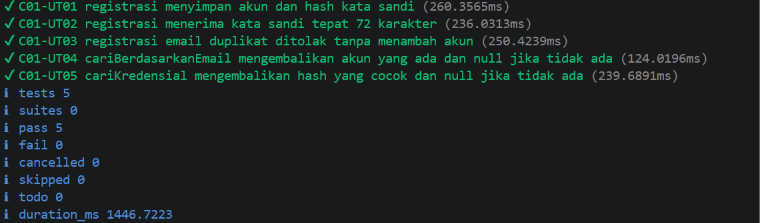* |
| *C01 (coverage)* | *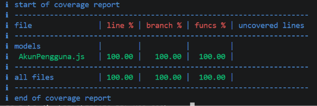* |
| *C02-UT01 – C02-UT18* | *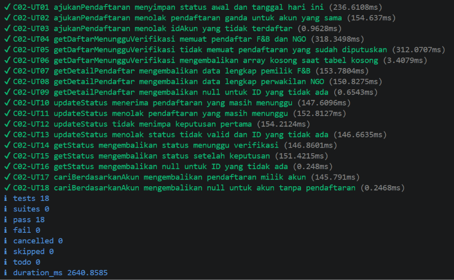* |
| *C02 (coverage)* | *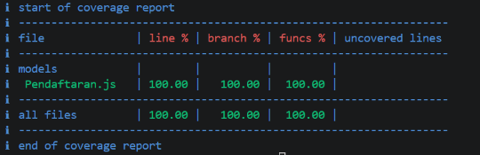* |
| *C03-UT01 – C03-UT10* | *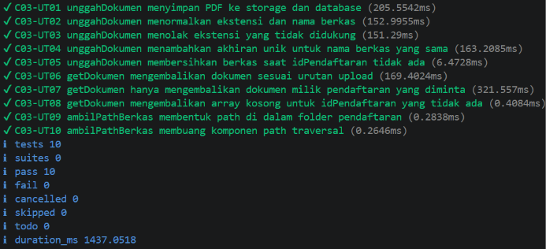* |
| *C03 (coverage)* | *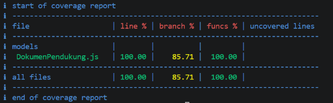* |
| *C04-UT01 – C04-UT07* | *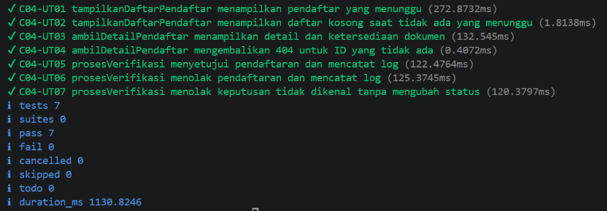* |
| *C06-UT01 – C06-UT08* | *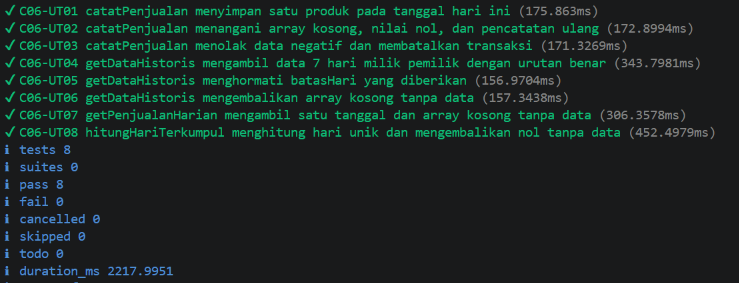* |
| *C06 (coverage)* | *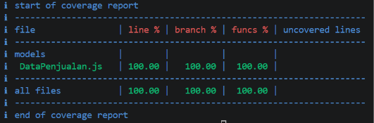* |
| *C07-UT01 – C07-UT08* | *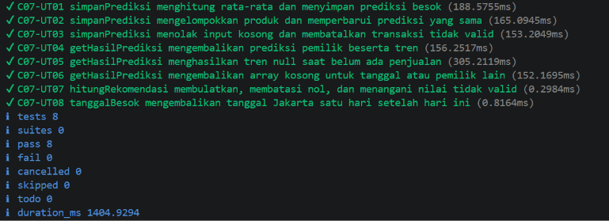* |
| *C07 (coverage)* | *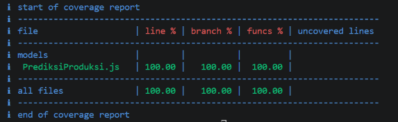* |
| *C08-UT01 – C08-UT16* | *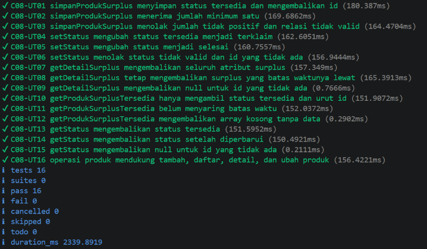* |
| *C08 (coverage)* | *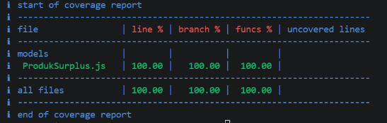* |
| *C09-UT01 – C09-UT09* | *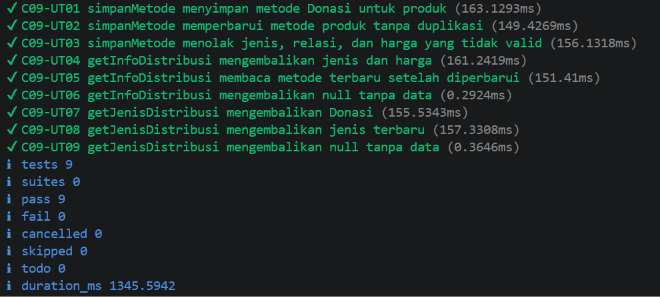* |
| *C09 (coverage)* | *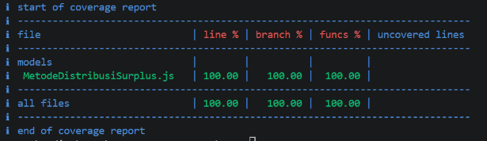* |
| *C10-UT01 – C10-UT09* | *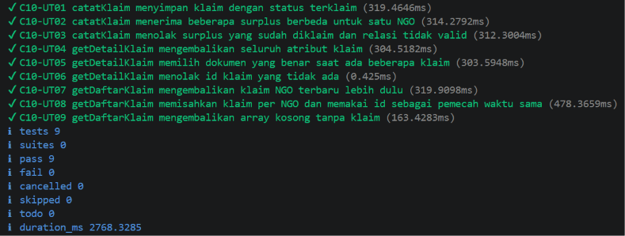* |
| *C10 (coverage)* | *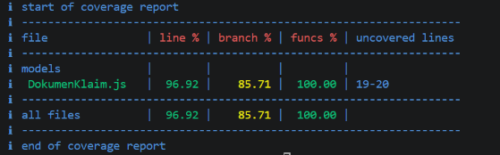* |
| *C11-UT01 – C11-UT09* | *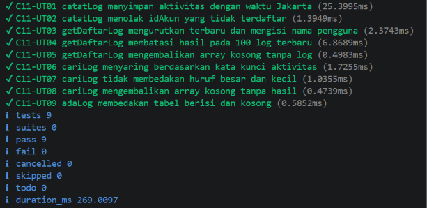* |
| *C11 (coverage)* | *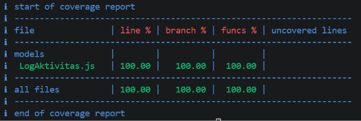* |
| *INT-TC01* | *[Sisipkan bukti pengujian integrasi]* |
| *UC01-TC01* | *[Sisipkan tangkapan layar UC01-TC01 sesuai prosedur pengujian]* |
| *UC01-TC02* | *[Sisipkan tangkapan layar UC01-TC02 sesuai prosedur pengujian]* |
| *KNF01-TC01* | *[Sisipkan bukti pengukuran parameter KNF01-TC01]* |
| *...* | *...* |

 

---

# BAB 5: Traceability

Petakan setiap KF ke KNF, use case, kelas perancangan, file implementasi, dan test case. Tabel traceability berikut akan menjadi sarana verifikasi KF. Setiap KF memiliki minimal satu test case dan dinyatakan terpenuhi apabila **seluruh** test case terkaitnya berkesimpulan `Pass`. KF yang tidak diimplementasikan tetap dicantumkan beserta alasannya.

Tabel 5.1. Matriks Kerunutan KF terhadap Implementasi dan Pengujian

| KF ID | KNF Terkait | Use Case ID | Kelas Terkait | Implementasi File Terkait | Test Case (UC) | Test Case (Unit/Integrasi/KNF) |
| :--- | :--- | :--- | :--- | :--- | :--- | :--- |
| *KF05* | *KNF01* | *UC03* | *C02 - Pesanan* | *`src/...`* | *UC03-TC01* | *C02-UT05, INT-TC04, KNF01-TC01* |
| *KF01* | *-* | *UC01 UC02* | *[C01 - Nama kelas] [C02 - Nama kelas]* | *[path/ke/file1] [path/ke/file2]* | *UC01-TC01, UC01-TC02 UC02-TC01* | *-* |
| *KF02* | *[KNFXX atau -]* | *[UCXX]* | *[CXX - Nama kelas]* | *[path/ke/file]* | *[UCXX-TCYY]* | *[CXX-UTYY, INT-TCYY, KNFXX-TCYY atau -]* |
| *KFXX* | *-* | *[UCXX atau -]* | *[CXX - Nama kelas atau -]* | *Tidak diimplementasikan: [alasan]* | *-* | *-* |
| *...* | *...* | *...* | *...* | *...* | *...* | *...* |

Tabel 5.2. Matriks Kerunutan KNF terhadap Pengujian

| ID KNF | Parameter | KF/UC Terkait | Test Case |
| :--- | :--- | :--- | :--- |
| *KNF01* | *Reliability* | *KF05 / UC03* | *KNF01-TC01* |
| *KNFXX* | *[Parameter]* | *[KFXX / UCXX atau -]* | *[KNFXX-TCYY]* |
| *...* | *...* | *...* | *...* |