<h1>
IF2150 REKAYASA PERANGKAT LUNAK
<br>
TUGAS 5
<br>
DESKRIPSI PERANCANGAN PERANGKAT LUNAK (DPPL)
</h1>
<br>

## *FoodLink*
<p align="center">


### Untuk: *Angel*

Dipersiapkan oleh:
| Informasi | Keterangan |
| --- | --- |
| Kelas | *03* |
| Kelompok | *08*  |

| NIM | Nama |
| --- | --- |
| *13525024* | *Excell Timothy Josua Tarigan* |
| *13525036* | *Dylan Frederico Ketaren* |
| *13525111* | *Edbert Fernando* |
| *13525114* | *Ernest Clarence Gunawan* |
| *13525117* | *Abdur Rauuf Fawaaz* |
---

## Daftar Perubahan

| Revisi | Deskripsi |
| :--- | :--- |
| *A* | *Merevisi realisasi UC11 dan UC12: mengganti identifikasi kelas pada kedua use case, menyeragamkan penamaan atribut dan operasi ke bahasa Indonesia, lalu mengganti sequence diagram dan class diagram sehingga konsisten dengan perubahan yang dilakukan* |
| *B* | *Merapikan serta menyesuaikan daftar kelas perancangan keseluruhan dengan perubahan yang ada* |
| *C* | *Menambahkan operasi getStatus() di C02 dan catatPenjualan() di C06 serta merevisi sequence diagram dan diagram kelas UC04 dan menambah* |
| ... |  |

---

<br>

> **Petunjuk pengerjaan:** *[Silahkan hapus bagian ini setelah selesai mengerjakan]*
>
> Dokumen ini melanjutkan **Deskripsi Perancangan Perangkat Lunak**. Gunakan nama, ID, kebutuhan, dan use case yang konsisten dengan kedua dokumen tersebut. Contoh pola ID baru di bawah dapat disesuaikan dengan kesepakatan kelompok, ID yang sudah ada tetap dipertahankan.

<br>

---


# BAB 1: Pendahuluan

## 1.1 Tujuan Penulisan Dokumen
Tuliskan dengan ringkas tujuan dokumen DPPL ini dibuat dan siapa saja yang akan menggunakan dokumen ini.

## 1.2 Lingkup Masalah
FoodLink merupakan suatu sistem perangkat lunak yang bertujuan untuk mengurangi pemborosan makanan dengan menghubungkan pemilik usaha F&B dan juga organisasi non-pemerintah (NGO). Sistem membantu pemilik F&B untuk mencatat data penjualan dan sisa produk harian untuk menghasilkan rekomendasi produksi, serta menyediakan akses untuk mengumumkan produk surplus yang dapat didonasikan atau dijual lagi dengan harga diskon. Sementara itu, NGO dapat menemukan, menyaring, dan mengklaim produk surplus di sekitar lokasinya. Dengan begitu, FoodLink akan mendukung pencapaian SDG 12 dan SDG 2.

## 1.3 Definisi, Istilah, dan Singkatan
Semua definisi dan singkatan yang digunakan dalam dokumen ini beserta penjelasannya.

Tabel 1.3. Definisi Istilah dan Singkatan

| Singkatan, Akronim, atau Istilah | Penjelasan |
| :--- | :--- |
| *P/L* | *Singkatan dari Perangkat Lunak, yaitu aplikasi yang memberikan perintah kepada komputer untuk menjalankan tugas tertentu.* |
| *SKPL* | *Singkatan dari Spesifikasi Kebutuhan Perangkat Lunak, yaitu dokumen yang merangkum kriteria-kriteria yang diperlukan untuk membangun aplikasi menjalankan tugasnya.* |
| *DPPL* | *Singkatan dari Spesifikasi Kebutuhan Perangkat Lunak, yaitu dokumen yang merangkum kriteria-kriteria yang diperlukan untuk membangun aplikasi menjalankan tugasnya.* |
| *KF* | *Singkatan dari Kebutuhan Fungsional.* |
| *KNF* | *Singkatan dari Kebutuhan Non-Fungsional.* |
| *UC* | *Singkatan dari Use Case.* |
| *NGO* | *Non-Governmental Organization, organisasi non-pemerintah yang menerima dan mendistribusikan makanan surplus kepada pihak yang membutuhkan.* |
| *F&B* | *Food and Beverage, sebutan untuk usaha yang bergerak di bidang makanan dan minuman.* |
| *Surplus* | *Produk makanan/minuman layak konsumsi yang tidak terjual dan berpotensi terbuang apabila tidak segera didistribusikan.* |

## 1.4 Aturan Penomoran
Aturan penomoran (ID) yang digunakan dalam dokumen ini.

Tabel 1.4. Aturan Penomoran

| Hal/Bagian | Penomoran | Keterangan |
| :--- | :--- | :--- |
| *Kebutuhan Fungsional* | *KFXX* | *XX merupakan nomor urut dua digit, dimulai dari 01.* |
| *Kebutuhan Non-Fungsional* | *KNFXX* | *XX merupakan nomor urut dua digit, dimulai dari 01.* |
| *Aktor* | *AXX* | *XX merupakan nomor urut dua digit, dimulai dari 01.* |
| *Use Case* | *UCXX* | *XX merupakan nomor urut dua digit, dimulai dari 01.* |
| *Kelas* | *CXX* | *XX merupakan nomor urut dua digit, dimulai dari 01.* |

## 1.5 Referensi
- K03_G08_SKPL.md
- K03_G08_APL.md
- K03_G08_DPPL.md
- Slide materi perkuliahan IF2150 RPL: https://drive.google.com/drive/folders/1SWxicyDoWrjlpJ18f9Oe_IuCYA-qGmrf?usp=sharing

## 1.6 Deskripsi Umum Dokumen (Ikhtisar)
Tuliskan sistematika pembahasan dokumen ini secara ringkas dan runut, dengan maksimal 1 paragraf.

<br>

---

# BAB 2: Perancangan Arsitektur

## 2.1 Rancangan Lingkungan Implementasi

Tabel 2.1. Lingkungan Implementasi

| Komponen | Spesifikasi |
| :--- | :--- |
| *Operating System* | *Cross-platform (Windows/Linux/macOS) melalui browser* |
| *DBMS* | *PostgreSQL 15* |
| *Development Tools* | *Visual Studio Code, Git dan GitHub, serta draw.io untuk pembuatan diagram* |
| *Filing System* | *Dokumen pendaftaran (PDF/JPG/PNG, maksimal 5 MB per berkas) disimpan pada file system server, sedangkan metadatanya disimpan di PostgreSQL* |
| *Bahasa Pemrograman* | *JavaScript (Node.js v20 dengan Express.js) di sisi server, serta HTML5, CSS, dan JavaScript di sisi klien* |

## 2.2 Style/Pattern Arsitektur Acuan

### 2.2.1 Style/Pattern FoodLink
FoodLink menggunakan arsitektur MVC (Model-View-Controller) sebagai architectural pattern acuan. MVC memisahkan penyajian informasi, koordinasi alur use case, dan pengelolaan data beserta aturan domainnya ke dalam tiga bagian dengan tanggung jawab yang berbeda. Berikut peran masing-masing komponen:
* Model: Bertanggung jawab menyimpan dan mengelola data aplikasi, termasuk logika untuk berinteraksi dengan basis data (PostgreSQL). Model merepresentasikan struktur data seperti akun pengguna, pendaftaran, produk surplus, dan data penjualan
* View: Halaman antarmuka web yang ditampilkan kepada Pemilik F&B, Perwakilan NGO, dan Admin Sistem. View hanya menampilkan data dan meneruskan aksi pengguna (*user events*) ke Controller, tanpa memuat aturan pengolahan data.
* Controller: Menjembatani interaksi antara View dan Model. Controller menerima permintaan dari View (misalnya saat pengguna menekan tombol submit), memvalidasi dan memproses data, lalu memerintahkan Model untuk menyimpan/mengambil data, dan menentukan View mana yang akan ditampilkan sebagai respons.

### 2.2.2 Alasan Pemilihan

MVC dipilih sebagai arsitektur acuan FoodLink karena kesesuaiannya dengan karakteristik sistem, baik dari sisi Kebutuhan Fungsional (KF) maupun Kebutuhan Non-Fungsional (KNF).

FoodLink memiliki tiga jenis pengguna (Pemilik F&B, Perwakilan NGO, Admin Sistem) dengan tampilan (View) berbeda-beda, namun beberapa di antaranya mengakses dan memperbarui *state* data yang sama. Misalnya, ProdukSurplus ditampilkan di DaftarSurplusPage (NGO) sekaligus diatur di DistribusiSurplusPage (Pemilik F&B). Pemisahan MVC memungkinkan kedua View ini berbagi Model yang sama tanpa duplikasi logika pengolahan data.

Dari sisi KF, mayoritas kebutuhan FoodLink berbentuk proses pencatatan dan penampilan data yang diakses lebih dari satu jenis pengguna, sehingga logika cukup didefinisikan sekali pada Controller dan Model, lalu dipakai ulang oleh berbagai View. Dari sisi KNF, kebutuhan seperti maintainability, response time, portability, dan reliability juga sesuai dengan prinsip pemisahan tanggung jawab MVC, karena masing-masing dapat ditangani secara terisolasi tanpa saling memengaruhi lapisan lain.

Secara keseluruhan, pemisahan tanggung jawab MVC, yaitu data terpusat di *Model*, tampilan fleksibel di *View*, dan logika bisnis terisolasi di *Controller*, sejalan dengan kebutuhan FoodLink seperti sistem yang modular, responsif, cepat, dan andal.

<p align="center">

</p>
<p align="center">
<i>Gambar 1. Arsitektur MVC FoodLink</i>
</p>

## 2.3 Identifikasi Komponen / Modul / Subsistem

Tabel 2.3. Identifikasi Komponen/Modul/Subsistem

| Nama Komponen/Modul/Subsistem | Jenis | Penjelasan |
| :--- | :--- | :--- |
| *PendaftaranView* | *View* | *Menampilkan formulir registrasi sesuai dengan tipe akun yang didaftarkan beserta tempat untuk upload dokumen yang dibutuhkan untuk pendaftaran. Akan ditampilkan juga status pendaftaran dan aksi pengguna akan diteruskan ke AuthController. (C12 & C14)* |
| *VerifikasiView* | *View* | *Menampilkan antarmuka daftar serta detail pendaftar untuk admin yang akan diteruskan ke VerifikasiController. (C13)* |
| *PenjualanPrediksiView* | *View* | *Menampilkan formulir untuk input data penjualan harian dan juga dashboard hasil prediksi produksi yang akan diteruskan ke PenjualanController dan PrediksiController. (C15 & C16)* |
| *SurplusPemilikView* | *View* | *Menampilkan antarmuka untuk menginput produk surplus dan juga pengaturan untuk metode distribusi surplus yang akan diteruskan ke ProdukSurplusController. (C17 & C18)* |
| *SurplusNGOView* | *View* | *Menampilkan antarmuka terkait produk surplus, mulai dari daftar dan detil produk serta fitur penyaringan produk hingga antarmuka untuk mengajukan klaim yang akan diteruskan ke SurplusController dan KlaimController. (C19 & C20)* |
| *PengambilanView* | *View* | *Menampilkan antarmuka untuk konfirmasi klaim produk surplus yang akan diteruskan ke KlaimController. (C21)* |
| *LogView* | *View* | *Menampilkan dashboard log aktivitas untuk admin yang akan diteruskan ke LogController. (C22)* |
| *AuthController* | *Controller* | *Memproses registrasi akun dan mengecek status pendaftaran. (C23)* |
| *VerifikasiController* | *Controller*  | *Memproses keputusan verifikasi saat pendaftaran dan menangani proses pemeriksaan. (C04)* |
| *PenjualanController* | *Controller* | *Memvalidasi data penjualan harian dan menyimpannya. (C24)* |
| *PrediksiController* | *Controller* | *Memvalidasi data historis dan menjalankan algoritma untuk menghasilkan rekomendasi produksi. (C25)* |
| *ProdukSurplusController* | *Controller* | *Memvalidasi dan menyimpan data terkait produk surplus serta metode distribusinya. (C26)* |
| *SurplusController* | *Controller* | *Mengurutkan produk surplus berdasarkan beberapa kategori seperti jarak dan jenis. (C27)* |
| *KlaimController* | *Controller* | *Memvalidasi ketersediaan produk surplus dan menyetujui klaim serta memproses konfirmasi pengambilan produk. (C28)* |
| *LogController* | *Controller* | *Menampilkan dan juga menyaring log aktivitas pengguna untuk admin. (C29)* |
| *AkunModel* | *Model* | *Menyimpan data akun dan identitas pengguna beserta sub kelasnya. (C01, C30, C31, C32)* |
| *PendaftaranModel* | *Model* | *Menyimpan data registrasi beserta statusnya dan juga dokumen pendukung yang diunggah oleh pendaftar. (C02 & C03)* |
| *PenjualanModel* | *Model* | *Menyimpan jenis produk, data penjualan dan sisa harian, dan hasil prediksi produksi. (C05, C06, C07)* |
| *SurplusModel* | *Model* | *Menyimpan informasi produk surplus, pilihan distribusi surplus, dan juga catatan NGO yang mengklaim produk surplus. (C08, C09, C10)* |
| *LogModel* | *Model* | *Menyimpan informasi terkait pengguna, aktivitas, dan waktu. (C11)* |
| *GeolocationAdapter* | *Integrasi Eksternal* | *Menghubungkan SurplusController dengan layanan peta pihak ketiga untuk mengonversi alamat pemilik F&B dan lokasi NGO menjadi koordinat untuk menghitung jaraknya.* |
| *Database* | *Penyimpanan Data* | *Menyimpan data secara persisten pada PostgreSQL 15, diakses oleh seluruh komponen Model.* |

## 2.4 Model Arsitektur Perangkat Lunak

### 2.4.1 Logical View

Gambar 2 adalah *Logical View* FoodLink. Untuk memodelkan struktur arsitektur aplikasi FoodLink, kami memilih *Logical View* sebagai representasi utama. *Logical View* dipilih karena model ini sangat efektif untuk memvisualisasikan dekomposisi fungsional sistem ke dalam unit-unit yang lebih kecil dan terorganisasi. Pada aplikasi FoodLink yang menggunakan pola arsitektur Model-View-Controller (MVC), *Logical View* memudahkan pengembang untuk melihat pemisahan tanggung jawab secara terstruktur, mulai dari antarmuka pengguna (View), pengontrol logika bisnis (Controller), hingga pengelolaan data (Model). Melalui view ini, aliran permintaan dari View ke Controller, akses Controller ke Model, penyimpanan data dari Model ke Database, serta pemakaian layanan eksternal oleh Controller dapat dipetakan dengan jelas, sehingga setiap Kebutuhan Fungsional (KF) dapat ditelusuri ke komponen yang mengerjakannya tanpa tumpang tindih logika.

<p align="center">

</p>
<p align="center">
<i>Gambar 2. Logical View FoodLink</i>
</p>

<br>

---


# BAB 3: Realisasi Use Case

## 3.1 Use Case Melakukan Registrasi Akun

**ID Use Case:** *UC01*  
**Nama Use Case:** *Melakukan Registrasi Akun*

### 3.1.1 Identifikasi Kelas

Tabel 3.1 Identifikasi Kelas Use Case UC01

| No | Nama Kelas Perancangan | Nama Kelas Analisis Terkait |
|:--- | :--- | :--- |
| 1 | *RegistrasiPage (C12)* | *RegistrasiPage (C12)* |
| 2 | *AuthController (C23)* | *AuthController (C23)* |
| 3 | *AkunPengguna (C01)* | *AkunPengguna (C01)* |
| 4 | *PemilikFnB (C30)* | *PemilikFnB (C30)* |
| 5 | *PerwakilanNGO (C31)* | *PerwakilanNGO (C31)* |
| 6 | *Pendaftaran (C02)* | *Pendaftaran (C02)* |
| 7 | *DokumenPendukung (C03)* | *DokumenPendukung (C03)* |

### 3.1.2 Sequence Diagram

- **Skenario Normal**

<p align="center">

</p>
<p align="center">
<i>Gambar 3.1.1 Sequence Diagram UC01</i>
</p>

- **Skenario Alternatif 1: Data Tidak Lengkap atau Dokumen Tidak Valid**

<p align="center">

</p>
<p align="center">
<i>Gambar 3.1.2 Sequence Diagram UC01 - Data Tidak Lengkap atau Dokumen Tidak Valid</i>
</p>

### 3.1.3 Diagram Kelas

<p align="center">

</p>
<p align="center">
<i>Gambar 3.1.3 Diagram Kelas Melakukan Registrasi Akun</i>
</p>

## 3.2 Use Case Memverifikasi Pendaftaran Akun

**ID Use Case:** *UC02*  
**Nama Use Case:** *Memverifikasi Pendaftaran Akun*

### 3.2.1 Identifikasi Kelas

Tabel 3.2 Identifikasi Kelas Use Case UC02

| No | Nama Kelas Perancangan | Nama Kelas Analisis Terkait |
|:--- | :--- | :--- |
| 1 | *VerifikasiPage (C13)* | *VerifikasiPage (C13)* |
| 2 | *VerifikasiController (C04)* | *VerifikasiController (C04)* |
| 3 | *AkunPengguna (C01)* | *AkunPengguna (C01)* |
| 4 | *AdminSistem (C32)* | *AdminSistem (C32)* |
| 5 | *Pendaftaran (C02)* | *Pendaftaran (C02)* |
| 6 | *DokumenPendukung (C03)* | *DokumenPendukung (C03)* |

### 3.2.2 Sequence Diagram

- **Skenario Normal**

<p align="center">

</p>
<p align="center">
<i>Gambar 3.2.1 Sequence Diagram UC02</i>
</p>

- **Skenario Alternatif 1: Pendaftaran Ditolak**

<p align="center">

</p>
<p align="center">
<i>Gambar 3.2.2 Sequence Diagram UC02 - Pendaftaran Ditolak</i>
</p>

### 3.2.3 Diagram Kelas

<p align="center">

</p>
<p align="center">
<i>Gambar 3.2.3 Diagram Kelas Memverifikasi Pendaftaran Akun</i>
</p>

## 3.3 Use Case Menampilkan Status Pendaftaran

**ID Use Case:** *UC03*  
**Nama Use Case:** *Menampilkan Status Pendaftaran*

### 3.3.1 Identifikasi Kelas

Tabel 3.3 Identifikasi Kelas Use Case UC03

| No | Nama Kelas Perancangan | Nama Kelas Analisis Terkait |
|:--- | :--- | :--- |
| 1 | *Pendaftaran (C02)* | *Pendaftaran (C02)* |
| 2 | *StatusPendaftaranPage (C14)* | *StatusPendaftaranPage (C14)* |
| 3 | *AuthController (C23)* | *AuthController (C23)* |
| 4 | *PemilikFnB (C30)* | *PemilikFnB (C30)* |
| 5 | *PerwakilanNGO (C31)* | *PerwakilanNGO (C31)* |

### 3.3.2 Sequence Diagram

- **Skenario Normal**

<p align="center">

</p>
<p align="center">
<i>Gambar 3.3.1 Sequence Diagram UC03</i>
</p>

- **Skenario Alternatif 1: Status Pendaftaran Ditolak**

<p align="center">

</p>
<p align="center">
<i>Gambar 3.3.2 Sequence Diagram UC03 - Status Pendaftaran Ditolak</i>
</p>

### 3.3.3 Diagram Kelas

<p align="center">

</p>
<p align="center">
<i>Gambar 3.3.3 Diagram Kelas Melihat Status Pendaftaran</i>
</p>

## 3.4 Use Case Mencatat Data Penjualan Harian

**ID Use Case:** *UC04*  
**Nama Use Case:** *Mencatat Data Penjualan Harian*

### 3.4.1 Identifikasi Kelas

Tabel 3.4 Identifikasi Kelas Use Case UC04

| No | Nama Kelas Perancangan | Nama Kelas Analisis Terkait |
|:--- | :--- | :--- |
| 1 | *PemilikFnB (C30)* | *PemilikFnB (C30)* |
| 2 | *PenjualanPage (C15)* | *PenjualanPage (C15)* |
| 3 | *PenjualanController (C24)* | *PenjualanController (C24)* |
| 4 | *DataPenjualan (C06)* | *DataPenjualan (C06)* |
| 5 | *Produk (C05)* | *Produk (C05)* |

### 3.4.2 Sequence Diagram

- **Skenario Normal**

<p align="center">

</p>
<p align="center">
<i>Gambar 3.4.1 Sequence Diagram UC04</i>
</p>

- **Skenario Alternatif 1: Format Isian Tidak Valid**

<p align="center">

</p>
<p align="center">
<i>Gambar 3.4.2 Sequence Diagram UC04 - Format Isian Tidak Valid</i>
</p>

### 3.4.3 Diagram Kelas

<p align="center">

</p>
<p align="center">
<i>Gambar 3.4.3 Diagram Kelas Mencatat Data Penjualan Harian</i>
</p>

## 3.5 Use Case Melihat Hasil Prediksi Produksi

**ID Use Case:** *UC05*  
**Nama Use Case:** *Melihat Hasil Prediksi Produksi*

### 3.5.1 Identifikasi Kelas

Tabel 3.5 Identifikasi Kelas Use Case UC05

| No | Nama Kelas Perancangan | Nama Kelas Analisis Terkait |
|:--- | :--- | :--- |
| 1 | *PrediksiPage (C16)* | *PrediksiPage (C16)* |
| 2 | *PrediksiController (C25)* | *PrediksiController (C25)* |
| 3 | *DataPenjualan (C06)* | *DataPenjualan (C06)* |
| 4 | *PrediksiProduksi (C07)* | *PrediksiProduksi (C07)* |
| 5 | *PemilikFnB (C30)* | *PemilikFnB (C30)* |

### 3.5.2 Sequence Diagram

- **Skenario Normal**

<p align="center">

</p>
<p align="center">
<i>Gambar 3.5.1. Sequence Diagram UC05 - Skenario Normal</i>
</p>

- **Skenario Alternatif 1: Data Historis Belum Memenuhi Syarat Minimal**

<p align="center">

</p>
<p align="center">
<i>Gambar 3.5.2. Sequence Diagram UC05 - Data Historis Belum Memenuhi Syarat Minimal</i>
</p>

### 3.5.3 Diagram Kelas

<p align="center">

</p>
<p align="center">
<i>Gambar 3.5.3 Diagram Kelas Melihat Hasil Prediksi Produksi</i>
</p>

## 3.6 Use Case Mencatat Produk Surplus

**ID Use Case:** *UC06*  
**Nama Use Case:** *Mencatat Produk Surplus*

### 3.6.1 Identifikasi Kelas

Tabel 3.6 Identifikasi Kelas Use Case UC06

| No | Nama Kelas Perancangan | Nama Kelas Analisis Terkait |
|:--- | :--- | :--- |
| 1 | *ProdukSurplusPage (C17)* | *ProdukSurplusPage (C17)* |
| 2 | *ProdukSurplusController (C26)* | *ProdukSurplusController (C26)* |
| 3 | *ProdukSurplus (C08)* | *ProdukSurplus (C08)* |
| 4 | *Produk (C05)* | *Produk (C05)* |
| 5 | *PemilikFnB (C30)* | *PemilikFnB (C30)* |

### 3.6.2 Sequence Diagram

- **Skenario Normal**

<p align="center">

</p>
<p align="center">
<i>Gambar 3.6.1. Sequence Diagram UC06 - Skenario Normal</i>
</p>

- **Skenario Alternatif 1: Mereset Isian Formulir**

<p align="center">

</p>
<p align="center">
<i>Gambar 3.6.2 Sequence Diagram UC06 - Mereset Isian Formulir</i>
</p>

### 3.6.3 Diagram Kelas

<p align="center">

</p>
<p align="center">
<i>Gambar 3.6.3 Diagram Kelas Mencatat Produk Surplus</i>
</p>

## 3.7 Use Case Mengatur Metode Distribusi Surplus

**ID Use Case:** *UC07*
**Nama Use Case:** *Mengatur Metode Distribusi Surplus*

### 3.7.1 Identifikasi Kelas

Tabel 3.7 Identifikasi Kelas Use Case UC07

| No | Nama Kelas Perancangan | Nama Kelas Analisis Terkait |
|:--- | :--- | :--- |
| 1 | *DistribusiSurplusPage* (C18) | *AkunPengguna* (C01) |
| 2 | *ProdukSurplusController* (C26) | *ProdukSurplus* (C08) |
| 3 | *ProdukSurplus* (C08) | *ProdukSurplus* (C08) |
| 4 | *MetodeDistribusiSurplus* (C09) | *MetodeDistribusiSurplus* (C09) |

### 3.7.2 Sequence Diagram

- **Skenario Normal**

<p align="center">

</p>
<p align="center">
<i>Gambar 3.7.1 Sequence Diagram UC07 - Skenario Normal</i>
</p>

- **Skenario Alternatif 1: Pemilik F&B Memilih Donasi**

<p align="center">

</p>
<p align="center">
<i>Gambar 3.7.2 Sequence Diagram UC07 - Memilih Donasi</i>
</p>

- **Skenario Alternatif 2: Harga Penjualan Tidak Valid**

<p align="center">

</p>
<p align="center">
<i>Gambar 3.7.3 Sequence Diagram UC07 - Harga Penjualan Tidak Valid</i>
</p>

### 3.7.3 Diagram Kelas

<p align="center">

</p>
<p align="center">
<i>Gambar 3.7.4 Diagram Kelas Mengatur Metode Distribusi Surplus</i>
</p>

## 3.8 Use Case Melihat Informasi Produk Surplus

**ID Use Case:** *UC08*  
**Nama Use Case:** *Melihat Informasi Produk Surplus*

### 3.8.1 Identifikasi Kelas

Tabel 3.8 Identifikasi Kelas Use Case UC08

| No | Nama Kelas Perancangan | ID | Kelas Analisis Terkait |
|---:|---|---|---|
| 1 | DaftarSurplusPage (Boundary) | C19 | AkunPengguna (C01) |
| 2 | SurplusController (Control) | C27 | ProdukSurplus (C08) |
| 3 | PerwakilanNGO (Entity) | C31 | PerwakilanNGO (C31) |
| 4 | ProdukSurplus (Entity) | C08 | ProdukSurplus (C08) |
| 5 | Produk (Entity) | C05 | Produk (C05) |
| 6 | PemilikFnB (Entity) | C30 | PemilikFnB (C30) |
| 7 | MetodeDistribusiSurplus (Entity) | C09 | MetodeDistribusiSurplus (C09) |
| 8 | GeolocationAdapter (Integration) | C33 | Kelas integrasi tambahan untuk melengkapi KF11 |

### 3.8.2 Sequence Diagram

- **Skenario Normal**

<p align="center">

</p>
<p align="center">
<i>Gambar 3.8.1 Sequence Diagram UC08 - Skenario Normal</i>
</p>

- **Skenario Alternatif 1: Lokasi Pengguna Belum Tersedia**

<p align="center">

</p>
<p align="center">
<i>Gambar 3.8.2 Sequence Diagram UC08 - Lokasi Pengguna Belum Tersedia</i>
</p>

### 3.8.3 Diagram Kelas

<p align="center">

</p>
<p align="center">
<i>Gambar 3.8.3 Diagram Kelas Melihat Informasi Produk Surplus</i>
</p>

## 3.9 Use Case Menyaring Produk Surplus

**ID Use Case:** *UC09*  
**Nama Use Case:** *Menyaring Produk Surplus*

### 3.9.1 Identifikasi Kelas

Tabel 3.9 Identifikasi Kelas Use Case UC09

| No | Nama Kelas Perancangan | Nama Kelas Analisis Terkait |
|:--- | :--- | :--- |
| 1 | *PerwakilanNGO (C31)* | *PerwakilanNGO (C31)* |
| 2 | *DaftarSurplusPage* (C19) | *AkunPengguna* (C01) |
| 3 | *SurplusController* (C27) | *ProdukSurplus* (C08) |
| 4 | *ProdukSurplus* (C08) | *ProdukSurplus* (C08) |
| 5 | *MetodeDistribusiSurplus* (C09) | *MetodeDistribusiSurplus* (C09) |
| 6 | *PenyaringanController* (C34) | *PenyaringanController* (C34) |

### 3.9.2 Sequence Diagram

- **Skenario Normal**

<p align="center">

</p>
<p align="center">
<i>Gambar 3.9.1 Sequence Diagram UC09 - Skenario Normal</i>
</p>

- **Skenario Alternatif 1: Tidak Ada Produk Sesuai**

<p align="center">

</p>
<p align="center">
<i>Gambar 3.9.2 Sequence Diagram UC09 - Tidak Ada Produk Sesuai</i>
</p>

### 3.9.3 Diagram Kelas

<p align="center">

</p>
<p align="center">
<i>Gambar 3.9.3 Diagram Kelas Menyaring Produk Surplus</i>
</p>

## 3.10 Use Case Mengklaim Produk Surplus

**ID Use Case:** *UC10*  
**Nama Use Case:** *Mengklaim Produk Surplus*

### 3.10.1 Identifikasi Kelas

Tabel 3.10 Identifikasi Kelas Use Case UC09

| No | Nama Kelas Perancangan | Nama Kelas Analisis Terkait |
|:--- | :--- | :--- |
| 1 | *PerwakilanNGO (C31)* | *PerwakilanNGO (C31)* |
| 2 | *KlaimPage* (C20) | *KlaimPage* (C20) |
| 3 | *KlaimController* (C28) | *KlaimSurplus* (C28) |
| 4 | *SurplusController* (C27) | *ProdukSurplus* (C08) |
| 5 | *MetodeDistribusiSurplus* (C09) | *MetodeDistribusiSurplus* (C09) |
| 6 | *ProdukSurplus* (C08) | *ProdukSurplus* (C08) |
| 7 | *DokumenKlaim* (C10) | *DokumenKlaim* (C10) |

### 3.10.2 Sequence Diagram

- **Skenario Normal**

<p align="center">

</p>
<p align="center">
<i>Gambar 3.10.1 Sequence Diagram UC10 - Skenario Normal</i>
</p>

- **Skenario Alternatif 1: Produk sudah diklaim NGO lain terlebih dahulu**

<p align="center">

</p>
<p align="center">
<i>Gambar 3.10.2 Sequence Diagram UC10 - Produk sudah diklaim NGO lain terlebih dahulu</i>
</p>

### 3.10.3 Diagram Kelas

<p align="center">

</p>
<p align="center">
<i>Gambar 3.10.3 Diagram Kelas Mengklaim Produk Surplus</i>
</p>

## 3.11 Use Case Mengonfirmasi Pengambilan Produk Surplus

**ID Use Case:** *UC11*  
**Nama Use Case:** *Mengonfirmasi Pengambilan Produk Surplus*

### 3.11.1 Identifikasi Kelas

Tabel 3.11 Identifikasi Kelas Use Case UC11

| No | Nama Kelas Perancangan | Nama Kelas Analisis Terkait |
|:---|:---|:---|
| 1 | *PengambilanPage (C21)* | *PengambilanPage (C21)* |
| 2 | *KlaimController (C28)* | *KlaimController (C28)* |
| 3 | *DokumenKlaim (C10)* | *DokumenKlaim (C10)* |
| 4 | *ProdukSurplus (C08)* | *ProdukSurplus (C08)* |
| 5 | *PemilikFnB (C30)* | *PemilikFnB (C30)* |
| 6 | *PerwakilanNGO (C31)* | *PerwakilanNGO (C31)* |
| 7 | *AkunPengguna (C01)* | *AkunPengguna (C01)* |


### 3.11.2 Sequence Diagram

- **Skenario Normal**

<p align="center">

</p>
<p align="center">
<i>Gambar 3.11.1 Sequence Diagram UC11</i>
</p>

- **Skenario Alternatif 1: Pemilik F&B atau Perwakilan NGO Ingin Membatalkan Pengonfirmasian Pengambilan Produk Surplus**

<p align="center">

</p>
<p align="center">
<i>Gambar 3.11.2 Sequence Diagram UC11 - Membatalkan Pengonfirmasian Pengambilan Produk Surplus</i>
</p>

### 3.11.3 Diagram Kelas

<p align="center">

</p>
<p align="center">
<i>Gambar 3.11.3 Diagram Kelas Mengonfirmasi Pengambilan Produk Surplus</i>
</p>

## 3.12 Use Case Mengecek Log Aktivitas Pengguna

**ID Use Case:** *UC12*  
**Nama Use Case:** *Mengecek Log Aktivitas Pengguna*

### 3.12.1 Identifikasi Kelas

Tabel 3.12 Identifikasi Kelas Use Case UC12

| No | Nama Kelas Perancangan | Nama Kelas Analisis Terkait |
|:--- | :--- | :--- |
| 1 | *LogAktivitasPage (C22)* | *LogAktivitasPage (C22)* |
| 2 | *LogController (C29)* | *LogController (C29)* |
| 3 | *LogAktivitas (C11)* | *LogAktivitas (C11)* |
| 4 | *AdminSistem (C32)* | *AdminSistem (C32)* |
| 5 | *AkunPengguna (C01)* | *AkunPengguna (C01)* |

### 3.12.2 Sequence Diagram

- **Skenario Normal**

<p align="center">

</p>
<p align="center">
<i>Gambar 3.12.1 Sequence Diagram UC12</i>
</p>

- **Skenario Alternatif 1: Tidak Ada Log yang Sesuai dengan Penyaringan**

<p align="center">

</p>
<p align="center">
<i>Gambar 3.12.2 Sequence Diagram UC12 - Tidak Ada Log yang Sesuai dengan Penyaringan</i>
</p>

- **Skenario Alternatif 2: Belum Ada Log Aktivitas**

<p align="center">

</p>
<p align="center">
<i>Gambar 3.12.3 Sequence Diagram UC12 - Belum Ada Log Aktivitas</i>
</p>

### 3.12.3 Diagram Kelas

<p align="center">

</p>
<p align="center">
<i>Gambar 3.12.4 Diagram Kelas Mengecek Log Aktivitas Pengguna</i>
</p>

<br>

---

# BAB 4: Diagram Kelas Keseluruhan

## 4.1 Diagram Kelas

<p align="center">

</p>
<p align="center">
<i>Gambar 4.1. Diagram Kelas Perancangan Keseluruhan FoodLink</i>
</p>

Tabel 4.1. Daftar Kelas Perancangan Keseluruhan

| ID Kelas | Nama Kelas | Atribut | Metode/Operasi |
| :--- | :--- | :--- | :--- |
| *C01* | *AkunPengguna* | *idAkun, email, kataSandi, tipeAkun* | *registrasi(), getIdAkun()* |
| *C02* | *Pendaftaran* | *idPendaftaran, tanggalDaftar, statusVerifikasi* | *ajukanPendaftaran(), getDaftarMenungguVerifikasi(), getDetailPendaftar(), updateStatus(), getStatus()* |
| *C03* | *DokumenPendukung* | *idDokumen, namaFile, tipeDokumen* | *unggahDokumen(), getDokumen()* |
| *C04* | *VerifikasiController* | *-* | *tampilkanDaftarPendaftar(), ambilDetailPendaftar(), prosesVerifikasi()* |
| *C05* | *Produk* | *-idProduk, -namaProduk, -kategori* | *+getDetailProduk()* |
| *C06* | *DataPenjualan* | *-idPenjualan, -tanggal, -jumlahTerjual, -jumlahTersisa* | *+getDataHistoris(), +catatPenjualan()* |
| *C07* | *PrediksiProduksi* | *-idPrediksi, -tanggalPrediksi, -jumlahRekomendasi* | *+buatPrediksi(), +getHasilPrediksi()* |
| *C08* | *ProdukSurplus* | *-idSurplus, -jumlah, -batasWaktuPengambilan, -status* | *+simpanProdukSurplus(), +setStatus(), +getDetailSurplus()* |
| *C09* | *MetodeDistribusiSurplus* | *-idDistribusi, -jenisDistribusi, -harga* | *+pilihMetodeDistribusi(), +hitungHargaDiskon(), +getInfoDistribusi()* |
| *C10* | *DokumenKlaim* | *idKlaim, idNgo, waktuKlaim* | *catatKlaim(), getDetailKlaim()* |
| *C11* | *LogAktivitas* | *idLog, aktivitas, waktu* | *catatLog(), getDaftarLog(), cariLog()* |
| *C12* | *RegistrasiPage* | *-* | *pilihTipeAkun(), tampilkanFormRegistrasi(), kirimFormulir(), tampilkanPesanBerhasil(), tampilkanPesanError()* |
| *C13* | *VerifikasiPage* | *-* | *bukaDaftarVerifikasi(), tampilkanDaftarVerifikasi(), pilihPendaftar(), tampilkanDetailPendaftar(), kirimKeputusan()* |
| *C14* | *StatusPendaftaranPage* | *-* | *tampilkanStatusPendaftaran()* |
| *C15* | *PenjualanPage* | *-* | *tampilkanFormPenjualan(), kirimDataPenjualan()* |
| *C16* | *PrediksiPage* | *-* | *+tampilkanDashboardPrediksi(), +tampilkanGrafik(), +tampilkanPesanError()* |
| *C17* | *ProdukSurplusPage* | *-* | *+tampilkanFormulirSurplus(), +kirimDataSurplus(), +resetFormulir(), +tampilkanNotifikasiSukses(), +kosongkanIsian()* |
| *C18* | *DistribusiSurplusPage* | *-* | *+tampilkanOpsiDistribusi()* |
| *C19* | *DaftarSurplusPage* | *-* | *+tampilkanDaftarSurplus(), +tampilkanFormFilter()* |
| *C20* | *KlaimPage* | *produkTerpilih* | *tampilkanHalaman(), kirimKlaim()* |
| *C21* | *PengambilanPage* | *-* | *bukaDetailPengambilan(), tampilkanDetailPengambilan(), tampilkanPopupKonfirmasi(), pilihKonfirmasiPengambilan(), pilihYes(), pilihNo(), tutupPopupKonfirmasi(), tampilkanPesanBerhasil()* |
| *C22* | *LogAktivitasPage* | *daftarLogTampil* | *bukaDashboardLog(), tampilkanDashboardLog(), terapkanFilter(), tampilkanTabelLog(), tampilkanPesanLogKosong()* |
| *C23* | *AuthController* | *-* | *registrasiAkun(), validasiKelengkapanData(), validasiFormatDokumen()* |
| *C24* | *PenjualanController* | *-* | *validasiInputPenjualan(), simpanDataPenjualan()* |
| *C25* | *PrediksiController* | *-* | *+cekKecukupanData(), +jalankanPrediksi()* |
| *C26* | *ProdukSurplusController* | *-* | *+validasiDataSurplus(), +simpanDataSurplus()* |
| *C27* | *SurplusController* | *-* | *+ambilDaftarSurplus(), +urutkanBerdasarkanJarak()* |
| *C28* | *KlaimController* | *-* | *ambilDetailPengambilan(), konfirmasiPengambilan()* |
| *C29* | *LogController* | *-* | *tampilkanLog(), saringLog()* |
| *C30* | *PemilikFnB* | *namaUsaha, alamatUsaha, jamOperasional* | *(diwarisi dari AkunPengguna)* |
| *C31* | *PerwakilanNGO* | *namaOrganisasi, nomorLegalitas, lokasi* | *(diwarisi dari AkunPengguna)* |
| *C32* | *AdminSistem* | *kewenangan* | *verifikasiPendaftaran()* |
| *C33* | *GeolocationAdapter* | *-* | *+getCoordinates(), +calculateDistance()* |
| *C34* | *PenyaringanController* | *-* | *saringProdukSurplus(), cariProdukSurplus(), validasiKriteria(), saringBerdasarkanJenis(), saringBerdasarkanJarak(), saringBerdasarkanBatasWaktu()* |

<br>

---

# BAB 5: Perancangan Rinci Kelas

Bagian ini diisi dengan daftar seluruh kelas dalam tabel berikut:

Tabel 5.1. Daftar Kelas Perancangan dan Kelas Analisis Terkait

| No | Nama Kelas Perancangan | Nama Kelas Analisis Terkait |
| :--- | :--- | :--- |
| 1 | *[Nama kelas perancangan]* | *[Nama kelas analisis pada SKPL atau -]* |
| 2 | *[Nama kelas perancangan]* | *[Nama kelas analisis pada SKPL atau -]* |
| ... | *...* | *...* |

Untuk **setiap kelas**, identifikasi operasi berdasarkan tanggung jawab kelas beserta *visibility*-nya, serta atribut beserta *visibility* dan tipenya. Buat subbab tersendiri untuk setiap kelas.

## 5.1 Kelas [Nama Kelas 1]

**Nama Kelas:** *[Nama kelas]*  
**ID Kelas:** *[ID kelas]*

Tabel 5.1.1. Operasi Kelas [Nama Kelas 1]

| Nama Operasi | Visibility (private, public) | Keterangan |
| :--- | :--- | :--- |
| *[Signature operasi, termasuk parameter dan tipe kembalian]* | *[Visibility]* | *[Tanggung jawab operasi]* |
| *...* | *...* | *...* |

Tabel 5.1.2. Atribut Kelas [Nama Kelas 1]

| Nama Atribut | Visibility (private, public) | Tipe |
| :--- | :--- | :--- |
| *[Nama atribut]* | *[Visibility]* | *[Tipe sesuai bahasa pemrograman yang digunakan]* |
| *...* | *...* | *...* |

### 5.1.1 Algoritma/Query

Bagian ini diisi untuk kerangka algoritma proses yang dianggap cukup penting. Algoritma dapat dituliskan sebagai *pseudocode*. Implementasi *skeleton code* juga dapat digunakan untuk kelas yang sudah terdefinisi pada bahasa pemrograman tertentu.

**Nama Kelas:** *[Nama kelas]*  
**Nama Operasi:** *[Signature operasi]*  
**ID Algoritma:** *[Algo-001]*

```text
[Tuliskan pseudocode algoritma operasi di sini.]
```

Jika operasi mengacu pada query tertentu, lengkapi tabel berikut. 

Tabel 5.1.1. Query Operasi [Nama Operasi]

| No Query | Query | Keterangan |
| :--- | :--- | :--- |
| *[Q-001]* | *[Tuliskan query]* | *[Fungsi query]* |
| *...* | *...* | *...* |


### 5.1.2 Algoritma/Query

*[Ulangi pola 5.1.1 untuk operasi penting berikutnya pada kelas yang sama, jika ada.]*

## 5.1 Kelas AkunPengguna

**Nama Kelas:** *AkunPengguna*  
**ID Kelas:** *C01*

Tabel 5.1.1. Operasi Kelas AkunPengguna

| Nama Operasi | Visibility (private, public) | Keterangan |
| :--- | :--- | :--- |
| *registrasi(dataForm: Object): Number* | *Public* | *Membuat akun baru dari data formulir registrasi (email, kata sandi, tipe akun) dan mengembalikan idAkun* |

Tabel 5.1.2. Atribut Kelas AkunPengguna

| Nama Atribut | Visibility (private, public) | Tipe |
| :--- | :--- | :--- |
| *idAkun* | *Private* | *Number* |
| *email* | *Private* | *String* |
| *kataSandi* | *Private* | *String* |
| *tipeAkun* | *Private* | *String* |

### 5.1.1 Algoritma/Query

**Nama Kelas:** *AkunPengguna*  
**Nama Operasi:** *registrasi(dataForm: Object): Number*  
**ID Algoritma:** *Algo-C01-01*

```text
FUNCTION registrasi(dataForm)
    kataSandiHash <- HASH(kata sandi dari dataForm)
    idAkun <- JALANKAN Q-C01-01 dengan (email dari dataForm, kataSandiHash, tipeAkun)
    RETURN idAkun
END FUNCTION
```

Tabel 5.1.3. Query Operasi registrasi()

| No Query | Query | Keterangan |
| :--- | :--- | :--- |
| *Q-C01-01* | *INSERT INTO akun_pengguna(email, kata_sandi, tipe_akun) VALUES ($1, $2, $3) RETURNING id_akun;* | *Menyimpan data akun pengguna baru ke tabel akun_pengguna di PostgreSQL dan mengembalikan id_akun yang dibuat.* |

## 5.2 Kelas Pendaftaran

**Nama Kelas:** *Pendaftaran*  
**ID Kelas:** *C02*

Tabel 5.2.1. Operasi Kelas Pendaftaran

| Nama Operasi | Visibility (private, public) | Keterangan |
| :--- | :--- | :--- |
| *ajukanPendaftaran(idAkun: Number): Number* | *Public* | *Membuat catatan pendaftaran untuk akun yang baru terbentuk  dan mengembalikan idPendaftaran* |
| *getDaftarMenungguVerifikasi(): Array* | *Public* | *Mengambil daftar pendaftaran yang berstatus "menunggu verifikasi" untuk ditampilkan ke admin sistem* |
| *getDetailPendaftar(idPendaftaran: Number): Object* | *Public* | *Mengambil data detil dari satu pendaftar* |
| *updateStatus(idPendaftaran: Number, status: String): void* | *Public* | *Memperbarui statusVerifikasi pendaftaran menjadi "diterima" atau "ditolak"* |
| *getStatus(): String* | *Public* | *Mengembalikan statusVerifikasi* |

Tabel 5.2.2. Atribut Kelas Pendaftaran 

| Nama Atribut | Visibility (private, public) | Tipe |
| :--- | :--- | :--- |
| *idPendaftaran* | *Private* | *Number* |
| *tanggalDaftar* | *Private* | *Date* |
| *statusVerifikasi* | *Private* | *String* |
### 5.2.1 Algoritma/Query

**Nama Kelas:** *Pendaftaran*  
**Nama Operasi:** *ajukanPendaftaran(idAkun: Number): Number*  
**ID Algoritma:** *Algo-C02-01*

```text
FUNCTION ajukanPendaftaran(idAkun)
    idPendaftaran <- JALANKAN Q-C02-01 dengan (idAkun)
    RETURN idPendaftaran
END FUNCTION
```

Tabel 5.2.3. Query Operasi ajukanPendaftaran()

| No Query | Query | Keterangan |
| :--- | :--- | :--- |
| *Q-C02-01* | *INSERT INTO pendaftaran(id_akun, tanggal_daftar, status_verifikasi) VALUES ($1, CURRENT_DATE, 'menunggu verifikasi') RETURNING id_pendaftaran;* | *Meyimpan pendaftaran baru dengan tanggal hari ini dan status awal "menunggu verifikasi", lalu mengembalikan idPendaftaran* |

### 5.2.2 Algoritma/Query

**Nama Kelas:** *Pendaftaran*  
**Nama Operasi:** *getDaftarMenungguVerifikasi(): Array*  
**ID Algoritma:** *Algo-C02-02*

```text
FUNCTION getDaftarMenungguVerifikasi()
    daftarPendaftar <- JALANKAN Q-C02-02
    RETURN daftarPendaftar
END FUNCTION
```
Tabel 5.2.4. Query Operasi getDaftarMenungguVerifikasi()

| No Query | Query | Keterangan |
| :--- | :--- | :--- |
| *Q-C02-02* | *SELECT id_pendaftaran, id_akun, tanggal_daftar, status_verifikasi FROM pendaftaran WHERE status_verifikasi = 'menunggu verifikasi';* | *Mengambil seluruh pendaftaran yang masih menunggu untuk verifikasi* |

### 5.2.3 Algoritma/Query

**Nama Kelas:** *Pendaftaran*  
**Nama Operasi:** *getDetailPendaftar(idPendaftaran: Number): Object*  
**ID Algoritma:** *Algo-C02-03*

```text
FUNCTION getDetailPendaftar(idPendaftaran)
    dataPendaftar <- JALANKAN Q-C02-03 dengan (idPendaftaran)
    RETURN dataPendaftar
END FUNCTION
```

Tabel 5.2.5. Query Operasi getDetailPendaftar()

| No Query | Query | Keterangan |
| :--- | :--- | :--- |
| *Q-C02-03* | *SELECT id_pendaftaran, id_akun, tanggal_daftar, status_verifikasi FROM pendaftaran WHERE id_pendaftaran = $1;* | *Mengambil data satu pendaftaran berdasarkan id_pendaftaran*|

### 5.2.4 Algoritma/Query

**Nama Kelas:** *Pendaftaran*  
**Nama Operasi:** *updateStatus(idPendaftaran: Number, status: String): void*  
**ID Algoritma:** *Algo-C02-04*

```text
PROCEDURE updateStatus(idPendaftaran, status)
    JALANKAN Q-C02-04 dengan (status, idPendaftaran)
END PROCEDURE
```
Tabel 5.2.6. Query Operasi updateStatus()

| No Query | Query | Keterangan |
| :--- | :--- | :--- |
| *Q-C02-04* | *UPDATE pendaftaran SET status_verifikasi = $1 WHERE id_pendaftaran = $2;* | *Memperbarui status verifikasi menjadi "diterima" atau "ditolak"* |

### 5.2.5 Algoritma/Query

**Nama Kelas:** *Pendaftaran*  
**Nama Operasi:** *getStatus(): String*  
**ID Algoritma:** *Algo-C02-05*

```text
FUNCTION getStatus()
    statusVerifikasi <- JALANKAN Q-C02-05 dengan (idPendaftaran milik objek)
    RETURN statusVerifikasi
END FUNCTION
```
Tabel 5.2.7. Query Operasi getStatus()

| No Query | Query | Keterangan |
| :--- | :--- | :--- |
| *Q-C02-05* | *SELECT status_verifikasi FROM pendaftaran WHERE id_pendaftaran = $1;* | *Mengambil status verifikasi dari pendaftaran* |

## 5.3 Kelas DokumenPendukung

**Nama Kelas:** *DokumenPendukung*  
**ID Kelas:** *C03*

Tabel 5.3.1. Operasi Kelas DokumenPendukung

| Nama Operasi | Visibility (private, public) | Keterangan |
| :--- | :--- | :--- |
| *unggahDokumen(idPendaftaran: Number, berkas: Object): void* | *Public* | *Menyimpan berkas dokumen pendukung milik sebuah pendaftar* |
| *getDokumen(idPendaftaran: Number): Array* | *Public* | *Mengambil dokumen pendukung milik satu pendaftar* |

Tabel 5.3.2. Atribut Kelas DokumenPendukung

| Nama Atribut | Visibility (private, public) | Tipe |
| :--- | :--- | :--- |
| *idDokumen* | *Private* | *Number* |
| *namaFile* | *Private* | *String* |
| *tipeDokumen* | *Private* | *String* |

### 5.3.1 Algoritma/Query

**Nama Kelas:** *DokumenPendukung*  
**Nama Operasi:** *unggahDokumen(idPendaftaran: Number, berkas: Object): void*  
**ID Algoritma:** *Algo-C03-01*

```text
PROCEDURE unggahDokumen(idPendaftaran, berkas)
    namaFile <- SIMPAN berkas ke folder penyimpanan dokumen di server
    tipeDokumen <- tipe berkas (PDF, JPG, atau PNG)
    JALANKAN Q-C03-01 dengan (idPendaftaran, namaFile, tipeDokumen)
END PROCEDURE
```

Tabel 5.3.3. Query Operasi unggahDokumen()

| No Query | Query | Keterangan |
| :--- | :--- | :--- |
| *Q-C03-01* | *INSERT INTO dokumen_pendukung(id_pendaftaran, nama_file, tipe_dokumen) VALUES ($1, $2, $3);* | *Menyimpan data dokumen pendukung ke dalam tabel dokumen_pendukung* |

### 5.3.2 Algoritma/Query

**Nama Kelas:** *DokumenPendukung*  
**Nama Operasi:** *getDokumen(idPendaftaran: Number): Array*  
**ID Algoritma:** *Algo-C03-02*

```text
FUNCTION getDokumen(idPendaftaran)
    daftarDokumen <- JALANKAN Q-C03-02 dengan (idPendaftaran)
    RETURN daftarDokumen
END FUNCTION
```

Tabel 5.3.4. Query Operasi getDokumen()

| No Query | Query | Keterangan |
| :--- | :--- | :--- |
| *Q-C03-02* | *SELECT id_dokumen, nama_file, tipe_dokumen FROM dokumen_pendukung WHERE id_pendaftaran = $1;* | *Mengambil data dokumen pendukung milik satu pendaftar* |

## 5.4 Kelas VerifikasiController

**Nama Kelas:** *VerifikasiController*  
**ID Kelas:** *C04*

Tabel 5.4.1. Operasi Kelas VerifikasiController

| Nama Operasi | Visibility (private, public) | Keterangan |
| :--- | :--- | :--- |
| *tampilkanDaftarPendaftar(): Array* | *Public* | *Meminta daftar dari pendaftar yang berstatus "menunggu verifikasi"* |
| *ambilDetailPendaftar(idPendaftaran: Number): Object* | *Public* | *Mengambil data pendaftar dan dokumen* |
| *prosesVerifikasi(idPendaftaran: Number, keputusan: String): String* | *Public* | *Meneruskan keputusan admin sistem terkait status pendaftaran* |

Tabel 5.4.2. Atribut Kelas VerifikasiController

| Nama Atribut | Visibility (private, public) | Tipe |
| :--- | :--- | :--- |
| *-* | *-* | *-* |


### 5.4.1 Algoritma/Query

**Nama Kelas:** *VerifikasiController*  
**Nama Operasi:** *tampilkanDaftarPendaftar(): Array*  
**ID Algoritma:** *Algo-C04-01*

```text
FUNCTION tampilkanDaftarPendaftar()
    daftarPendaftar <- getDaftarMenungguVerifikasi() pada Pendaftaran
    RETURN daftarPendaftar
END FUNCTION
```

Tabel 5.4.3. Query Operasi tampilkanDaftarPendaftar()

| No Query | Query | Keterangan |
| :--- | :--- | :--- |
| *-* | *-* | *-* |

### 5.4.2 Algoritma/Query

**Nama Kelas:** *VerifikasiController*  
**Nama Operasi:** *ambilDetailPendaftar(idPendaftaran: Number): Object*  
**ID Algoritma:** *Algo-C04-02*

```text
FUNCTION ambilDetailPendaftar(idPendaftaran)
    dataPendaftar <- getDetailPendaftar(idPendaftaran) pada Pendaftaran
    daftarDokumen <- getDokumen(idPendaftaran) pada DokumenPendukung
    detailPendaftar <- GABUNGKAN dataPendaftar dan daftarDokumen
    RETURN detailPendaftar
END FUNCTION
```

Tabel 5.4.4. Query Operasi ambilDetailPendaftar()

| No Query | Query | Keterangan |
| :--- | :--- | :--- |
| *-* | *-* | *-* |

### 5.4.3 Algoritma/Query

**Nama Kelas:** *VerifikasiController*  
**Nama Operasi:** *prosesVerifikasi(idPendaftaran: Number, keputusan: String): String*  
**ID Algoritma:** *Algo-C04-03*

```text
FUNCTION prosesVerifikasi(idPendaftaran, keputusan)
    verifikasiPendaftaran(idPendaftaran, keputusan) pada AdminSistem
    RETURN pesan status keputusan tersimpan
END FUNCTION
```

Tabel 5.4.5. Query Operasi prosesVerifikasi()

| No Query | Query | Keterangan |
| :--- | :--- | :--- |
| *-* | *-* | *-* |

## 5.5 Kelas Produk

**Nama Kelas:** *Produk*  
**ID Kelas:** *C05*

Tabel 5.5.1. Operasi Kelas Produk

| Nama Operasi | Visibility (private, public) | Keterangan |
| :--- | :--- | :--- |
| *getDetailProduk(): Object* | *Public* | *Mengembalikan data detil milik suatu produk* |

Tabel 5.5.2. Atribut Kelas Produk

| Nama Atribut | Visibility (private, public) | Tipe |
| :--- | :--- | :--- |
| *idProduk* | *Private* | *Number* |
| *namaProduk* | *Private* | *String* |
| *kategori* | *Private* | *String* |

### 5.5.1 Algoritma/Query

**Nama Kelas:** *Produk*  
**Nama Operasi:** *getDetailProduk()*  
**ID Algoritma:** *Algo-C05-01*

```text
FUNCTION getDetailProduk()
    RETURN idProduk, namaProduk, kategori
END FUNCTION
```

Tabel 5.5.3. Query Operasi getDetailProduk()

| No Query | Query | Keterangan |
| :--- | :--- | :--- |
| *-* | *-* | *-* |

## 5.6 Kelas DataPenjualan

**Nama Kelas:** *DataPenjualan*  
**ID Kelas:** *C06*

Tabel 5.6.1. Operasi Kelas DataPenjualan

| Nama Operasi | Visibility (private, public) | Keterangan |
| :--- | :--- | :--- |
| *getDataHistoris(): Array* | *Public* | *Mengambil data historis penjualan untuk dijadikan prediksi* |
| *catatPenjualan(data: Array): void* | *Public* | *Menyimpan data penjualan harian* |

Tabel 5.6.2. Atribut Kelas DataPenjualan

| Nama Atribut | Visibility (private, public) | Tipe |
| :--- | :--- | :--- |
| *idPenjualan* | *Private* | *Number* |
| *tanggal* | *Private* | *Date* |
| *jumlahTerjual* | *Private* | *Number* |
| *jumlahTersisa* | *Private* | *Number* |

### 5.6.1 Algoritma/Query

**Nama Kelas:** *DataPenjualan*  
**Nama Operasi:** *catatPenjualan(data: Array): void*  
**ID Algoritma:** *Algo-C06-01*

```text
PROCEDURE catatPenjualan(data)
    tanggalHariIni <- DAPATKAN TANGGAL HARI INI
    UNTUK SETIAP produk DALAM data
        JALANKAN Q-C06-01 dengan (produk.idProduk, tanggalHariIni, produk.jumlahTerjual, produk.jumlahTersisa)
    AKHIR UNTUK
END PROCEDURE
``` 
Tabel 5.6.3. Query Operasi catatPenjualan()

| No Query | Query | Keterangan |
| :--- | :--- | :--- |
| *Q-C06-01* | *INSERT INTO data_penjualan (id_penjualan, id_produk, tanggal, jumlah_terjual, jumlah_tersisa) VALUES (DEFAULT, $1, $2, $3, $4);* | *Menyimpan data penjualan harian* |

### 5.6.2 Algoritma/Query

**Nama Kelas:** *DataPenjualan*  
**Nama Operasi:** *getDataHistoris(): Array*  
**ID Algoritma:** *Algo-C06-02*

```text
FUNCTION getDataHistoris()
    dataHistoris <- JALANKAN Q-C06-02
    RETURN dataHistoris
END FUNCTION
``` 
Tabel 5.6.4. Query Operasi getDataHistoris()

| No Query | Query | Keterangan |
| :--- | :--- | :--- |
| *Q-C06-02* | *SELECT tanggal, jumlah_terjual, jumlah_tersisa FROM data_penjualan ORDER BY tanggal DESC LIMIT 7;* | *mengambil data historis hingga 7 hari untuk dijadikan prediksi* |

## 5.29 Kelas LogController

**Nama Kelas:** *LogController*  
**ID Kelas:** *C29*

Tabel 5.29.1. Operasi Kelas LogController

| Nama Operasi | Visibility (private, public) | Keterangan |
| :--- | :--- | :--- |
| *tampilkanLog(): Object* | *Public* | *Mengambil seluruh log aktivitas pengguna dari LogAktivitas, lalu mengembalikannya bersama pilihan penyaringan untuk ditampilkan oleh LogAktivitasPage. Jika belum ada log, daftarLog berupa array kosong.* |
| *saringLog(kriteria: String): Array* | *Public* | *Meminta LogAktivitas mencari log sesuai jenis aktivitas yang dipilih admin ("Semua", "Klaim", "Surplus", atau "Verifikasi"). Jika tidak ada log yang cocok, mengembalikan array kosong.* |

Tabel 5.29.2. Atribut Kelas LogController

| Nama Atribut | Visibility (private, public) | Tipe |
| :--- | :--- | :--- |
| *-* | *-* | *-* |

### 5.29.1 Algoritma/Query

**Nama Kelas:** *LogController*  
**Nama Operasi:** *tampilkanLog(): Object*  
**ID Algoritma:** *Algo-C29-01*

```text
FUNCTION tampilkanLog()
    daftarLog <- getDaftarLog() pada LogAktivitas
    pilihanFilter <- DAFTAR ("Semua", "Klaim", "Surplus", "Verifikasi")
    RETURN { daftarLog, pilihanFilter }
END FUNCTION
```

Tabel 5.29.3. Query Operasi tampilkanLog()

| No Query | Query | Keterangan |
| :--- | :--- | :--- |
| *-* | *-* | *Controller tidak mengakses database secara langsung. Query pengambilan log berada pada getDaftarLog() di kelas LogAktivitas (C11).* |

### 5.29.2 Algoritma/Query

**Nama Kelas:** *LogController*  
**Nama Operasi:** *saringLog(kriteria: String): Array*  
**ID Algoritma:** *Algo-C29-02*

```text
FUNCTION saringLog(kriteria)
    IF kriteria BUKAN salah satu dari ("Semua", "Klaim", "Surplus", "Verifikasi") THEN
        RAISE Error("Kriteria penyaringan tidak valid.")
    END IF
    hasilLog <- cariLog(kriteria) pada LogAktivitas
    RETURN hasilLog
END FUNCTION
```

Tabel 5.29.4. Query Operasi saringLog()

| No Query | Query | Keterangan |
| :--- | :--- | :--- |
| *-* | *-* | *Query penyaringan log berada pada cariLog() di kelas LogAktivitas (C11).* |

## 5.30 Kelas PemilikFnB

**Nama Kelas:** *PemilikFnB*  
**ID Kelas:** *C30*

Tabel 5.30.1. Operasi Kelas PemilikFnB

| Nama Operasi | Visibility (private, public) | Keterangan |
| :--- | :--- | :--- |
| *getLokasiUsaha(idPemilik: Number): String* | *Public* | *Mengambil alamat usaha milik Pemilik F&B berdasarkan idPemilik. Dipakai SurplusController untuk menghitung jarak produk surplus ke lokasi NGO (UC08, UC09, UC10).* |
| *aturDistribusiSurplus(): void* | *Public* | *Titik awal UC07: membuka DistribusiSurplusPage agar Pemilik F&B dapat memilih produk surplus dan mengatur metode distribusinya.* |
| *catatProdukSurplus(dataSurplus: Object): void* | *Public* | *Titik awal UC06: meneruskan data produk surplus (produk, jumlah, batas waktu pengambilan) ke ProdukSurplusPage.* |
| *lihatHasilPrediksi(): void* | *Public* | *Titik awal UC05: membuka PrediksiPage agar Pemilik F&B dapat melihat rekomendasi produksi.* |
| *registrasi(dataForm: Object): Number* | *Public* | *Pada UC01, operasi registrasi() dipanggil AuthController pada kelas ini. Operasi memanggil registrasi() milik AkunPengguna untuk membuat akun, lalu menyimpan namaUsaha, alamatUsaha, dan jamOperasional ke tabel pemilik_fnb. Mengembalikan idAkun.* |

Tabel 5.30.2. Atribut Kelas PemilikFnB

| Nama Atribut | Visibility (private, public) | Tipe |
| :--- | :--- | :--- |
| *idPemilik* | *Private* | *Number* |
| *namaUsaha* | *Private* | *String* |
| *alamatUsaha* | *Private* | *String* |
| *jamOperasional* | *Private* | *String* |

*Kelas ini merupakan subkelas AkunPengguna (C01) sehingga mewarisi atribut idAkun, email, kataSandi, tipeAkun dan operasi getAkunId().*

### 5.30.1 Algoritma/Query

**Nama Kelas:** *PemilikFnB*  
**Nama Operasi:** *getLokasiUsaha(idPemilik: Number): String*  
**ID Algoritma:** *Algo-C30-01*

```text
FUNCTION getLokasiUsaha(idPemilik)
    IF idPemilik kosong THEN
        RAISE Error("idPemilik harus diisi.")
    END IF
    dataPemilik <- JALANKAN Q-C30-01 dengan (idPemilik)
    IF dataPemilik kosong THEN
        RAISE Error("Data Pemilik F&B tidak ditemukan.")
    END IF
    RETURN dataPemilik.alamat_usaha
END FUNCTION
```

Tabel 5.30.3. Query Operasi getLokasiUsaha()

| No Query | Query | Keterangan |
| :--- | :--- | :--- |
| *Q-C30-01* | *SELECT alamat_usaha FROM pemilik_fnb WHERE id_pemilik = $1;* | *Mengambil alamat usaha dari tabel pemilik_fnb berdasarkan id_pemilik* |

### 5.30.2 Algoritma/Query

**Nama Kelas:** *PemilikFnB*  
**Nama Operasi:** *aturDistribusiSurplus(): void*  
**ID Algoritma:** *Algo-C30-02*

```text
PROCEDURE aturDistribusiSurplus()
    NAVIGATOR.goTo(DistribusiSurplusPage)
END PROCEDURE
```

Tabel 5.30.4. Query Operasi aturDistribusiSurplus()

| No Query | Query | Keterangan |
| :--- | :--- | :--- |
| *-* | *-* | *-* |

### 5.30.3 Algoritma/Query

**Nama Kelas:** *PemilikFnB*  
**Nama Operasi:** *catatProdukSurplus(dataSurplus: Object): void*  
**ID Algoritma:** *Algo-C30-03*

```text
PROCEDURE catatProdukSurplus(dataSurplus)
    kirimDataSurplus(dataSurplus) pada ProdukSurplusPage
END PROCEDURE
```

Tabel 5.30.5. Query Operasi catatProdukSurplus()

| No Query | Query | Keterangan |
| :--- | :--- | :--- |
| *-* | *-* | *Penyimpanan produk surplus dilakukan oleh ProdukSurplus (C08).* |

### 5.30.4 Algoritma/Query

**Nama Kelas:** *PemilikFnB*  
**Nama Operasi:** *lihatHasilPrediksi(): void*  
**ID Algoritma:** *Algo-C30-04*

```text
PROCEDURE lihatHasilPrediksi()
    NAVIGATOR.goTo(PrediksiPage)
END PROCEDURE
```

Tabel 5.30.6. Query Operasi lihatHasilPrediksi()

| No Query | Query | Keterangan |
| :--- | :--- | :--- |
| *-* | *-* | *-* |

### 5.30.5 Algoritma/Query

**Nama Kelas:** *PemilikFnB*  
**Nama Operasi:** *registrasi(dataForm: Object): Number*  
**ID Algoritma:** *Algo-C30-05*

```text
FUNCTION registrasi(dataForm)
    idAkun <- registrasi(dataForm) pada AkunPengguna
    JALANKAN Q-C30-02 dengan (idAkun, dataForm.namaUsaha, dataForm.alamatUsaha, dataForm.jamOperasional)
    RETURN idAkun
END FUNCTION
```

Tabel 5.30.7. Query Operasi registrasi()

| No Query | Query | Keterangan |
| :--- | :--- | :--- |
| *Q-C30-02* | *INSERT INTO pemilik_fnb(id_akun, nama_usaha, alamat_usaha, jam_operasional) VALUES ($1, $2, $3, $4);* | *Menyimpan data profil usaha Pemilik F&B ke tabel pemilik_fnb. Kolom jam_operasional boleh kosong karena formulir registrasi (I-02) tidak memintanya.* |

## 5.31 Kelas PerwakilanNGO

**Nama Kelas:** *PerwakilanNGO*  
**ID Kelas:** *C31*

Tabel 5.31.1. Operasi Kelas PerwakilanNGO

| Nama Operasi | Visibility (private, public) | Keterangan |
| :--- | :--- | :--- |
| *lihatDaftarSurplus(): void* | *Public* | *Titik awal UC08: membuka DaftarSurplusPage agar Perwakilan NGO dapat melihat daftar produk surplus yang terurut berdasarkan jarak terdekat.* |
| *saringDaftarSurplus(): void* | *Public* | *Titik awal UC09: membuka fitur pencarian dan penyaringan pada DaftarSurplusPage.* |
| *ajukanKlaim(idSurplus: Number): Boolean* | *Public* | *Titik awal pengajuan klaim pada UC10: meneruskan idSurplus ke KlaimPage. Mengembalikan false jika idSurplus kosong.* |
| *registrasi(dataForm: Object): Number* | *Public* | *Pada UC01, operasi registrasi() dipanggil AuthController pada kelas ini. Operasi memanggil registrasi() milik AkunPengguna untuk membuat akun, lalu menyimpan namaOrganisasi, nomorLegalitas, dan lokasi ke tabel perwakilan_ngo. Mengembalikan idAkun.* |

Tabel 5.31.2. Atribut Kelas PerwakilanNGO

| Nama Atribut | Visibility (private, public) | Tipe |
| :--- | :--- | :--- |
| *namaOrganisasi* | *Private* | *String* |
| *nomorLegalitas* | *Private* | *String* |
| *lokasi* | *Private* | *String* |

*Kelas ini merupakan subkelas AkunPengguna (C01) sehingga mewarisi atribut idAkun, email, kataSandi, tipeAkun dan operasi getAkunId().*

### 5.31.1 Algoritma/Query

**Nama Kelas:** *PerwakilanNGO*  
**Nama Operasi:** *lihatDaftarSurplus(): void*  
**ID Algoritma:** *Algo-C31-01*

```text
PROCEDURE lihatDaftarSurplus()
    NAVIGATOR.goTo(DaftarSurplusPage)
END PROCEDURE
```

Tabel 5.31.3. Query Operasi lihatDaftarSurplus()

| No Query | Query | Keterangan |
| :--- | :--- | :--- |
| *-* | *-* | *-* |

### 5.31.2 Algoritma/Query

**Nama Kelas:** *PerwakilanNGO*  
**Nama Operasi:** *saringDaftarSurplus(): void*  
**ID Algoritma:** *Algo-C31-02*

```text
PROCEDURE saringDaftarSurplus()
    tampilkanFormFilter() pada DaftarSurplusPage
END PROCEDURE
```

Tabel 5.31.4. Query Operasi saringDaftarSurplus()

| No Query | Query | Keterangan |
| :--- | :--- | :--- |
| *-* | *-* | *-* |

### 5.31.3 Algoritma/Query

**Nama Kelas:** *PerwakilanNGO*  
**Nama Operasi:** *ajukanKlaim(idSurplus: Number): Boolean*  
**ID Algoritma:** *Algo-C31-03*

```text
FUNCTION ajukanKlaim(idSurplus)
    IF idSurplus kosong THEN
        RETURN false
    END IF
    kirimKlaim(idSurplus) pada KlaimPage
    RETURN true
END FUNCTION
```

Tabel 5.31.5. Query Operasi ajukanKlaim()

| No Query | Query | Keterangan |
| :--- | :--- | :--- |
| *-* | *-* | *Pencatatan klaim dilakukan oleh DokumenKlaim (C10).* |

### 5.31.4 Algoritma/Query

**Nama Kelas:** *PerwakilanNGO*  
**Nama Operasi:** *registrasi(dataForm: Object): Number*  
**ID Algoritma:** *Algo-C31-04*

```text
FUNCTION registrasi(dataForm)
    idAkun <- registrasi(dataForm) pada AkunPengguna
    JALANKAN Q-C31-01 dengan (idAkun, dataForm.namaOrganisasi, dataForm.nomorLegalitas, dataForm.lokasi)
    RETURN idAkun
END FUNCTION
```

Tabel 5.31.6. Query Operasi registrasi()

| No Query | Query | Keterangan |
| :--- | :--- | :--- |
| *Q-C31-01* | *INSERT INTO perwakilan_ngo(id_akun, nama_organisasi, nomor_legalitas, lokasi) VALUES ($1, $2, $3, $4);* | *Menyimpan data profil organisasi ke tabel perwakilan_ngo. Kolom lokasi diisi dari Alamat Kantor. Kolom nomor_legalitas boleh kosong karena formulir registrasi (I-03) hanya meminta dokumen Akta/SK.* |

## 5.32 Kelas AdminSistem

**Nama Kelas:** *AdminSistem*  
**ID Kelas:** *C32*

Tabel 5.32.1. Operasi Kelas AdminSistem

| Nama Operasi | Visibility (private, public) | Keterangan |
| :--- | :--- | :--- |
| *verifikasiPendaftaran(idPendaftaran: Number, keputusan: String): void* | *Public* | *Menjalankan keputusan verifikasi admin ("diterima" atau "ditolak") atas satu pendaftaran. Operasi ini memeriksa kewenangan admin dan keabsahan keputusan, lalu meminta Pendaftaran memperbarui statusVerifikasi.* |

Tabel 5.32.2. Atribut Kelas AdminSistem

| Nama Atribut | Visibility (private, public) | Tipe |
| :--- | :--- | :--- |
| *kewenangan* | *Private* | *String* |

*Kelas ini merupakan subkelas AkunPengguna (C01) sehingga mewarisi atribut idAkun, email, kataSandi, tipeAkun dan operasi getAkunId().*

### 5.32.1 Algoritma/Query

**Nama Kelas:** *AdminSistem*  
**Nama Operasi:** *verifikasiPendaftaran(idPendaftaran: Number, keputusan: String): void*  
**ID Algoritma:** *Algo-C32-01*

```text
PROCEDURE verifikasiPendaftaran(idPendaftaran, keputusan)
    IF kewenangan milik objek TIDAK memuat "verifikasi" THEN
        RAISE Error("Admin tidak berwenang melakukan verifikasi.")
    END IF
    IF keputusan BUKAN "diterima" DAN keputusan BUKAN "ditolak" THEN
        RAISE Error("Keputusan verifikasi harus 'diterima' atau 'ditolak'.")
    END IF
    updateStatus(idPendaftaran, keputusan) pada Pendaftaran
END PROCEDURE
```

Tabel 5.32.3. Query Operasi verifikasiPendaftaran()

| No Query | Query | Keterangan |
| :--- | :--- | :--- |
| *-* | *-* | *Perubahan status disimpan oleh updateStatus() di kelas Pendaftaran (C02, Q-005).* |

## 5.33 Kelas GeolocationAdapter

**Nama Kelas:** *GeolocationAdapter*  
**ID Kelas:** *C33*

Tabel 5.33.1. Operasi Kelas GeolocationAdapter

| Nama Operasi | Visibility (private, public) | Keterangan |
| :--- | :--- | :--- |
| *hitungJarak(lokasiPengguna: String, lokasiPemilik: String): Number* | *Public* | *Menghitung jarak (km) antara lokasi Perwakilan NGO dan alamat usaha Pemilik F&B. Kedua lokasi diubah menjadi koordinat melalui ambilKoordinat(), lalu jarak dihitung dengan rumus Haversine. Dipanggil oleh SurplusController untuk setiap produk surplus (UC08, UC09, UC10).* |
| *ambilKoordinat(alamat: String): Object* | *Public* | *Mengubah lokasi menjadi koordinat {lat, lng}. Lokasi berformat "lat,lng" (dari HTML5 Geolocation API) langsung diurai, sedangkan alamat teks dikonversi melalui layanan peta pihak ketiga (Google Maps Geocoding API atau OpenStreetMap Nominatim).* |

Tabel 5.33.2. Atribut Kelas GeolocationAdapter

| Nama Atribut | Visibility (private, public) | Tipe |
| :--- | :--- | :--- |
| *-* | *-* | *-* |

### 5.33.1 Algoritma/Query

**Nama Kelas:** *GeolocationAdapter*  
**Nama Operasi:** *hitungJarak(lokasiPengguna: String, lokasiPemilik: String): Number*  
**ID Algoritma:** *Algo-C33-01*

```text
FUNCTION hitungJarak(lokasiPengguna, lokasiPemilik)
    IF lokasiPengguna kosong ATAU lokasiPemilik kosong THEN
        RAISE Error("Lokasi pengguna dan lokasi pemilik harus diisi.")
    END IF

    koordinatPengguna <- ambilKoordinat(lokasiPengguna)
    koordinatPemilik  <- ambilKoordinat(lokasiPemilik)

    R <- 6371                                   // jari-jari bumi (km)
    dLat <- RADIAN(koordinatPemilik.lat - koordinatPengguna.lat)
    dLng <- RADIAN(koordinatPemilik.lng - koordinatPengguna.lng)
    a <- SIN(dLat / 2) ^ 2
         + COS(RADIAN(koordinatPengguna.lat)) * COS(RADIAN(koordinatPemilik.lat))
         * SIN(dLng / 2) ^ 2
    jarak <- 2 * R * ATAN2(SQRT(a), SQRT(1 - a))
    RETURN PEMBULATAN(jarak, 2)
END FUNCTION
```

Tabel 5.33.3. Query Operasi hitungJarak()

| No Query | Query | Keterangan |
| :--- | :--- | :--- |
| *-* | *-* | *Kelas ini memakai layanan peta pihak ketiga, bukan database.* |

### 5.33.2 Algoritma/Query

**Nama Kelas:** *GeolocationAdapter*  
**Nama Operasi:** *ambilKoordinat(alamat: String): Object*  
**ID Algoritma:** *Algo-C33-02*

```text
FUNCTION ambilKoordinat(alamat)
    IF alamat kosong THEN
        RAISE Error("Lokasi harus diisi.")
    END IF
    IF alamat berformat "lat,lng" THEN             
        RETURN { lat: PARSE(lat dari alamat), lng: PARSE(lng dari alamat) }
    END IF
    respons <- GEOCODING_API.cari(alamat)          
    IF respons gagal ATAU respons kosong THEN
        RAISE Error("Lokasi tidak ditemukan: " + alamat)
    END IF
    RETURN { lat: respons.lat, lng: respons.lng }
END FUNCTION
```

Tabel 5.33.4. Query Operasi ambilKoordinat()

| No Query | Query | Keterangan |
| :--- | :--- | :--- |
| *-* | *-* | *Kelas ini memakai layanan peta pihak ketiga, bukan database.* |

## 5.34 Kelas PenyaringanController

**Nama Kelas:** *PenyaringanController*  
**ID Kelas:** *C34*

Tabel 5.34.1. Operasi Kelas PenyaringanController

| Nama Operasi | Visibility (private, public) | Keterangan |
| :--- | :--- | :--- |
| *saringProdukSurplus(kataKunci: String, kriteriaFilter: Object, lokasi: String): Array* | *Public* | *Operasi utama UC09. Memvalidasi kriteria, mengambil daftar surplus terurut dari SurplusController, lalu menerapkan pencarian kata kunci dan penyaringan jenis, jarak, serta batas waktu. Mengembalikan array kosong jika tidak ada produk yang sesuai.* |
| *cariProdukSurplus(kataKunci: String, daftarSurplus: Array): Array* | *Public* | *Mencari produk surplus yang nama atau jenis produknya memuat kata kunci (tidak membedakan huruf besar/kecil).* |
| *validasiKriteria(kriteriaFilter: Object): Boolean* | *Private* | *Memeriksa kriteria penyaringan: jenisProduk harus "Semua", "Makanan", atau "Minuman"; jarakMaks harus angka lebih dari nol; batasWaktu tidak boleh di masa lalu. Kriteria yang kosong dianggap valid.* |
| *saringBerdasarkanJenis(daftarSurplus: Array, jenisProduk: String): Array* | *Private* | *Menyaring produk surplus berdasarkan jenis produk. Jika jenisProduk kosong atau "Semua", daftar dikembalikan apa adanya.* |
| *saringBerdasarkanJarak(daftarSurplus: Array, jarakMaks: Number): Array* | *Private* | *Menyaring produk surplus yang jarakProduk-nya tidak melebihi jarakMaks (km). Jarak sudah dihitung SurplusController melalui GeolocationAdapter. Jika jarakMaks kosong, daftar dikembalikan apa adanya.* |
| *saringBerdasarkanBatasWaktu(daftarSurplus: Array, batasWaktu: DateTime): Array* | *Private* | *Menyaring produk surplus yang batasWaktuPengambilan-nya tidak melewati batasWaktu. Jika batasWaktu kosong, daftar dikembalikan apa adanya.* |

Tabel 5.34.2. Atribut Kelas PenyaringanController

| Nama Atribut | Visibility (private, public) | Tipe |
| :--- | :--- | :--- |
| *-* | *-* | *-* |

### 5.34.1 Algoritma/Query

**Nama Kelas:** *PenyaringanController*  
**Nama Operasi:** *saringProdukSurplus(kataKunci: String, kriteriaFilter: Object, lokasi: String): Array*  
**ID Algoritma:** *Algo-C34-01*

```text
FUNCTION saringProdukSurplus(kataKunci, kriteriaFilter, lokasi)
    IF NOT validasiKriteria(kriteriaFilter) THEN
        RAISE Error("Kriteria penyaringan tidak valid.")
    END IF
    daftarSurplus <- ambilDaftarSurplus(lokasi) pada SurplusController
    hasil <- cariProdukSurplus(kataKunci, daftarSurplus)
    hasil <- saringBerdasarkanJenis(hasil, kriteriaFilter.jenisProduk)
    hasil <- saringBerdasarkanJarak(hasil, kriteriaFilter.jarakMaks)
    hasil <- saringBerdasarkanBatasWaktu(hasil, kriteriaFilter.batasWaktu)
    RETURN hasil
END FUNCTION
```

Tabel 5.34.3. Query Operasi saringProdukSurplus()

| No Query | Query | Keterangan |
| :--- | :--- | :--- |
| *-* | *-* | *Data diambil melalui SurplusController; penyaringan dilakukan pada daftar di memori.* |

### 5.34.2 Algoritma/Query

**Nama Kelas:** *PenyaringanController*  
**Nama Operasi:** *cariProdukSurplus(kataKunci: String, daftarSurplus: Array): Array*  
**ID Algoritma:** *Algo-C34-02*

```text
FUNCTION cariProdukSurplus(kataKunci, daftarSurplus)
    IF kataKunci kosong THEN
        RETURN daftarSurplus
    END IF
    kata <- HURUF_KECIL(TRIM(kataKunci))
    hasil <- DAFTAR KOSONG
    UNTUK SETIAP produk DALAM daftarSurplus
        IF kata TERKANDUNG DALAM HURUF_KECIL(produk.namaProduk)
           ATAU kata TERKANDUNG DALAM HURUF_KECIL(produk.jenisProduk) THEN
            TAMBAHKAN produk KE hasil
        END IF
    AKHIR UNTUK
    RETURN hasil
END FUNCTION
```

Tabel 5.34.4. Query Operasi cariProdukSurplus()

| No Query | Query | Keterangan |
| :--- | :--- | :--- |
| *-* | *-* | *-* |

### 5.34.3 Algoritma/Query

**Nama Kelas:** *PenyaringanController*  
**Nama Operasi:** *validasiKriteria(kriteriaFilter: Object): Boolean*  
**ID Algoritma:** *Algo-C34-03*

```text
FUNCTION validasiKriteria(kriteriaFilter)
    IF kriteriaFilter.jenisProduk tidak kosong
       DAN kriteriaFilter.jenisProduk BUKAN salah satu dari ("Semua", "Makanan", "Minuman") THEN
        RETURN false
    END IF
    IF kriteriaFilter.jarakMaks tidak kosong
       DAN (kriteriaFilter.jarakMaks BUKAN angka ATAU kriteriaFilter.jarakMaks <= 0) THEN
        RETURN false
    END IF
    IF kriteriaFilter.batasWaktu tidak kosong
       DAN kriteriaFilter.batasWaktu < WAKTU_SEKARANG THEN
        RETURN false
    END IF
    RETURN true
END FUNCTION
```

Tabel 5.34.5. Query Operasi validasiKriteria()

| No Query | Query | Keterangan |
| :--- | :--- | :--- |
| *-* | *-* | *-* |

### 5.34.4 Algoritma/Query

**Nama Kelas:** *PenyaringanController*  
**Nama Operasi:** *saringBerdasarkanJenis(daftarSurplus: Array, jenisProduk: String): Array*  
**ID Algoritma:** *Algo-C34-04*

```text
FUNCTION saringBerdasarkanJenis(daftarSurplus, jenisProduk)
    IF jenisProduk kosong ATAU jenisProduk = "Semua" THEN
        RETURN daftarSurplus
    END IF
    hasil <- DAFTAR KOSONG
    UNTUK SETIAP produk DALAM daftarSurplus
        IF produk.jenisProduk = jenisProduk THEN
            TAMBAHKAN produk KE hasil
        END IF
    AKHIR UNTUK
    RETURN hasil
END FUNCTION
```

Tabel 5.34.6. Query Operasi saringBerdasarkanJenis()

| No Query | Query | Keterangan |
| :--- | :--- | :--- |
| *-* | *-* | *-* |

### 5.34.5 Algoritma/Query

**Nama Kelas:** *PenyaringanController*  
**Nama Operasi:** *saringBerdasarkanJarak(daftarSurplus: Array, jarakMaks: Number): Array*  
**ID Algoritma:** *Algo-C34-05*

```text
FUNCTION saringBerdasarkanJarak(daftarSurplus, jarakMaks)
    IF jarakMaks kosong THEN
        RETURN daftarSurplus
    END IF
    hasil <- DAFTAR KOSONG
    UNTUK SETIAP produk DALAM daftarSurplus
        IF produk.jarakProduk <= jarakMaks THEN
            TAMBAHKAN produk KE hasil
        END IF
    AKHIR UNTUK
    RETURN hasil
END FUNCTION
```

Tabel 5.34.7. Query Operasi saringBerdasarkanJarak()

| No Query | Query | Keterangan |
| :--- | :--- | :--- |
| *-* | *-* | *-* |

### 5.34.6 Algoritma/Query

**Nama Kelas:** *PenyaringanController*  
**Nama Operasi:** *saringBerdasarkanBatasWaktu(daftarSurplus: Array, batasWaktu: DateTime): Array*  
**ID Algoritma:** *Algo-C34-06*

```text
FUNCTION saringBerdasarkanBatasWaktu(daftarSurplus, batasWaktu)
    IF batasWaktu kosong THEN
        RETURN daftarSurplus
    END IF
    hasil <- DAFTAR KOSONG
    UNTUK SETIAP produk DALAM daftarSurplus
        IF produk.batasWaktuPengambilan <= batasWaktu THEN
            TAMBAHKAN produk KE hasil
        END IF
    AKHIR UNTUK
    RETURN hasil
END FUNCTION
```

Tabel 5.34.8. Query Operasi saringBerdasarkanBatasWaktu()

| No Query | Query | Keterangan |
| :--- | :--- | :--- |
| *-* | *-* | *-* |

<br>

---

# BAB 6: Perancangan Antarmuka

## 6.1 Rancangan Antarmuka I-01

**Antarmuka:** *I-01*  
**Nama Layar:** *Selamat Datang (A1)*  
**Use Case Terkait:** *UC01*

<p align="center">
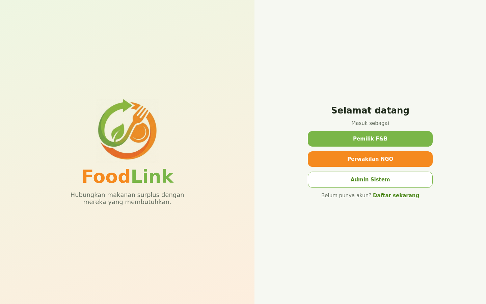
</p>
<p align="center">
<i>Gambar 6.1. Rancangan Antarmuka I-01 - Selamat Datang</i>
</p>

Tabel 6.1. Spesifikasi Objek Antarmuka I-01

| Id_Objek | Jenis | Konten | Keterangan |
| :--- | :--- | :--- | :--- |
| *A1-01* | *Button* | *Pemilik F&B* | *Menuju dashboard Pemilik F&B (I-05)* |
| *A1-02* | *Button* | *Perwakilan NGO* | *Menuju daftar surplus NGO (I-12)* |
| *A1-03* | *Button* | *Admin Sistem* | *Menuju verifikasi pendaftar Admin (I-19)* |
| *A1-04* | *Link* | *Daftar sekarang* | *Menuju formulir registrasi (I-02)* |

## 6.2 Rancangan Antarmuka I-02

**Antarmuka:** *I-02*  
**Nama Layar:** *Registrasi - Pemilik F&B (A2)*  
**Use Case Terkait:** *UC01*

<p align="center">
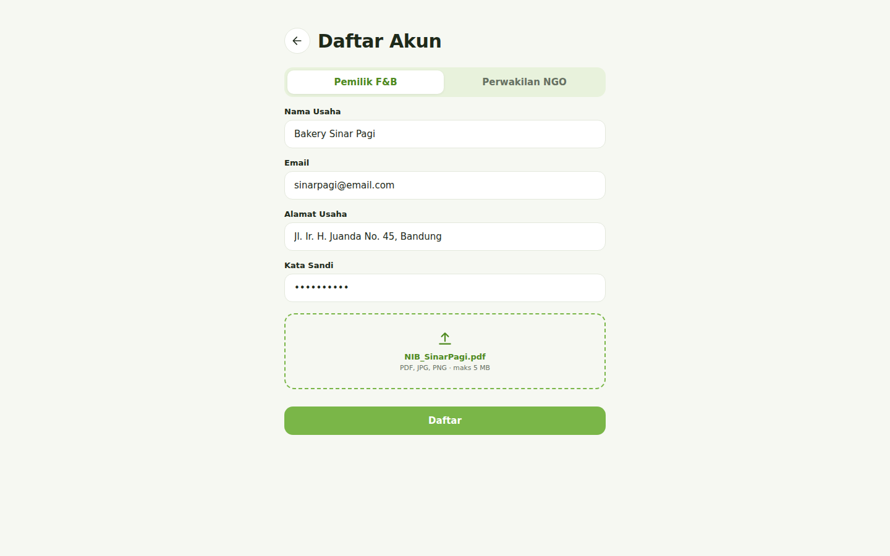
</p>
<p align="center">
<i>Gambar 6.2. Rancangan Antarmuka I-02 - Registrasi - Pemilik F&B</i>
</p>

Tabel 6.2. Spesifikasi Objek Antarmuka I-02

| Id_Objek | Jenis | Konten | Keterangan |
| :--- | :--- | :--- | :--- |
| *A2-01* | *Segmented tab* | *Pemilik F&B | Perwakilan NGO* | *Berpindah antara formulir F&B (I-02) dan NGO (I-03)* |
| *A2-02* | *Textbox* | *Nama Usaha* | *Wajib diisi* |
| *A2-03* | *Textbox* | *Email* | *Wajib diisi* |
| *A2-04* | *Textbox* | *Alamat Usaha* | *Wajib diisi* |
| *A2-05* | *Password* | *Kata Sandi* | *Wajib diisi, karakter disamarkan* |
| *A2-06* | *File upload* | *Unggah NIB / Izin Usaha (PDF, JPG, PNG · maks 5 MB)* | *Memvalidasi format dan ukuran; menampilkan nama berkas terpilih* |
| *A2-07* | *Button* | *Daftar* | *Jika data/dokumen tidak lengkap atau tidak valid tampil pesan galat; jika valid menuju status pendaftaran (I-04)* |

## 6.3 Rancangan Antarmuka I-03

**Antarmuka:** *I-03*  
**Nama Layar:** *Registrasi - NGO (A3)*  
**Use Case Terkait:** *UC01*

<p align="center">
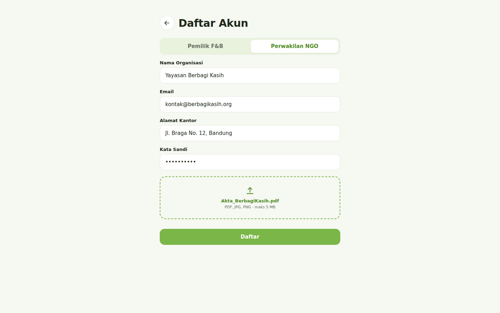
</p>
<p align="center">
<i>Gambar 6.3. Rancangan Antarmuka I-03 - Registrasi - NGO</i>
</p>

Tabel 6.3. Spesifikasi Objek Antarmuka I-03

| Id_Objek | Jenis | Konten | Keterangan |
| :--- | :--- | :--- | :--- |
| *A3-01* | *Segmented tab* | *Pemilik F&B | Perwakilan NGO* | *Berpindah formulir* |
| *A3-02* | *Textbox* | *Nama Organisasi* | *Wajib diisi* |
| *A3-03* | *Textbox* | *Email* | *Wajib diisi* |
| *A3-04* | *Textbox* | *Alamat Kantor* | *Wajib diisi* |
| *A3-05* | *Password* | *Kata Sandi* | *Wajib diisi* |
| *A3-06* | *File upload* | *Unggah Akta / SK Kemenkumham (PDF, JPG, PNG · maks 5 MB)* | *Validasi format dan ukuran berkas* |
| *A3-07* | *Button* | *Daftar* | *Menuju status pendaftaran (I-04) jika valid* |

## 6.4 Rancangan Antarmuka I-04

**Antarmuka:** *I-04*  
**Nama Layar:** *Status Pendaftaran (A4)*  
**Use Case Terkait:** *UC03*

<p align="center">
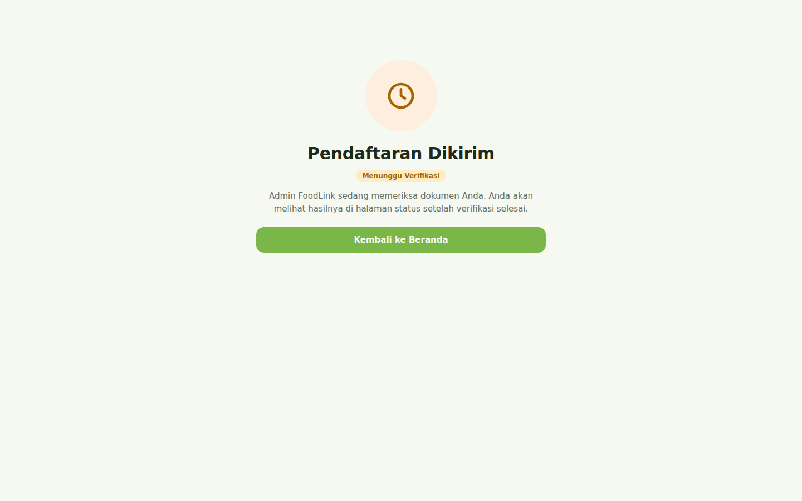
</p>
<p align="center">
<i>Gambar 6.4. Rancangan Antarmuka I-04 - Status Pendaftaran</i>
</p>

Tabel 6.4. Spesifikasi Objek Antarmuka I-04

| Id_Objek | Jenis | Konten | Keterangan |
| :--- | :--- | :--- | :--- |
| *A4-01* | *Ikon* | *Jam* | *Menandakan status menunggu* |
| *A4-02* | *Label* | *Pendaftaran Dikirim* | *Judul status* |
| *A4-03* | *Badge* | *Menunggu Verifikasi* | *Status pendaftaran saat ini (Menunggu/Diterima/Ditolak)* |
| *A4-04* | *Teks* | *Admin FoodLink sedang memeriksa dokumen Anda…* | *Penjelasan status* |
| *A4-05* | *Button* | *Kembali ke Beranda* | *Menuju layar selamat datang (I-01)* |

## 6.5 Rancangan Antarmuka I-05

**Antarmuka:** *I-05*  
**Nama Layar:** *Dashboard Pemilik F&B (F1)*  
**Use Case Terkait:** *UC05*

<p align="center">
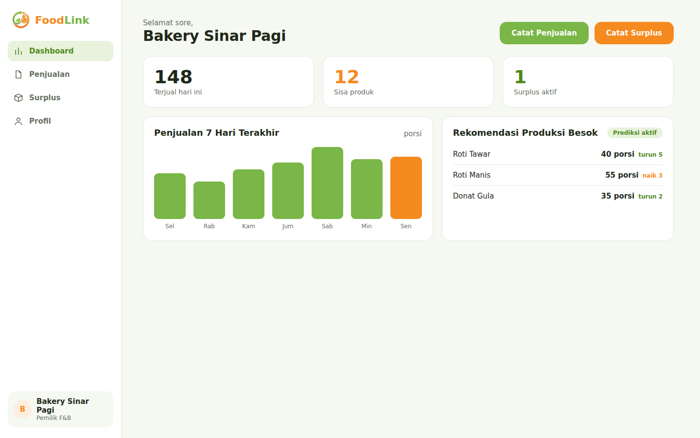
</p>
<p align="center">
<i>Gambar 6.5. Rancangan Antarmuka I-05 - Dashboard Pemilik F&B</i>
</p>

Tabel 6.5. Spesifikasi Objek Antarmuka I-05

| Id_Objek | Jenis | Konten | Keterangan |
| :--- | :--- | :--- | :--- |
| *F1-01* | *Sidebar* | *Dashboard · Penjualan · Surplus · Profil* | *Navigasi antar menu Pemilik F&B* |
| *F1-02* | *Kartu statistik* | *148 Terjual hari ini · 12 Sisa produk · jumlah Surplus aktif* | *Ringkasan operasional hari ini* |
| *F1-03* | *Button* | *Catat Penjualan* | *Menuju penjualan harian (I-06)* |
| *F1-04* | *Button* | *Catat Surplus* | *Menuju catat surplus (I-08)* |
| *F1-05* | *Bar chart* | *Penjualan 7 Hari Terakhir* | *Menampilkan porsi terjual per hari; hari ini disorot* |
| *F1-06* | *Daftar* | *Rekomendasi Produksi Besok + badge Prediksi aktif* | *Hasil prediksi per produk beserta tren naik/turun* |

## 6.6 Rancangan Antarmuka I-06

**Antarmuka:** *I-06*  
**Nama Layar:** *Penjualan Harian (F2)*  
**Use Case Terkait:** *UC04*

<p align="center">
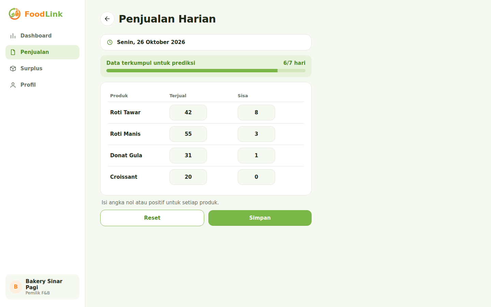
</p>
<p align="center">
<i>Gambar 6.6. Rancangan Antarmuka I-06 - Penjualan Harian</i>
</p>

Tabel 6.6. Spesifikasi Objek Antarmuka I-06

| Id_Objek | Jenis | Konten | Keterangan |
| :--- | :--- | :--- | :--- |
| *F2-01* | *Button* | *Kembali (←)* | *Menuju dashboard (I-05)* |
| *F2-02* | *Label* | *Senin, 26 Oktober 2026* | *Tanggal pencatatan* |
| *F2-03* | *Progress bar* | *Data terkumpul untuk prediksi 6/7 hari* | *Menunjukkan kelengkapan data historis (minimal 7 hari)* |
| *F2-04* | *Textbox angka* | *Terjual (per produk)* | *Wajib bilangan bulat ≥ 0* |
| *F2-05* | *Textbox angka* | *Sisa (per produk)* | *Wajib bilangan bulat ≥ 0* |
| *F2-06* | *Button* | *Reset* | *Mengosongkan seluruh isian* |
| *F2-07* | *Button* | *Simpan* | *Jika ada isian tidak valid tampil pesan galat; jika valid menuju penjualan tersimpan (I-07)* |

## 6.7 Rancangan Antarmuka I-07

**Antarmuka:** *I-07*  
**Nama Layar:** *Penjualan Tersimpan (F3)*  
**Use Case Terkait:** *UC04*

<p align="center">
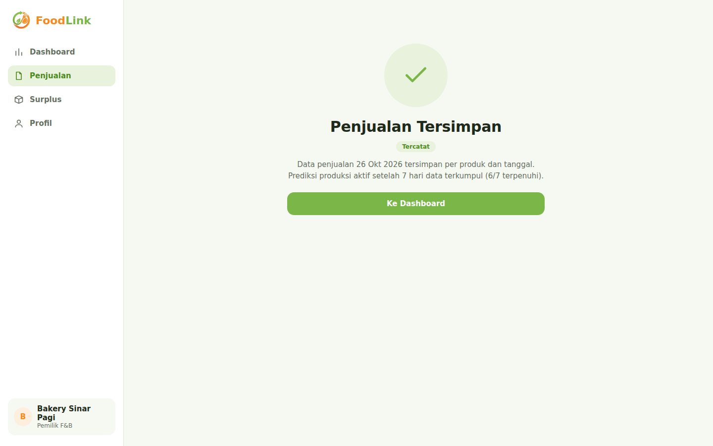
</p>
<p align="center">
<i>Gambar 6.7. Rancangan Antarmuka I-07 - Penjualan Tersimpan</i>
</p>

Tabel 6.7. Spesifikasi Objek Antarmuka I-07

| Id_Objek | Jenis | Konten | Keterangan |
| :--- | :--- | :--- | :--- |
| *F3-01* | *Ikon* | *Centang* | *Menandakan penyimpanan berhasil* |
| *F3-02* | *Badge* | *Tercatat* | *Status penyimpanan* |
| *F3-03* | *Teks* | *Data penjualan … tersimpan per produk dan tanggal* | *Informasi progres prediksi (6/7)* |
| *F3-04* | *Button* | *Ke Dashboard* | *Menuju dashboard (I-05)* |

## 6.8 Rancangan Antarmuka I-08

**Antarmuka:** *I-08*  
**Nama Layar:** *Catat Produk Surplus (F4)*  
**Use Case Terkait:** *UC06*

<p align="center">
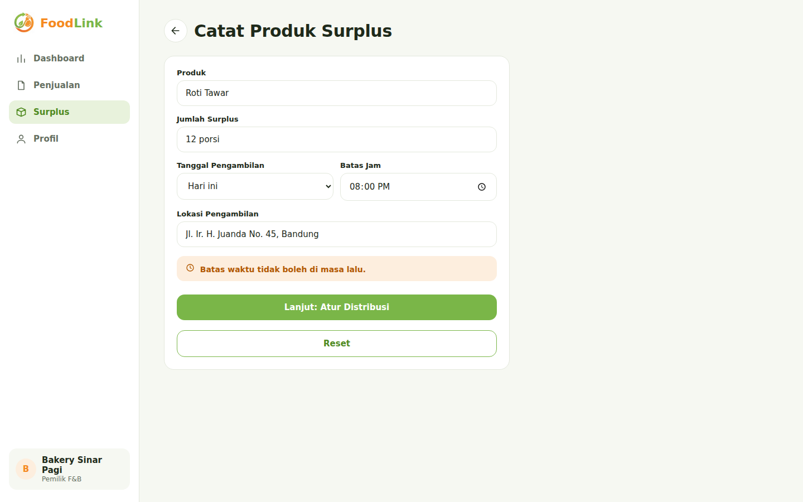
</p>
<p align="center">
<i>Gambar 6.8. Rancangan Antarmuka I-08 - Catat Produk Surplus</i>
</p>

Tabel 6.8. Spesifikasi Objek Antarmuka I-08

| Id_Objek | Jenis | Konten | Keterangan |
| :--- | :--- | :--- | :--- |
| *F4-01* | *Textbox* | *Produk* | *Nama produk surplus* |
| *F4-02* | *Textbox* | *Jumlah Surplus* | *Wajib > 0* |
| *F4-03* | *Dropdown* | *Tanggal Pengambilan (Hari ini/Besok)* | *Menentukan tanggal batas ambil* |
| *F4-04* | *Time picker* | *Batas Jam* | *Tidak boleh di masa lalu; jika melanggar isian ditandai galat* |
| *F4-05* | *Textbox* | *Lokasi Pengambilan* | *Alamat pengambilan* |
| *F4-06* | *Button* | *Lanjut: Atur Distribusi* | *Jika valid menuju atur distribusi (I-09/I-10)* |
| *F4-07* | *Button* | *Reset* | *Mengosongkan seluruh isian formulir* |

## 6.9 Rancangan Antarmuka I-09

**Antarmuka:** *I-09*  
**Nama Layar:** *Atur Distribusi - Donasi (F5)*  
**Use Case Terkait:** *UC07*

<p align="center">
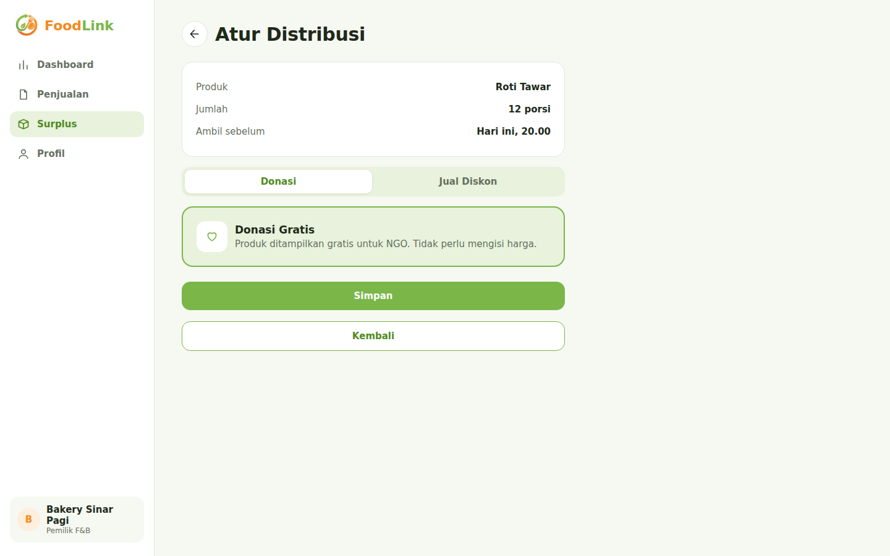
</p>
<p align="center">
<i>Gambar 6.9. Rancangan Antarmuka I-09 - Atur Distribusi - Donasi</i>
</p>

Tabel 6.9. Spesifikasi Objek Antarmuka I-09

| Id_Objek | Jenis | Konten | Keterangan |
| :--- | :--- | :--- | :--- |
| *F5-01* | *Kartu ringkasan* | *Produk · Jumlah · Ambil sebelum* | *Ringkasan data surplus dari I-08* |
| *F5-02* | *Segmented tab* | *Donasi | Jual Diskon* | *Berpindah metode distribusi* |
| *F5-03* | *Kartu pilihan* | *Donasi Gratis* | *Produk tampil gratis bagi NGO; tanpa harga* |
| *F5-04* | *Button* | *Simpan* | *Mempublikasikan surplus; menuju I-11* |
| *F5-05* | *Button* | *Kembali* | *Menuju catat surplus (I-08)* |

## 6.10 Rancangan Antarmuka I-10

**Antarmuka:** *I-10*  
**Nama Layar:** *Atur Distribusi - Jual Diskon (F6)*  
**Use Case Terkait:** *UC07*

<p align="center">
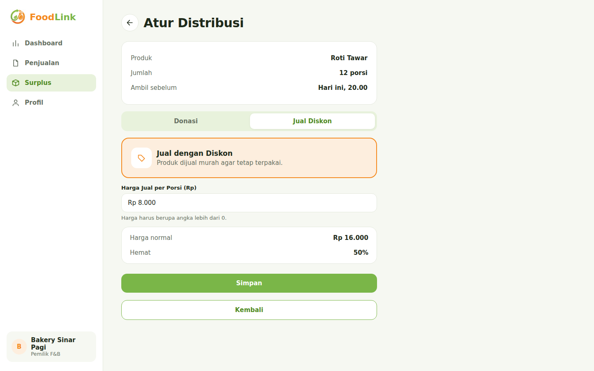
</p>
<p align="center">
<i>Gambar 6.10. Rancangan Antarmuka I-10 - Atur Distribusi - Jual Diskon</i>
</p>

Tabel 6.10. Spesifikasi Objek Antarmuka I-10

| Id_Objek | Jenis | Konten | Keterangan |
| :--- | :--- | :--- | :--- |
| *F6-01* | *Segmented tab* | *Donasi | Jual Diskon* | *Berpindah metode distribusi* |
| *F6-02* | *Kartu pilihan* | *Jual dengan Diskon* | *Metode jual murah* |
| *F6-03* | *Textbox* | *Harga Jual per Porsi (Rp)* | *Wajib angka > 0; jika tidak valid tampil galat* |
| *F6-04* | *Kartu ringkasan* | *Harga normal · Hemat (%)* | *Persentase hemat dihitung otomatis dari harga normal* |
| *F6-05* | *Button* | *Simpan* | *Mempublikasikan surplus; menuju I-11* |
| *F6-06* | *Button* | *Kembali* | *Menuju catat surplus (I-08)* |

## 6.11 Rancangan Antarmuka I-11

**Antarmuka:** *I-11*  
**Nama Layar:** *Surplus Dipublikasikan (F7)*  
**Use Case Terkait:** *UC07*

<p align="center">
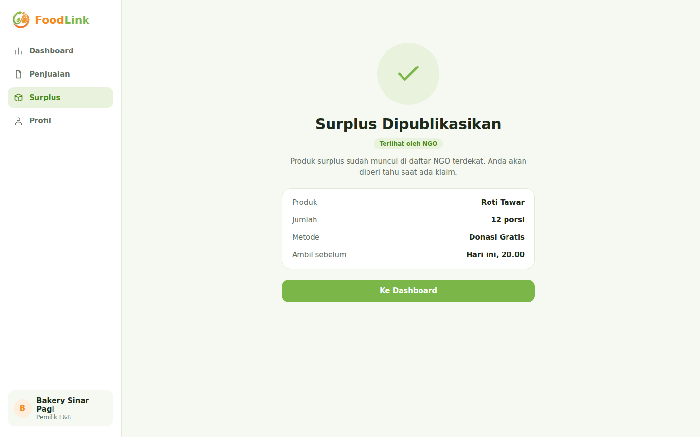
</p>
<p align="center">
<i>Gambar 6.11. Rancangan Antarmuka I-11 - Surplus Dipublikasikan</i>
</p>

Tabel 6.11. Spesifikasi Objek Antarmuka I-11

| Id_Objek | Jenis | Konten | Keterangan |
| :--- | :--- | :--- | :--- |
| *F7-01* | *Ikon* | *Centang* | *Menandakan publikasi berhasil* |
| *F7-02* | *Badge* | *Terlihat oleh NGO* | *Status publikasi* |
| *F7-03* | *Kartu ringkasan* | *Produk · Jumlah · Metode · Ambil sebelum* | *Rangkuman surplus yang dipublikasikan* |
| *F7-04* | *Button* | *Ke Dashboard* | *Menuju dashboard (I-05)* |

## 6.12 Rancangan Antarmuka I-12

**Antarmuka:** *I-12*  
**Nama Layar:** *Daftar Surplus (N1)*  
**Use Case Terkait:** *UC08*

<p align="center">
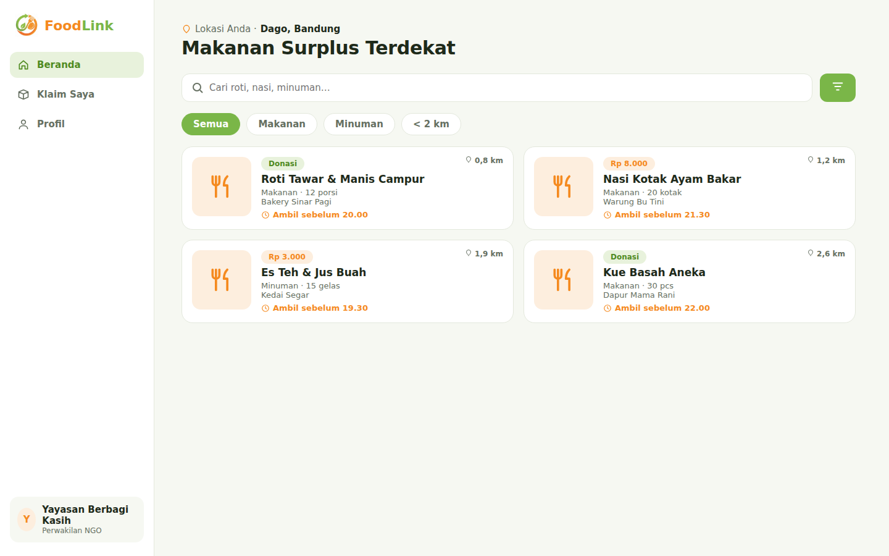
</p>
<p align="center">
<i>Gambar 6.12. Rancangan Antarmuka I-12 - Daftar Surplus</i>
</p>

Tabel 6.12. Spesifikasi Objek Antarmuka I-12

| Id_Objek | Jenis | Konten | Keterangan |
| :--- | :--- | :--- | :--- |
| *N1-01* | *Label* | *Lokasi Anda · Dago, Bandung* | *Lokasi acuan jarak* |
| *N1-02* | *Textbox* | *Cari roti, nasi, minuman…* | *Menyaring daftar berdasarkan kata kunci* |
| *N1-03* | *Button ikon* | *Filter* | *Membuka panel filter (I-13)* |
| *N1-04* | *Chip* | *Semua · Makanan · Minuman · < 2 km* | *Filter cepat* |
| *N1-05* | *Kartu produk* | *Nama, jenis/jumlah, penjual, jarak, batas ambil, badge Donasi/harga* | *Klik membuka detail produk (I-15)* |

## 6.13 Rancangan Antarmuka I-13

**Antarmuka:** *I-13*  
**Nama Layar:** *Filter (N2)*  
**Use Case Terkait:** *UC09*

<p align="center">
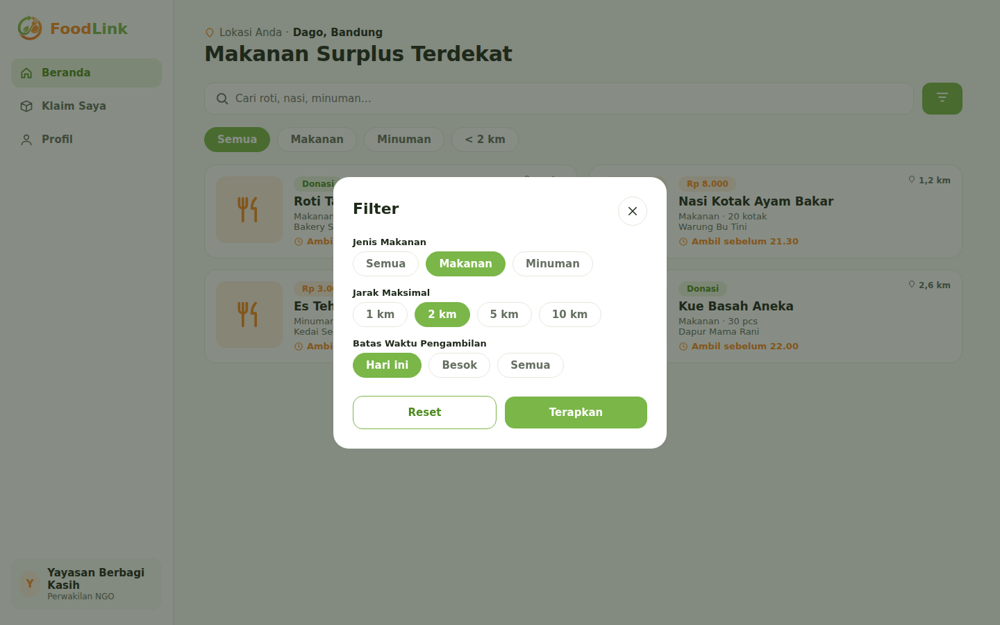
</p>
<p align="center">
<i>Gambar 6.13. Rancangan Antarmuka I-13 - Filter</i>
</p>

Tabel 6.13. Spesifikasi Objek Antarmuka I-13

| Id_Objek | Jenis | Konten | Keterangan |
| :--- | :--- | :--- | :--- |
| *N2-01* | *Chip* | *Jenis Makanan: Semua/Makanan/Minuman* | *Memilih jenis produk* |
| *N2-02* | *Chip* | *Jarak Maksimal: 1/2/5/10 km* | *Memilih radius* |
| *N2-03* | *Chip* | *Batas Waktu: Hari ini/Besok/Semua* | *Memilih rentang waktu ambil* |
| *N2-04* | *Button* | *Reset* | *Mengembalikan filter ke default* |
| *N2-05* | *Button* | *Terapkan* | *Menerapkan filter; menuju daftar terfilter (I-14)* |
| *N2-06* | *Button ikon* | *Tutup (✕)* | *Menutup panel tanpa menerapkan* |

## 6.14 Rancangan Antarmuka I-14

**Antarmuka:** *I-14*  
**Nama Layar:** *Daftar Surplus (Terfilter) (N3)*  
**Use Case Terkait:** *UC09*

<p align="center">
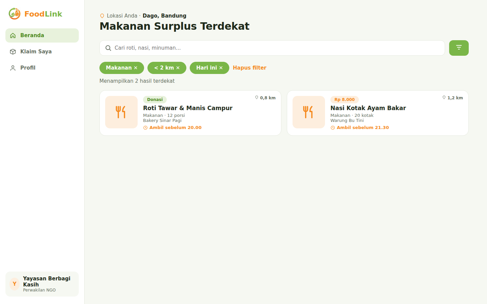
</p>
<p align="center">
<i>Gambar 6.14. Rancangan Antarmuka I-14 - Daftar Surplus (Terfilter)</i>
</p>

Tabel 6.14. Spesifikasi Objek Antarmuka I-14

| Id_Objek | Jenis | Konten | Keterangan |
| :--- | :--- | :--- | :--- |
| *N3-01* | *Chip aktif* | *Makanan ✕ · < 2 km ✕ · Hari ini ✕* | *Klik ✕ menghapus filter terkait* |
| *N3-02* | *Link* | *Hapus filter* | *Menghapus semua filter; kembali ke I-12* |
| *N3-03* | *Label* | *Menampilkan N hasil terdekat* | *Jumlah hasil; jika kosong tampil pesan tidak ada produk* |
| *N3-04* | *Kartu produk* | *Hasil yang sesuai filter* | *Klik membuka detail produk (I-15)* |

## 6.15 Rancangan Antarmuka I-15

**Antarmuka:** *I-15*  
**Nama Layar:** *Detail Produk (N4)*  
**Use Case Terkait:** *UC08*

<p align="center">
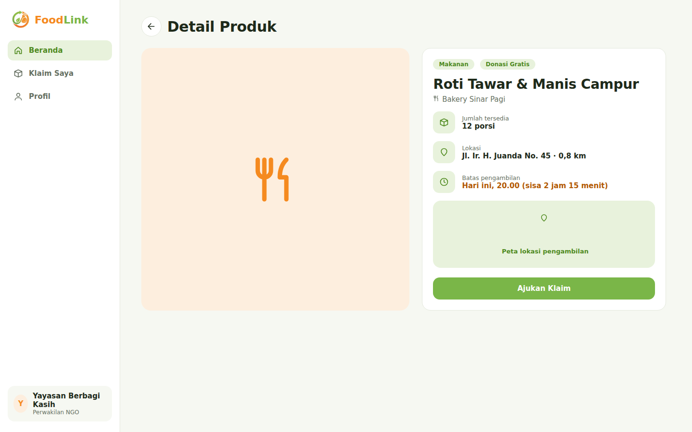
</p>
<p align="center">
<i>Gambar 6.15. Rancangan Antarmuka I-15 - Detail Produk</i>
</p>

Tabel 6.15. Spesifikasi Objek Antarmuka I-15

| Id_Objek | Jenis | Konten | Keterangan |
| :--- | :--- | :--- | :--- |
| *N4-01* | *Button* | *Kembali (←)* | *Menuju daftar surplus (I-12)* |
| *N4-02* | *Badge* | *Makanan · Donasi Gratis / Jual Diskon* | *Jenis dan metode distribusi* |
| *N4-03* | *Label* | *Nama produk, penjual* | *Identitas produk* |
| *N4-04* | *Info* | *Jumlah tersedia · Lokasi · Batas pengambilan* | *Menampilkan jumlah, alamat, jarak, dan sisa waktu* |
| *N4-05* | *Peta* | *Peta lokasi pengambilan* | *Menampilkan titik lokasi* |
| *N4-06* | *Button* | *Ajukan Klaim* | *Membuka dialog konfirmasi klaim (I-16)* |

## 6.16 Rancangan Antarmuka I-16

**Antarmuka:** *I-16*  
**Nama Layar:** *Konfirmasi Klaim (N5)*  
**Use Case Terkait:** *UC10*

<p align="center">
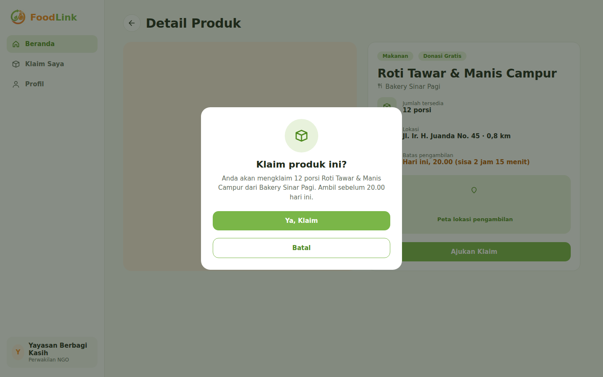
</p>
<p align="center">
<i>Gambar 6.16. Rancangan Antarmuka I-16 - Konfirmasi Klaim</i>
</p>

Tabel 6.16. Spesifikasi Objek Antarmuka I-16

| Id_Objek | Jenis | Konten | Keterangan |
| :--- | :--- | :--- | :--- |
| *N5-01* | *Dialog* | *Klaim produk ini?* | *Ringkasan produk, jumlah, penjual, batas ambil* |
| *N5-02* | *Button* | *Ya, Klaim* | *Menyimpan klaim; menuju klaim berhasil (I-17)* |
| *N5-03* | *Button* | *Batal* | *Menutup dialog; tetap di detail produk* |

## 6.17 Rancangan Antarmuka I-17

**Antarmuka:** *I-17*  
**Nama Layar:** *Klaim Berhasil (N6)*  
**Use Case Terkait:** *UC10*

<p align="center">
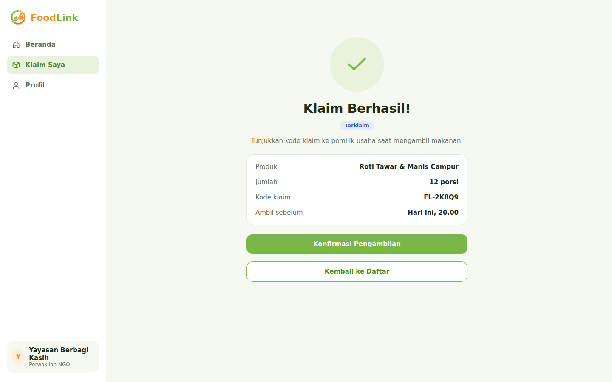
</p>
<p align="center">
<i>Gambar 6.17. Rancangan Antarmuka I-17 - Klaim Berhasil</i>
</p>

Tabel 6.17. Spesifikasi Objek Antarmuka I-17

| Id_Objek | Jenis | Konten | Keterangan |
| :--- | :--- | :--- | :--- |
| *N6-01* | *Badge* | *Terklaim* | *Status klaim* |
| *N6-02* | *Kartu ringkasan* | *Produk · Jumlah · Kode klaim · Ambil sebelum* | *Kode klaim ditunjukkan ke pemilik usaha saat pengambilan* |
| *N6-03* | *Button* | *Konfirmasi Pengambilan* | *Menuju pengambilan selesai (I-18)* |
| *N6-04* | *Button* | *Kembali ke Daftar* | *Menuju daftar surplus (I-12)* |

## 6.18 Rancangan Antarmuka I-18

**Antarmuka:** *I-18*  
**Nama Layar:** *Pengambilan Selesai (N7)*  
**Use Case Terkait:** *UC11*

<p align="center">
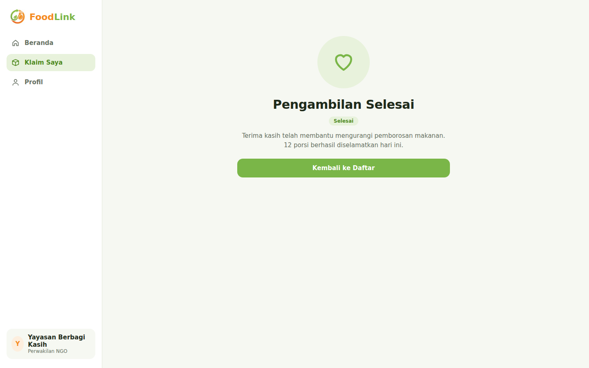
</p>
<p align="center">
<i>Gambar 6.18. Rancangan Antarmuka I-18 - Pengambilan Selesai</i>
</p>

Tabel 6.18. Spesifikasi Objek Antarmuka I-18

| Id_Objek | Jenis | Konten | Keterangan |
| :--- | :--- | :--- | :--- |
| *N7-01* | *Ikon* | *Hati* | *Menandakan pengambilan selesai* |
| *N7-02* | *Badge* | *Selesai* | *Status pengambilan* |
| *N7-03* | *Teks* | *Terima kasih telah membantu mengurangi pemborosan makanan…* | *Ringkasan dampak* |
| *N7-04* | *Button* | *Kembali ke Daftar* | *Menuju daftar surplus (I-12)* |

## 6.19 Rancangan Antarmuka I-19

**Antarmuka:** *I-19*  
**Nama Layar:** *Verifikasi Pendaftar (M1)*  
**Use Case Terkait:** *UC02*

<p align="center">
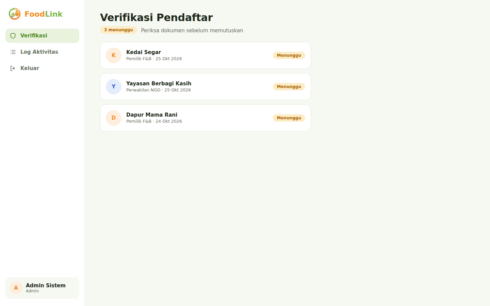
</p>
<p align="center">
<i>Gambar 6.19. Rancangan Antarmuka I-19 - Verifikasi Pendaftar</i>
</p>

Tabel 6.19. Spesifikasi Objek Antarmuka I-19

| Id_Objek | Jenis | Konten | Keterangan |
| :--- | :--- | :--- | :--- |
| *M1-01* | *Badge* | *N menunggu* | *Jumlah pendaftar berstatus menunggu* |
| *M1-02* | *Kartu pendaftar* | *Avatar, nama, tipe akun · tanggal, badge status* | *Klik membuka detail pendaftar (I-20)* |

## 6.20 Rancangan Antarmuka I-20

**Antarmuka:** *I-20*  
**Nama Layar:** *Detail Pendaftar (M2)*  
**Use Case Terkait:** *UC02*

<p align="center">
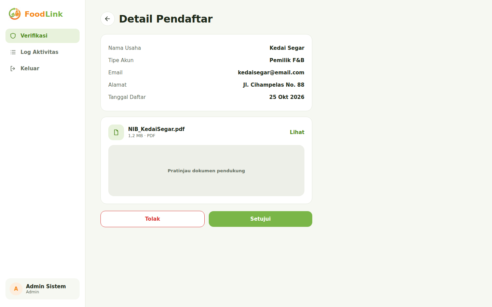
</p>
<p align="center">
<i>Gambar 6.20. Rancangan Antarmuka I-20 - Detail Pendaftar</i>
</p>

Tabel 6.20. Spesifikasi Objek Antarmuka I-20

| Id_Objek | Jenis | Konten | Keterangan |
| :--- | :--- | :--- | :--- |
| *M2-01* | *Kartu data* | *Nama, Tipe Akun, Email, Alamat, Tanggal Daftar* | *Data pendaftar yang diperiksa* |
| *M2-02* | *Kartu dokumen* | *Nama berkas, ukuran, tautan Lihat, pratinjau* | *Memeriksa dokumen pendukung* |
| *M2-03* | *Button* | *Tolak* | *Menolak pendaftaran; menuju I-22* |
| *M2-04* | *Button* | *Setujui* | *Menyetujui pendaftaran; menuju I-21* |

## 6.21 Rancangan Antarmuka I-21

**Antarmuka:** *I-21*  
**Nama Layar:** *Pendaftar Diterima (M3)*  
**Use Case Terkait:** *UC02*

<p align="center">
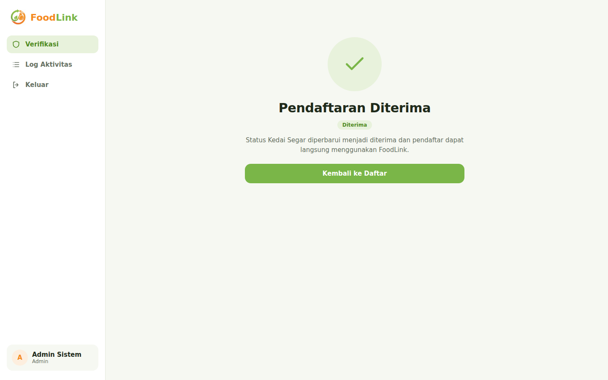
</p>
<p align="center">
<i>Gambar 6.21. Rancangan Antarmuka I-21 - Pendaftar Diterima</i>
</p>

Tabel 6.21. Spesifikasi Objek Antarmuka I-21

| Id_Objek | Jenis | Konten | Keterangan |
| :--- | :--- | :--- | :--- |
| *M3-01* | *Badge* | *Diterima* | *Status baru pendaftar* |
| *M3-02* | *Teks* | *Status … diperbarui menjadi diterima* | *Pendaftar dapat langsung memakai FoodLink* |
| *M3-03* | *Button* | *Kembali ke Daftar* | *Menuju verifikasi pendaftar (I-19)* |

## 6.22 Rancangan Antarmuka I-22

**Antarmuka:** *I-22*  
**Nama Layar:** *Pendaftar Ditolak (M4)*  
**Use Case Terkait:** *UC02*

<p align="center">
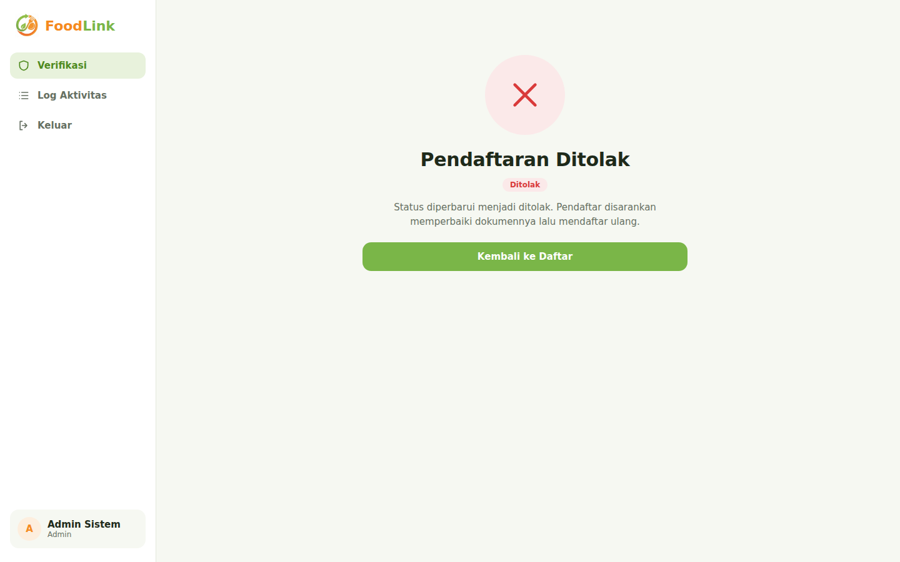
</p>
<p align="center">
<i>Gambar 6.22. Rancangan Antarmuka I-22 - Pendaftar Ditolak</i>
</p>

Tabel 6.22. Spesifikasi Objek Antarmuka I-22

| Id_Objek | Jenis | Konten | Keterangan |
| :--- | :--- | :--- | :--- |
| *M4-01* | *Badge* | *Ditolak* | *Status baru pendaftar* |
| *M4-02* | *Teks* | *Pendaftar disarankan memperbaiki dokumennya…* | *Pendaftar dapat mendaftar ulang* |
| *M4-03* | *Button* | *Kembali ke Daftar* | *Menuju verifikasi pendaftar (I-19)* |

## 6.23 Rancangan Antarmuka I-23

**Antarmuka:** *I-23*  
**Nama Layar:** *Log Aktivitas (M5)*  
**Use Case Terkait:** *UC12*

<p align="center">
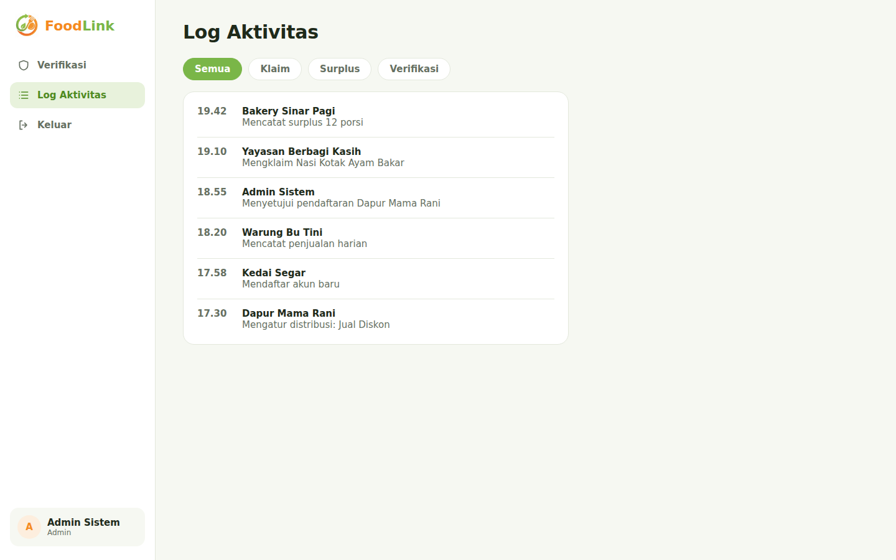
</p>
<p align="center">
<i>Gambar 6.23. Rancangan Antarmuka I-23 - Log Aktivitas</i>
</p>

Tabel 6.23. Spesifikasi Objek Antarmuka I-23

| Id_Objek | Jenis | Konten | Keterangan |
| :--- | :--- | :--- | :--- |
| *M5-01* | *Chip* | *Semua · Klaim · Surplus · Verifikasi* | *Menyaring log; jika tidak ada tampil pesan belum ada log yang sesuai* |
| *M5-02* | *Daftar* | *Jam, nama pengguna, deskripsi aktivitas* | *Log terbaru berada di paling atas* |

## 6.24 Rancangan Antarmuka Keseluruhan

Tabel 6.24. Rancangan Antarmuka Keseluruhan

| No | Tampilan Antarmuka |
| :--- | :--- |
| *I-01* (Selamat Datang) |  |
| *I-02* (Registrasi - Pemilik F&B) |  |
| *I-03* (Registrasi - NGO) |  |
| *I-04* (Status Pendaftaran) |  |
| *I-05* (Dashboard Pemilik F&B) |  |
| *I-06* (Penjualan Harian) |  |
| *I-07* (Penjualan Tersimpan) |  |
| *I-08* (Catat Produk Surplus) |  |
| *I-09* (Atur Distribusi - Donasi) |  |
| *I-10* (Atur Distribusi - Jual Diskon) |  |
| *I-11* (Surplus Dipublikasikan) |  |
| *I-12* (Daftar Surplus) |  |
| *I-13* (Filter) |  |
| *I-14* (Daftar Surplus (Terfilter)) |  |
| *I-15* (Detail Produk) |  |
| *I-16* (Konfirmasi Klaim) |  |
| *I-17* (Klaim Berhasil) |  |
| *I-18* (Pengambilan Selesai) |  |
| *I-19* (Verifikasi Pendaftar) |  |
| *I-20* (Detail Pendaftar) |  |
| *I-21* (Pendaftar Diterima) |  |
| *I-22* (Pendaftar Ditolak) |  |
| *I-23* (Log Aktivitas) |  |


<br>

---

# BAB 7: Matriks Kerunutan

Petakan kelas perancangan dengan use case yang terkait. Gunakan **BAB 6 Traceability pada dokumen SKPL** sebagai acuan keterkaitan kelas analisis dan use case, lalu sesuaikan dengan realisasi use case dan kelas perancangan pada BAB 3–BAB 5 DPPL.

Tabel 7.1. Matriks Kerunutan Kelas terhadap Use Case

| Kelas | Use Case Terkait |
| :--- | :--- |
| *[ID kelas - Nama kelas]* | *[ID UC - Nama use case; tuliskan seluruh use case terkait]* |
| *[ID kelas - Nama kelas]* | *[ID UC - Nama use case]* |
| *...* | *...* |
